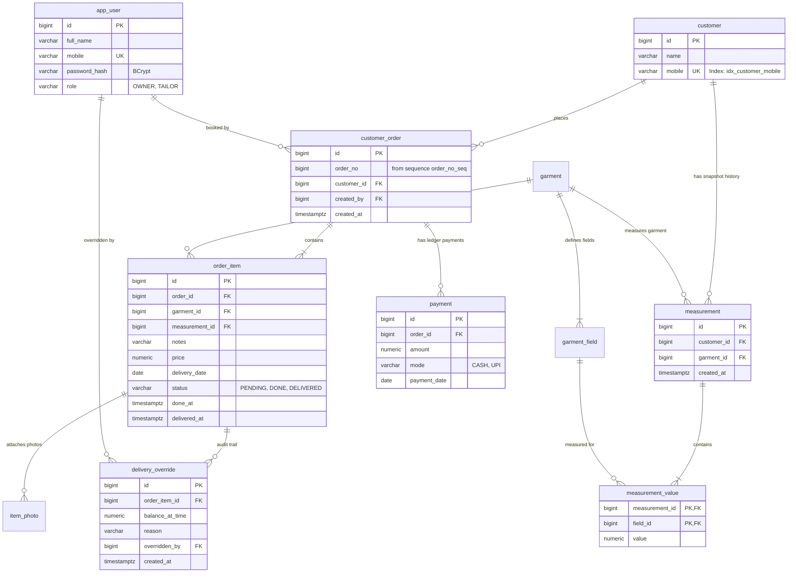

# Geetanjali Tailor Shop Management System
## Complete Source Code Tree Structure & Technical Reference Manual

---

## 1. Complete Project Directory & Source Code Tree

```text
Geetanjali/
├── .git/                                         # Git version control repository
├── .idea/                                        # IDE project configuration
├── docs/                                         # Complete engineering documentation suite & architecture
│   ├── images/                                   # High-resolution screenshots of the studio interface
│   ├── 01-PROBLEM_IDENTIFICATION_AND_ORIGIN_STORY.md
│   ├── 02-SYSTEM_ARCHITECTURE_FLOWS_AND_ERD.md
│   ├── 03-DYNAMIC_MEASUREMENT_ENGINE_AND_SPECIFICATIONS.md
│   ├── 04-ORDER_LIFECYCLE_FINANCIALS_AND_CAPACITY_SCHEDULER.md
│   └── 05-STUDIO_AI_ASSISTANT_AND_TOOL_INTEGRATION.md
├── uploads/                                      # Uploaded garment & cloth swatch photos
├── README.md                                     # Dedicated project overview & quickstart manual
├── PROJECT_STRUCTURE_AND_CODEBASE_REFERENCE.md   # [THIS FILE] Complete codebase tree & technical reference
└── System/                                       # Spring Boot 4.1.1 & Java 21 core enterprise system
    ├── pom.xml                                   # Maven dependencies, build plugins & configuration
    ├── mvnw                                      # Maven wrapper shell script (Linux/macOS)
    ├── mvnw.cmd                                  # Maven wrapper batch script (Windows)
    ├── uploads/                                  # Development upload storage directory
    └── src/
        ├── test/                                 # Automated Test Suite (165 Unit & Integration Tests)
        │   └── java/
        │       └── com/geetanjali/backend/
        │           ├── controller/
        │           │   ├── AuthControllerTest.java
        │           │   ├── CalendarControllerTest.java
        │           │   ├── CustomerControllerTest.java
        │           │   ├── CustomerDetailControllerTest.java
        │           │   ├── GarmentControllerTest.java
        │           │   ├── HomeControllerTest.java
        │           │   ├── MoreControllerTest.java
        │           │   ├── OrderControllerTest.java
        │           │   ├── OrderWizardControllerTest.java
        │           │   ├── OrderWizardCustomerPreselectTest.java
        │           │   ├── PaymentControllerTest.java
        │           │   ├── advice/
        │           │   │   └── GlobalExceptionHandlerTest.java
        │           │   └── api/
        │           │       ├── AssistantApiControllerTest.java
        │           │       ├── CalendarApiControllerTest.java
        │           │       └── PhotoApiControllerTest.java
        │           ├── entity/
        │           │   ├── CustomerOrderCalculatedGettersTest.java
        │           │   └── OrderItemTest.java
        │           ├── repository/
        │           │   ├── CustomerOrderRepositoryTest.java
        │           │   └── CustomerRepositoryTest.java
        │           ├── security/
        │           │   └── PasswordHashTest.java
        │           └── service/
        │               ├── CalendarServiceTest.java
        │               ├── CustomerAndGarmentServiceTest.java
        │               ├── CustomerServiceTest.java
        │               ├── DeliveryServiceTest.java
        │               ├── GarmentServiceSettingsTest.java
        │               ├── GarmentServiceTest.java
        │               ├── MeasurementEngineIntegrationTest.java
        │               ├── MeasurementServiceTest.java
        │               ├── OrderEditItemIntegrationTest.java
        │               ├── OrderServiceTest.java
        │               ├── OrderTransactionRollbackIntegrationTest.java
        │               ├── OrderWizardServiceTest.java
        │               ├── PaymentServiceTest.java
        │               ├── PhoneNumbersTest.java
        │               └── assistant/
        │                   └── ToolRegistryServiceTest.java
        └── main/
            ├── resources/
            │   ├── application.properties        # App properties: DB connection, JPA, Flyway, file uploads
            │   ├── db/
            │   │   └── migration/                # Flyway Database Migrations
            │   │       ├── V1__core_schema.sql   # Core tables: customer, order, items, measurements, payments
            │   │       ├── V2__seed_defaults.sql # Seed garments (Shirt, Pant, Kurta, Blouse) & measurement fields
            │   │       └── V3__stage2_delivery.sql # Delivery status, timestamps, and delivery_override audit table
            │   ├── static/                       # Static Web Assets (CSS, JS)
            │   │   ├── css/
            │   │   │   ├── app.css               # Sarvam AI design tokens, theme scrollbars, modals, assistant drawer
            │   │   │   └── calendar.css          # Google Calendar boxed month grid, capacity chips, executive sidebar
            │   │   └── js/
            │   │       ├── app.js                # Global helpers: toasts, modals, password reveal
            │   │       ├── calendar.js           # Interactive calendar navigation, schedule inspector, initial avatars
            │   │       ├── floating-assistant.js # AI floating drawer: streaming markdown, nested tables, wide mode
            │   │       └── new-order.js          # Async customer lookup, interactive chips, photo upload
            │   └── templates/                    # Server-Side Thymeleaf HTML Templates
            │       ├── more.html                 # More features and shop navigation hub
            │       ├── auth/
            │       │   ├── login.html            # Staff & Owner login screen
            │       │   └── signup.html           # Initial owner registration screen
            │       ├── calendar/
            │       │   └── index.html            # Google Calendar-style delivery grid, monthly stats, top days
            │       ├── customers/
            │       │   ├── index.html            # Customer directory with live search & order history count
            │       │   └── detail.html           # 2-column widescreen profile: details, measurements & scrollable orders
            │       ├── error/
            │       │   ├── 403.html              # Forbidden access error page
            │       │   ├── 404.html              # Resource not found error page
            │       │   ├── 5xx.html              # Internal server error page
            │       │   └── error.html            # Generic fallback error page
            │       ├── fragments/
            │       │   ├── layout.html           # Master layout: top navbar, collapsible sidebar, AI drawer, alerts
            │       │   └── item-form.html        # Reusable garment measurement input form fragment with capacity modal
            │       ├── home/
            │       │   └── index.html            # Executive dashboard: metrics row, customer search & recent orders
            │       ├── orders/
            │       │   ├── index.html            # All orders: earliest delivery sorting, load more, completion filter
            │       │   ├── detail.html           # Order details: items, open measurements, delivery block & override, ledger
            │       │   ├── item-edit.html        # Edit item notes, price, and delivery date with capacity check
            │       │   ├── wizard-customer.html  # Step 1: Customer identification with live AJAX lookup
            │       │   ├── wizard-garment.html   # Step 2: Garment category selection tiles
            │       │   ├── wizard-item.html      # Step 3: Measurements form with automatic snapshot prefill
            │       │   ├── wizard-summary.html   # Step 4: Order cart review, advance payment deposit & mode
            │       │   └── wizard-done.html      # Order booked confirmation screen with sequence number & balance chip
            │       ├── payments/
            │       │   ├── index.html            # Payment ledger overview
            │       │   └── pending.html          # Outstanding payments dashboard sorted by promised delivery deadline
            │       └── settings/
            │           ├── index.html            # Shop settings & tailoring profile
            │           ├── garments.html         # Active garments catalog list
            │           └── garment-template.html # Garment measurement parameter fields configuration
            └── java/
                └── com/geetanjali/backend/
                    ├── BackendApplication.java   # Spring Boot entry point (@SpringBootApplication)
                    ├── config/                   # Spring Configuration Classes
                    │   ├── AppConfig.java        # Injected Clock (Asia/Kolkata) & BCrypt PasswordEncoder
                    │   └── WebMvcConfig.java     # Static resource handler for photo uploads (/uploads/**)
                    ├── advice/                   # Global Controller Advice
                    │   ├── GlobalExceptionHandler.java # Friendly error handling (404, 403, 500, business exceptions)
                    │   └── GlobalModelAdvice.java      # Binds currentUser, shopName, currentUri to every template
                    ├── controller/               # Spring MVC Web Controllers (Thin HTTP Layer)
                    │   ├── AuthController.java   # Login, registration, and logout handling
                    │   ├── CalendarController.java # Google Calendar-style month delivery view (/calendar)
                    │   ├── CustomerController.java # Customer directory and detailed profile view
                    │   ├── GarmentController.java# Garment catalog and template settings
                    │   ├── HomeController.java   # Main dashboard (/), metrics, customer search, top 20 orders
                    │   ├── MoreController.java   # More options and management hub
                    │   ├── OrderController.java  # Active orders list, details, payments, mark done, deliver, override
                    │   ├── OrderWizardController.java # 4-step order wizard navigation and cart management
                    │   ├── PaymentController.java# Pending payments ledger (/payments/pending)
                    │   └── api/                  # RESTful AJAX Endpoints (@RestController)
                    │       ├── AssistantApiController.java # POST /api/assistant/chat (Dual-provider AI stream)
                    │       ├── CalendarApiController.java  # GET /api/calendar/capacity, /month, /day
                    │       ├── CustomerApiController.java  # GET /api/customers/lookup (Live mobile autofill)
                    │       ├── CustomerLookupResponse.java # JSON DTO for customer lookup
                    │       └── PhotoApiController.java     # POST /api/photos/upload (Cloth photo upload)
                    ├── dto/                      # Data Transfer Objects
                    │   ├── PendingPaymentRow.java     # Row representation for pending payments table
                    │   ├── PendingPaymentsSummary.java # Aggregated outstanding debt summary DTO
                    │   ├── calendar/             # Delivery Calendar DTOs
                    │   │   ├── CalendarDaySummaryDto.java # Day cell summary (itemCount, orderCount, capacity color)
                    │   │   ├── CalendarOrderItemDto.java  # Item detail for schedule inspector
                    │   │   ├── DayCapacityDto.java        # Workload metrics (maxReached, overbooking, color)
                    │   │   ├── MonthCalendarDto.java      # Sun-Sat grid & month metadata
                    │   │   └── TopDeliveryDayDto.java     # Ranked delivery day peak metrics
                    │   ├── draft/                # In-Memory Wizard Session DTOs
                    │   │   ├── OrderDraft.java       # Session cart holding customer, items, and active draft
                    │   │   └── OrderDraftItem.java   # Draft item holding garment, measurements, notes, price
                    │   ├── form/                 # Validated Form Backing Objects
                    │   │   ├── AdvanceForm.java      # Step 4: Advance amount and Cash/UPI mode
                    │   │   ├── CustomerStepForm.java # Step 1: Customer mobile and name
                    │   │   ├── FieldForm.java        # Garment measurement field configuration form
                    │   │   ├── GarmentForm.java      # Garment category creation/edit form
                    │   │   ├── ItemForm.java         # Step 3: Measurements, notes, delivery date, price, overbooking confirmation
                    │   │   ├── OverrideForm.java     # Owner delivery override reason form
                    │   │   ├── PaymentForm.java      # Add payment dialog form (amount, mode, date)
                    │   │   └── SignupForm.java       # Owner signup registration form
                    │   └── response/             # Service Response Carriers
                    │       ├── GarmentLatestMeasurement.java # Pairs active garment with customer's latest snapshot
                    │       ├── MeasurementPrefill.java       # Prefill values for wizard step 3
                    │       └── PhotoRef.java                 # Uploaded photo reference (URL and public ID)
                    ├── entity/                   # JPA / Hibernate Relational Entities
                    │   ├── AppUser.java          # Staff / Owner user account with BCrypt password and Role
                    │   ├── Customer.java         # Customer entity (id, name, mobile)
                    │   ├── CustomerOrder.java    # Master order header (orderNo, customer, createdBy, createdAt, getters)
                    │   ├── DeliveryOverride.java # Audit record for delivery override when balance pending
                    │   ├── Garment.java          # Garment category (Shirt, Pant, Kurta, Blouse, sortOrder, active)
                    │   ├── GarmentField.java     # Measurement field template (Chest, Length, Waist, unit, sortOrder)
                    │   ├── ItemPhoto.java        # Cloth swatch / styling photo attached to order item
                    │   ├── Measurement.java      # Immutable measurement snapshot header (customer, garment, createdAt)
                    │   ├── MeasurementValue.java # Individual measurement value linked to GarmentField
                    │   ├── MeasurementValueId.java # Composite primary key (measurementId, fieldId)
                    │   ├── OrderItem.java        # Garment item in order (notes, price, deliveryDate, status, doneAt, deliveredAt)
                    │   ├── Payment.java          # Payment transaction receipt (amount, mode [CASH/UPI], paymentDate)
                    │   └── Shop.java             # Tailor shop branding details (name, address, phone)
                    ├── enums/                    # Strongly-Typed Business Enums
                    │   ├── ItemStatus.java       # Garment lifecycle status: PENDING, DONE, DELIVERED
                    │   ├── PaymentMode.java      # Payment mode: CASH, UPI
                    │   └── Role.java             # User authorization role: OWNER, TAILOR
                    ├── exception/                # Custom Business Exception Hierarchy
                    │   ├── BalancePendingException.java # Thrown when delivery attempted with balance > 0
                    │   ├── BusinessRuleException.java   # Thrown when tailoring domain rule violated
                    │   └── ResourceNotFoundException.java # Thrown when database entity not found (maps to 404)
                    ├── repository/               # Spring Data JPA Database Repositories
                    │   ├── AppUserRepository.java
                    │   ├── CustomerOrderRepository.java # Custom sequence getNextOrderNo(), recent & active queries
                    │   ├── CustomerRepository.java      # Phone lookups & name/mobile search
                    │   ├── DeliveryOverrideRepository.java
                    │   ├── GarmentFieldRepository.java
                    │   ├── GarmentRepository.java
                    │   ├── ItemPhotoRepository.java
                    │   ├── MeasurementRepository.java   # Latest snapshot lookups per customer & garment
                    │   ├── MeasurementValueRepository.java
                    │   ├── OrderItemRepository.java
                    │   ├── PaymentRepository.java       # Payment ledger queries & sum calculations
                    │   └── ShopRepository.java
                    ├── security/                 # Spring Security Authentication & Authorization
                    │   ├── AppUserDetails.java          # Spring Security UserDetails adapter
                    │   ├── AppUserDetailsService.java   # Loads staff/owner by normalized mobile number
                    │   └── SecurityConfig.java          # SecurityFilterChain, URL rules, CSRF & session rules
                    ├── service/                  # Business Logic Layer (@Service & @Transactional)
                    │   ├── AuthService.java             # User registration and authentication service
                    │   ├── CalendarService.java         # Daily capacity calculation, month grid, top delivery days
                    │   ├── CustomerService.java         # Customer lookups, phone normalization, history queries
                    │   ├── DeliveryService.java         # Delivery block, owner override enforcement & audit logging
                    │   ├── GarmentService.java          # Garment catalog & measurement fields management
                    │   ├── MeasurementService.java      # Immutable snapshot engine & numerical deduplication
                    │   ├── OrderService.java            # Master atomic placeOrder, active orders sort, markDone
                    │   ├── OrderWizardService.java      # Multi-step session cart draft management
                    │   ├── PaymentService.java          # Advance recording & payment additions with validation
                    │   ├── ShopService.java             # Shop branding & profile management
                    │   ├── assistant/                   # AI Studio Assistant Services
                    │   │   ├── AssistantService.java    # Dual-provider LLM orchestration (Groq primary, Gemini fallback)
                    │   │   ├── ModelProvider.java       # LLM provider contract interface
                    │   │   ├── GroqModelProvider.java   # High-speed native OpenAI-compatible Groq implementation
                    │   │   ├── GeminiModelProvider.java # Google Gemini 2.5 Flash fallback implementation
                    │   │   └── ToolRegistryService.java # Executable tool execution registry for AI actions
                    │   └── storage/                     # File Storage Abstraction
                    │       ├── LocalDiskPhotoStorageService.java # Stores uploaded photos to local filesystem
                    │       └── PhotoStorageService.java          # Storage interface contract
                    └── util/                     # Pure Utility Classes
                        ├── OrderNumberFormatter.java    # Formats TS-YYYY-NNNN & currency Rs. 1,500
                        └── PhoneNumbers.java            # Indian 10-digit mobile number normalization
```

---

## 2. Architecture & Design Principles

### Architectural Flow: Strict Layering
```text
Browser / HTTP Request
       │
       ▼
SecurityFilterChain (Authentication & Authorization)
       │
       ▼
Controller Layer (@Controller / @RestController)
  - Reads request parameters & form backing DTOs
  - Validates input (@Valid)
  - Calls ONE service method
  - Returns view name or redirect URL (Controllers NEVER call Repositories)
       │
       ▼
Service Layer (@Service)
  - Enforces all business rules and validation
  - Coordinates database transactions (@Transactional)
  - Interacts with Spring Data Repositories
       │
       ▼
Repository Layer (@Repository)
  - Spring Data JPA interfaces
  - Executes SQL queries against PostgreSQL
       │
       ▼
PostgreSQL Database (Flyway Managed Schema)
```

### Essential Domain Rules
1. **Financial Precision**: Money amounts are strictly `BigDecimal` (stored as `NUMERIC(10,2)` in PostgreSQL). Never use `double` or `float`.
2. **Dynamic Balance (Single Source of Truth)**:
   $$\text{Balance} = \sum (\text{order\_item.price}) - \sum (\text{payment.amount})$$
   Balance is **never stored** in the database table to prevent synchronization bugs and race conditions.
3. **Timezone Determinism**: All date/time calculations come from the injected `Clock` configured strictly to `Asia/Kolkata`.
4. **Immutable Measurement Snapshots**: Measurements are never updated in place. Every change creates an immutable snapshot with a timestamp so historical orders and receipts remain uncorrupted.
5. **Defense-in-Depth Delivery Override**: Owner-only delivery override is enforced at two separate levels:
   - URL Filter in `SecurityConfig.java`: `.requestMatchers("/orders/*/items/*/override").hasRole("OWNER")`
   - Programmatic verification in `DeliveryService.java`: Throws `AccessDeniedException` if caller is not an `OWNER`.
   - Complete audit trail written to `delivery_override` table.

---

## 3. Database Schema Reference



---

## 4. Key Workflows & Page Matrix

| Page / Section | Route | Controller Method | Primary Service Methods | Key Features |
|---|---|---|---|---|
| **Dashboard** | `GET /` | `HomeController.home` | `orderService.getRecentOrders()`, `paymentService.getPendingPaymentsSummary()` | Full widescreen 1440px layout, 4 executive metrics, customer search, top 20 recent orders. |
| **All Orders** | `GET /orders` | `OrderController.listOrders` | `orderService.getActiveOrdersSortedByDeliveryDate()` | Ascending sort by earliest delivery deadline, completed order filter (`!order.isCompleted()`), progressive disclosure "Load More" button. |
| **Order Detail** | `GET /orders/{id}` | `OrderController.showOrderDetail` | `orderService.getOrderOrThrow(id)` | Garment items with open measurements, status chips, delivery block & override panel, payment ledger, Add Payment `<dialog>`. |
| **Add Payment** | `POST /orders/{id}/payments` | `OrderController.recordPayment` | `paymentService.addPayment(id, form)` | Validates amount > 0, amount <= balance, date not future. Redirects safely preventing open redirects. |
| **Mark Stitched** | `POST /orders/{id}/items/{itemId}/done` | `OrderController.markItemDone` | `orderService.markDone(orderId, itemId)` | Allowed only from `PENDING`. Sets status `DONE` and `done_at` timestamp. |
| **Deliver Item** | `POST /orders/{id}/items/{itemId}/deliver` | `OrderController.deliverItem` | `deliveryService.deliverItem(orderId, itemId)` | If balance > 0, throws `BalancePendingException` displaying red block panel. Tailor sees prompt to ask owner. |
| **Owner Override** | `POST /orders/{id}/items/{itemId}/override` | `OrderController.overrideAndDeliver` | `deliveryService.deliverWithOverride(...)` | Owner-only. Validates reason, saves `delivery_override` audit row, marks `DELIVERED` in ONE atomic transaction. |
| **Customer Profile** | `GET /customers/{id}` | `CustomerController.showCustomerDetail` | `customerService.getById(id)`, `measurementService.getLatestPerGarment(customer)` | Widescreen 2-column layout: left side customer details & saved measurements; right side all order tiles in fixed-size scrollable box with themed scrollbar. |
| **Customer Lookup** | `GET /api/customers/lookup` | `CustomerApiController.lookupCustomer` | `customerService.findByMobile(normalized)` | Fast async AJAX endpoint returning JSON for live customer phone autofill in Step 1. |
| **New Order Wizard** | `GET/POST /orders/new/*` | `OrderWizardController.*` | `orderWizardService.*`, `orderService.placeOrder(...)` | 4-step booking: 1. Customer -> 2. Garment -> 3. Measurements -> 4. Summary & Advance Deposit -> Atomic Commit. |
| **Pending Payments**| `GET /payments/pending` | `PaymentController.showPendingPayments` | `paymentService.getPendingPaymentsSummary()` | Shop-wide unpaid balance banner, rows sorted by earliest delivery, smart due text (`"due in N days"`, `"overdue by N days"`). |
| **Delivery Calendar**| `GET /calendar` | `CalendarController.showCalendar` | `calendarService.getMonthCalendar()`, `calendarService.getDayCapacity()` | Google Calendar-style boxed month view with capacity indicators, ranked top delivery days, and day schedule inspector. |
| **Studio AI Assistant**| `POST /api/assistant/chat` | `AssistantApiController.chat` | `assistantService.chat()`, `toolRegistryService.executeTool()` | Floating conversational drawer with streaming responses, nested measurement tables, wide mode, and live tool calling. |

---

## 5. Verification & Test Suite

The system is fully covered by **165 automated unit and integration tests**:
- Unit tests: Mockito mock isolation for services and controllers.
- Integration tests: Full Spring context (`@SpringBootTest`) with PostgreSQL rollback verification.
- Test execution command:
  ```bash
  cd System && ./mvnw test
  ```
- **Test Result**: `Tests run: 165, Failures: 0, Errors: 0, Skipped: 0`.
