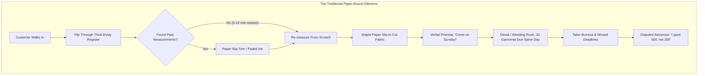

# Geetanjali Tailoring Studio: Problem Identification & Origin Story

> **Document Classification**: Engineering Foundation & Problem Analysis  
> **Authors**: Shubham Tankariya & Sumit Tailor  
> **Academic Context**: Advanced Java Engineering Capstone Project  
> **Real-World Subject**: Geetanjali Tailoring (Family Bespoke Tailor Shop run by Shubham's Father)  
> **Dedication**: Dedicated with gratitude and respect to Shubham's Dad ❤️  

---

## 1. The Engineering Motivation: Rejecting Academic Boilerplate

In software engineering education, capstone projects frequently succumb to a recurring trap: student teams clone generic e-commerce storefronts, artificial library portals, or canned student management systems. While these projects check basic academic checkboxes, they fail to cultivate the core essence of software craftsmanship: **identifying an authentic, messy human workflow in the physical world and engineering a disciplined, resilient digital system that permanently eliminates operational suffering.**

When our Advanced Java professor challenged our batch to reject canned templates and discover an authentic, unsolved problem, our team did not look to theoretical problem statements or textbook case studies. The answer was right before our eyes, inside the bustling neighborhood shop run by Shubham’s father: **Geetanjali Tailoring**.

---

## 2. The Living Context: A Bespoke Craft in a Paper-Bound World

Bespoke tailoring in India is not off-the-rack manufacturing; it is high-touch, custom artisanal tailoring. Every customer walk-in involves:
- Intricate, multi-point anatomical body measurements (chest, waist, collar, sleeve, cuff, inseam, outseam, fork, posture).
- Customer-provided uncut textile bundles (lengths of suiting and shirting fabric).
- Bespoke styling decisions (collar types, pocket shapes, cuff buttons, pleat counts, fit preferences).
- Staged production cycles: fabric chalking, precision cutting, interlining pressing, artisan sewing, fitting trials, buttonholing, and final steam finishing.
- Staggered financial transactions: an initial advance booking deposit, followed by balance settlement upon trial and delivery.

For decades, master craftspeople—including Shubham’s father—have operated this entire enterprise using **physical paper notebooks, stapled paper measurement slips, and mental scheduling**. While their tailoring craft was master-class, the **manual, paper-based administrative mechanism was breaking down under modern shop scale**.

---

## 3. Deep Real-World Problem Identification

Through continuous shop observation and customer interactions, Shubham and Sumit mapped the structural failure points of the physical tailoring business into six distinct crisis domains:

### 3.1. The "Red Register" Fragility & Measurement Amnesia
- **Physical Wear & Tear**: Tailor shops are environments with chalk dust, steam irons, cutting shears, and frequent tea cups. Physical paper registers get dog-eared, oil-stained, torn, and ink-faded over months and years.
- **Search Latency**: When a regular customer returns after six months, finding their past measurement record requires manually scanning through hundreds of handwritten pages. The shopkeeper spends 10–15 minutes while the customer waits.
- **Measurement Drift**: If the old record cannot be located in time, the tailor is forced to remeasure from scratch. This introduces subtle human measurement drift, leading to frequent customer complaints: *"The collar fits differently than last time."*

### 3.2. Delivery Date Clashes & Unchecked Capacity Bottlenecks
- **Blind Commitments**: When booking orders during peak seasons (festivals such as Diwali, Eid, or wedding seasons), orders are taken verbally without real-time workload visibility.
- **The "Sunday Avalanche"**: Customers uniformly ask for deliveries on weekends. A tailor capable of crafting at most **5 garments per day** suddenly commits to delivering **25 garments on a single Sunday**.
- **Consequences**: Tailors work 16-hour shifts under exhaustion, stitch quality suffers, deadlines slip, and customers arrive at the shop only to find their clothes still lying in uncut bundles on the cutting table.

### 3.3. Fabric Swatch Detachment & Cloth Mix-ups
- In traditional setups, small paper tags or paper chits are stapled or pinned onto uncut fabric pieces.
- During steam pressing, handling, and moving bundles between cutters and stitchers, paper pins detach.
- Fabric bundles get swapped or misattributed, resulting in costly garment remakes and immense customer distress.

### 3.4. Financial Ledger Leakage & Disputed Advance Balances
- Traditional advance payment accounting relies on penciled margins in notebooks.
- Customers frequently arrive claiming: *"I gave you ₹500 advance at booking,"* while the tailor's faded pencil note says *"₹200"*.
- Without timestamped, immutable transaction receipts, the shop either loses money or damages long-term community relationships.
- Furthermore, garments were occasionally handed over to familiar customers with pending balances that were never collected because there was no unified outstanding debt ledger.

### 3.5. Lack of Tailor Workload Protection & Burnout
- A bespoke tailor has a physical human limit to how many shirts or suits can be chalked, cut, and stitched with precision in a workday.
- When there is no system guardrail preventing excessive order scheduling on a given date, shop owners inadvertently accept more work than the shop can deliver.
- An intelligent studio management system must protect the artisan by enforcing **strict daily capacity ceilings and overbooking confirmation alerts**.

---

## 4. The Engineering Objective & Vision

Shubham and Sumit Tailor resolved to build **Geetanjali** as a full-fledged enterprise tailoring studio platform that addresses every single one of these physical vulnerabilities with digital precision:

| Physical Vulnerability | Engineered Solution in Geetanjali |
|---|---|
| Fragile, dusty paper registers | Immutable, versioned relational database schema with PostgreSQL 17 |
| 15-minute measurement search latency | Instant 10-digit mobile number lookup with sub-50ms AJAX autofill |
| Lost measurement slips & drift | Dynamic Measurement Engine with reusable customer garment profiles |
| Fabric swatch pin loss & mix-ups | Digital photo attachment pipeline storing high-res cloth images on disk |
| Blind delivery scheduling & weekend logjams | Google Calendar-style month grid with strict 5-order standard limit & 10-order hard cap |
| Disputed advance balances & debt loss | Atomic payment ledger, real-time balance invariant, and owner-only delivery override audit |
| Complex keyboard navigation for busy tailors | Desktop-optimized UI with Sarvam AI design system, fast keyboard flow, and in-app AI Assistant |

---

## 5. Team Composition & Project Ownership

* **Domain Inspiration & Engineering Lead**: **Shubham Tankariya**
  * Conceptualized the real-world operational requirements based on his father's tailoring enterprise.
  * Architected the Spring Boot domain models, transaction boundaries, measurement engine, and AI tool engine.
* **Co-Developer & Engineering Collaborator**: **Sumit Tailor**
  * Co-designed the core operational workflows, multi-step booking wizard, calendar scheduler layout, and automated integration test suites.
  * Verified shopkeeper user journeys and edge-case validation rules.
* **Faculty Advisor**: Department of Computer Engineering (Advanced Java Project Curriculum).

---

## 6. Document Suite Overview

To ensure complete architectural clarity, this documentation suite is structured into dedicated, full-fledged reference manuals:

1. **`01-PROBLEM_IDENTIFICATION_AND_ORIGIN_STORY.md`** *(This Document)*: Real-world domain, motivation, and physical failure modes.
2. **[`02-SYSTEM_ARCHITECTURE_FLOWS_AND_ERD.md`](./02-SYSTEM_ARCHITECTURE_FLOWS_AND_ERD.md)**: High-level layered architecture, core workflows, and complete 11-table Entity Relationship Diagram (ERD).
3. **[`03-DYNAMIC_MEASUREMENT_ENGINE_AND_SPECIFICATIONS.md`](./03-DYNAMIC_MEASUREMENT_ENGINE_AND_SPECIFICATIONS.md)**: Dynamic parameter engine, JSON modeling, nested tabular UI, and garment template configuration.
4. **[`04-ORDER_LIFECYCLE_FINANCIALS_AND_CAPACITY_SCHEDULER.md`](./04-ORDER_LIFECYCLE_FINANCIALS_AND_CAPACITY_SCHEDULER.md)**: Multi-step wizard, financial invariants, 5-order tailor capacity rule, and Google Calendar scheduler.
5. **[`05-STUDIO_AI_ASSISTANT_AND_TOOL_INTEGRATION.md`](./05-STUDIO_AI_ASSISTANT_AND_TOOL_INTEGRATION.md)**: Floating assistant drawer, Groq/Gemini dual LLM fallback, structured tool calling, and guardrails.
6. **[`06-FUTURE_ROADMAP_AND_SYSTEM_UPGRADES.md`](./06-FUTURE_ROADMAP_AND_SYSTEM_UPGRADES.md)**: Future roadmap: WhatsApp automation, barcode label thermal printing, multi-branch scaling, and mobile PWA.
