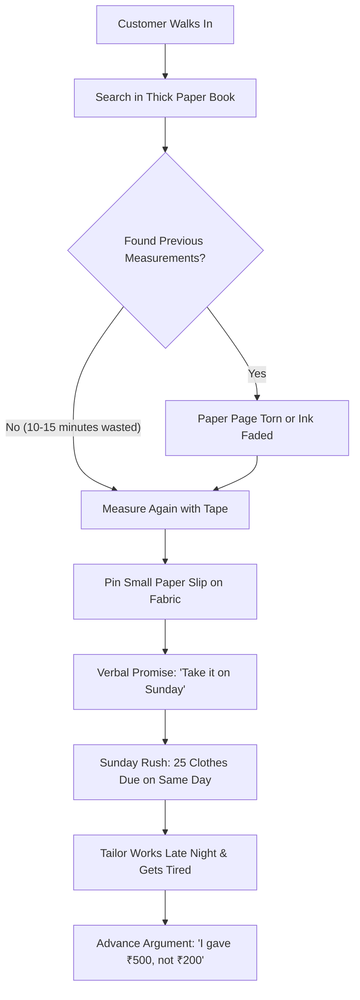

# Geetanjali Tailoring Studio: Problem Identification & Origin Story

> **Created By**: Shubham Tankariya & Sumit Tailor  
> **Project Type**: Advanced Java Engineering Project  
> **Real Shop**: Geetanjali Tailoring (Bespoke tailor shop run by Shubham's father)  
> **Dedication**: Dedicated with love and respect to my Dad ❤️  

---

## 1. Why We Built This: Solving a Real Problem

In college, most students build generic projects like a fake online bookstore, a simple library system, or an imaginary shopping site. Our Advanced Java professor gave us clear advice: **do not copy an easy topic—pick a real problem that people face every day and solve it.**

We did not have to search far. Shubham's father runs a busy local tailor shop: **Geetanjali Tailoring**.

As engineers, our goal is to use technology to make life easier for people. Watching my dad work hard every day, we noticed that while his tailoring skills are amazing, running the shop with paper books, handwritten slips, and memory was creating daily stress and confusion. 

My friend **Sumit Tailor** and I teamed up to build a complete digital system for Dad's shop so that no order is ever lost, no measurements are misplaced, and the shop runs smoothly without stress.

---

## 2. How the Traditional Tailor Shop Worked

In a custom tailor shop, clothes are not sold ready-made. Every single customer gets clothes stitched specifically for their body:

1. A customer brings uncut cloth (fabric for a shirt, pant, kurta, etc.).
2. The tailor takes detailed body measurements using a measuring tape.
3. The customer chooses their style (collar type, cuffs, pockets, fit).
4. The tailor writes everything in a thick paper notebook (register) and writes a paper slip.
5. The customer pays some advance money (like ₹200 or ₹500).
6. The tailor promises a delivery date (often verbally: *"Come on Sunday evening"*).
7. The cloth is cut, stitched, pressed with a steam iron, and kept ready on a hanger.
8. The customer comes back, tries on the clothes, pays the remaining balance, and takes their clothes home.

This sounds simple on paper, but in real life, paper registers cause major headaches every day.

---

## 3. The 6 Big Problems We Noticed in Dad's Shop

By spending time at the shop, Shubham and Sumit wrote down the 6 main everyday problems:

### Problem 1: Torn Paper Books & Lost Measurements
- Tailor shops have chalk dust, steam from irons, tea cups, and cutting shears. Over time, paper registers get dog-eared, torn, oil-stained, and the ink fades away.
- When an old customer comes back after 6 months, finding their old measurements means turning page after page for 10 to 15 minutes.
- If we cannot find the old page, the tailor has to measure the customer all over again. If the new measurement is even half an inch off, the customer complains: *"Last time it fit better!"*

### Problem 2: Weekend Clashes & Tailor Burnout
- Customers almost always ask for delivery on weekends (Saturday or Sunday), or right before big festivals like Diwali and Eid.
- Because orders were taken verbally on paper, Dad could not see how many clothes were already promised for that day.
- A tailor can comfortably cut and stitch **5 garments in a single day**. But because dates were promised blindly, sometimes **20 to 25 clothes were due on the same day**.
- Dad and the tailors had to work late past midnight, getting exhausted, and still some customers had to be told: *"Sorry, come back tomorrow."*

### Problem 3: Pinned Paper Slips Falling Off (Cloth Mix-ups)
- In the traditional shop, a small paper token is stapled or pinned to the customer's uncut cloth bundle.
- When moving heavy bundles of cloth between the cutting table and sewing machines, or during steam pressing, the pin often comes off.
- If two customers bring similar blue shirting fabric, it becomes confusing to know which cloth belongs to whom.

### Problem 4: Arguments Over Advance Payments
- Advance money was written in pencil in the corner of the paper page.
- When collecting clothes, customers would sometimes say: *"I gave you ₹500 advance when I booked!"* while the faded pencil note said *"₹200"*.
- Without a clear, printed, or timestamped receipt, the shop either loses money or upsets a regular customer.

### Problem 5: Forgetting Unpaid Balances
- Sometimes a friendly neighbor or loyal customer takes their stitched clothes and says: *"I will send the remaining ₹400 via UPI tonight."*
- In a busy shop, that ₹400 is easily forgotten because there was no central screen showing who owes money. Over a year, this caused thousands of rupees in lost income.

### Problem 6: Complicated Software Is Too Hard to Use
- Tailors are busy cutting and stitching. They do not have time to click 20 buttons on complicated screens.
- Any software for them has to be **simple, fast, keyboard-friendly**, and should work instantly using just a **10-digit mobile number**.

---

## 4. How Geetanjali Solves Every Problem

| Real-World Problem | How Geetanjali Solves It |
|---|---|
| Torn paper books & lost measurements | All customer measurements are saved permanently in a secure database. Finding them takes less than a second using just their phone number. |
| Customer measurement differences | Saved measurements automatically fill in when making a new order. Tailors can see old values instantly. |
| Tailors getting too many orders on one day | A smart **Workload Limit** protects the tailor: standard limit is 5 orders/day. At 5–9 orders, an alert asks if you really want to overbook. At 10 orders, it blocks adding more so tailors do not burn out. |
| Weekend delivery rush | A **Google Calendar-style screen** shows the whole month at a glance with color dots (Green = easy day, Yellow = busy day, Red = full). |
| Pinned paper slips falling off cloth | Tailors can take a quick photo of the customer's cloth and save it directly with the order. |
| Advance payment arguments | Every payment (Cash or UPI) is recorded with date and time. Balance is calculated automatically. |
| Forgotten customer balances | A **Pending Payments** page lists every customer who owes money, sorted by delivery date. |
| Clothes given away without payment | The system **blocks delivery** if any balance is pending, unless the shop owner approves an override with a written reason. |
| Fast shop floor questions | An **in-app AI Assistant** is always available in a side drawer to answer questions like: *"What is the balance on order 4?"* or *"Can we deliver 2 shirts this Friday?"* |

---

## 5. Who Built This

- **Shubham Tankariya**: Came up with the idea based on his father's tailor shop. Built the core database design, business logic, calendar rules, and AI assistant.
- **Sumit Tailor**: Shubham's engineering project partner. Co-designed the user screens, customer lookup flow, and wrote automated tests to make sure everything works without bugs.

---

## 6. How the Documentation Is Organized

The rest of the documentation explains each part of the system in plain English:

1. **[`02-SYSTEM_ARCHITECTURE_FLOWS_AND_ERD.md`](./02-SYSTEM_ARCHITECTURE_FLOWS_AND_ERD.md)**: How the software is structured, how data flows, and how the database tables connect to each other.
2. **[`03-DYNAMIC_MEASUREMENT_ENGINE_AND_SPECIFICATIONS.md`](./03-DYNAMIC_MEASUREMENT_ENGINE_AND_SPECIFICATIONS.md)**: How we handle custom measurements for shirts, pants, kurtas, and safari suits without breaking the database.
3. **[`04-ORDER_LIFECYCLE_FINANCIALS_AND_CAPACITY_SCHEDULER.md`](./04-ORDER_LIFECYCLE_FINANCIALS_AND_CAPACITY_SCHEDULER.md)**: The 4-step order wizard, how payments work, the 5-order tailor workload rule, and the calendar screen.
4. **[`05-STUDIO_AI_ASSISTANT_AND_TOOL_INTEGRATION.md`](./05-STUDIO_AI_ASSISTANT_AND_TOOL_INTEGRATION.md)**: How the in-app AI assistant works in the side drawer and connects to the shop database.
