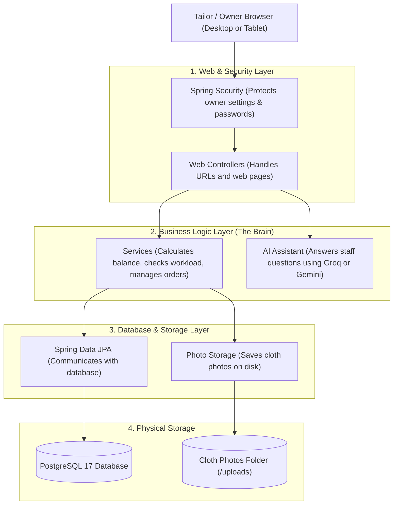
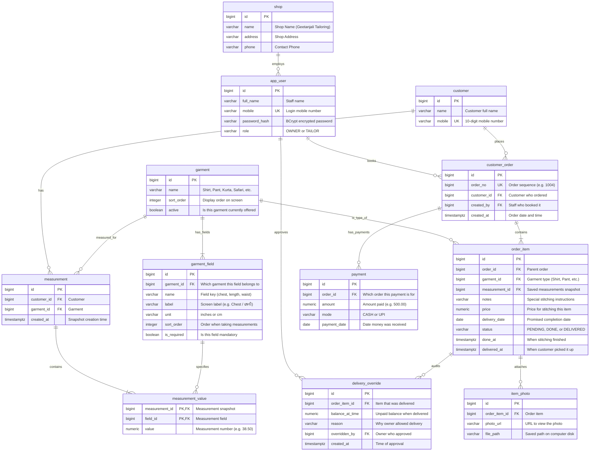
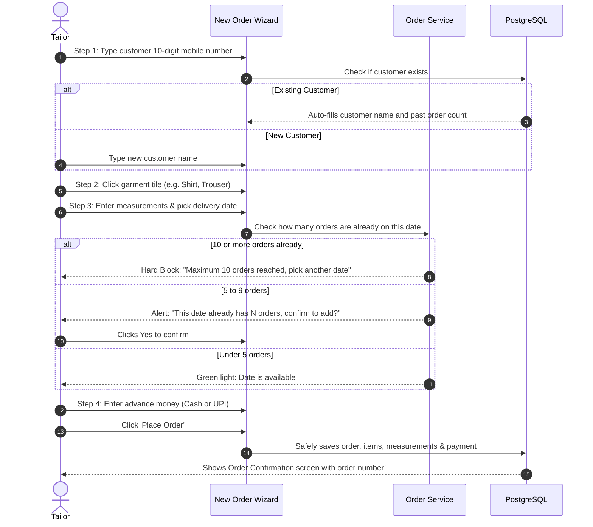

# Geetanjali Tailoring Studio: System Architecture, Workflows & Database Schema (ERD)

> **Created By**: Shubham Tankariya & Sumit Tailor  
> **Technologies Used**: Java 21 | Spring Boot 4.1.1 | Spring Data JPA | PostgreSQL 17 | Flyway | Thymeleaf | Groq & Gemini AI  

---

## 1. High-Level System Architecture

Geetanjali is built as a complete web application that runs directly on the tailor shop's computer. We chose **Spring Boot with Java 21** and **PostgreSQL 17** because tailor shops need a system that is fast, reliable, and keeps customer records and money completely safe without crashes.



---

## 2. The 4 Layers of the Application Explained Simply

To keep the code clean and easy to maintain, the application is divided into 4 simple layers:

1. **Controllers (`controller/`) — The Reception Desk**:
   - Listens to web browser requests (like opening `/orders` or submitting a new customer form).
   - Checks if the input is valid (for example, making sure a mobile number has 10 digits).
   - Hands over the work to the right service.
   - Tells the browser which HTML page to show.

2. **Services (`service/`) — The Brain**:
   - Contains all the real business rules of the tailor shop.
   - Examples:
     - Calculating the outstanding balance on an order.
     - Checking if a tailor already has 5 or 10 orders on a date.
     - Blocking delivery if money is still unpaid.
   - When saving an order, it makes sure all parts (customer, items, measurements, advance payment) are saved together in one safe transaction. If anything fails, it cancels everything so data is never half-saved.

3. **Repositories (`repository/`) — The Librarian**:
   - Talks directly to PostgreSQL using Spring Data JPA.
   - Finds records quickly (like finding a customer by their mobile number, or counting how many orders are due on a specific day).

4. **Entities (`entity/`) — The Data Records**:
   - Java classes that represent the database tables (Customer, Order, Garment, Payment, etc.).

---

## 3. Database Schema & Entity Relationship Diagram (ERD)

The database has 11 simple, interconnected tables managed automatically by Flyway migrations:



---

## 4. Main Everyday Workflows

### 4.1. Booking a New Order (4 Steps)



---

### 4.2. Stitched Garment Status: PENDING &rarr; DONE &rarr; DELIVERED

Every piece of clothing goes through 3 simple states:

1. **`PENDING` (Yellow)**: The order is placed. The cloth is waiting to be cut or is being stitched on the sewing machine.
2. **`DONE` (Blue)**: The tailor finished stitching and pressing. It is now hanging on the rack ready for customer trial.
3. **`DELIVERED` (Purple)**: The customer tried it on, paid the remaining balance, and took it home.

---

### 4.3. Delivery Protection & Balance Check Flow

To make sure the shop never loses money:

```mermaid
flowchart TD
    CustomerComes[Customer arrives to pick up clothes] --> OpenOrder[Tailor opens order on screen]
    OpenOrder --> CheckStatus{Are clothes marked DONE?}
    CheckStatus -- No --> TellCustomer[Tell customer: 'Garment still being stitched/ironed']
    CheckStatus -- Yes --> CheckMoney{Is remaining balance ₹0?}
    
    CheckMoney -- Yes (Fully Paid) --> DeliverCloth[Click 'Deliver Garment' -> Marked DELIVERED]
    
    CheckMoney -- No (Money Pending) --> BlockScreen[SYSTEM BLOCKS DELIVERY<br/>Shows red warning with balance amount]
    BlockScreen --> WhatNext{What does customer do?}
    
    WhatNext -- Customer pays balance now --> TakePayment[Click 'Add Payment' (Cash or UPI)]
    TakePayment --> DeliverCloth
    
    WhatNext -- Customer asks to pay later --> CheckWhoIsLogged{Who is using computer?}
    CheckWhoIsLogged -- Tailor --> TailorBlocked[Tailor cannot deliver without money.<br/>Must call the shop owner.]
    CheckWhoIsLogged -- Owner --> OwnerReason[Owner types reason: e.g. 'Trusted neighbor, pays tonight']
    OwnerReason --> SaveAudit[System saves audit log with owner name & reason]
    SaveAudit --> DeliverCloth
```

---

## 5. Important Rules That Keep the System Safe

1. **Balance Is Always Calculated Fresh**:
   The database never stores a static "balance" number. Instead, every time a screen opens, the system calculates:
   $$\text{Balance} = \text{Total Price of Items} - \text{Total Payments Made}$$
   This guarantees that balance numbers are always 100% accurate and can never get out of sync.

2. **Old Measurements Are Never Overwritten**:
   When an old customer comes in and their measurements changed slightly, the system creates a brand-new measurement snapshot with today's date. The old record from 6 months ago stays untouched, so old receipts and job cards are never changed.

3. **Accurate Money Calculations**:
   All money amounts use exact decimal math (`BigDecimal`). We never use floating-point numbers (`double` or `float`), ensuring zero rounding errors even on ₹0.50.
