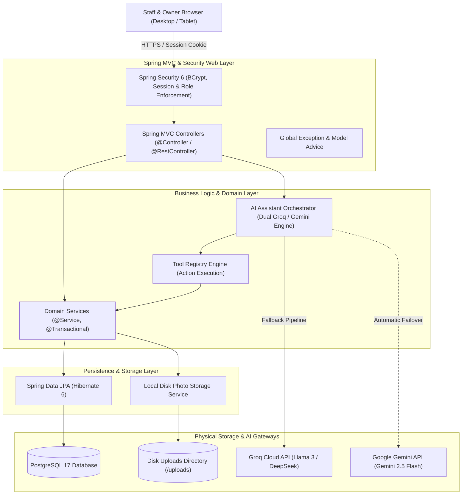
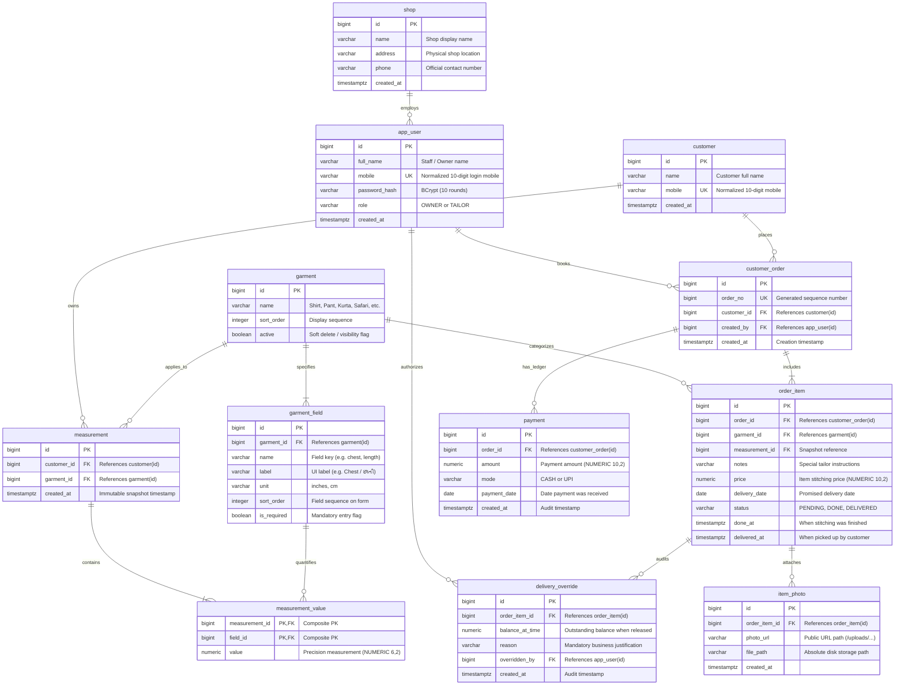
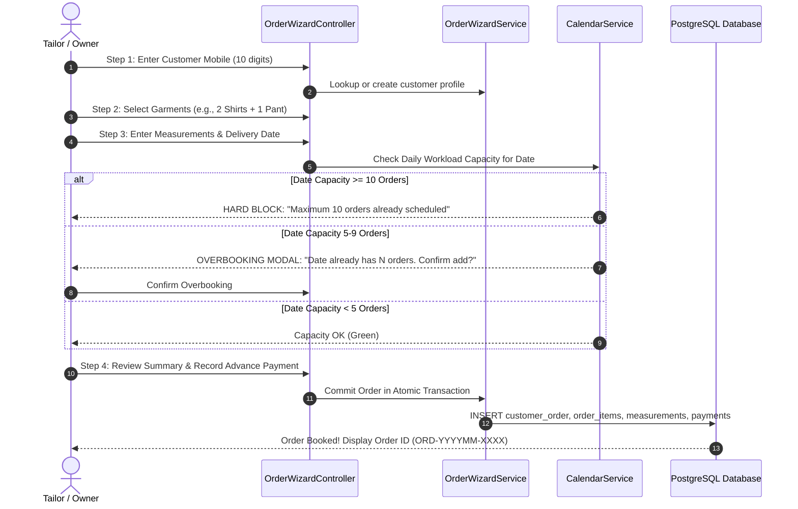

# Geetanjali Tailoring Studio: System Architecture, Workflows & Database Schema (ERD)

> **Document Classification**: Core Technical Architecture & Data Model  
> **Authors**: Shubham Tankariya & Sumit Tailor  
> **Tech Stack**: Java 21 (LTS) | Spring Boot 4.1.1 | Spring Data JPA | PostgreSQL 17 | Flyway 10 | Thymeleaf | Groq & Gemini AI  

---

## 1. High-Level Architectural Overview

Geetanjali is built as a high-performance, modular monolithic web application. Monolithic design was deliberately chosen over microservices to guarantee **immediate ACID transactional consistency**, eliminate network latency in shop desk operations, and provide seamless, zero-maintenance local deployment for neighborhood enterprises.



---

## 2. Layered Separation of Concerns

The architecture strictly enforces clean separation across four distinct boundaries:

1. **Controller Layer (`com.geetanjali.backend.controller`)**:
   - Thin HTTP orchestration only.
   - Binds HTTP form inputs into validated DTOs (`@Valid`).
   - Delegates business execution to exactly one service method.
   - Returns a Thymeleaf template view name or a REST JSON response.
   - **Absolute Rule**: Controllers never access database repositories directly.

2. **Business Service Layer (`com.geetanjali.backend.service`)**:
   - Encapsulates all domain invariants, calculations, and transactional boundaries (`@Transactional`).
   - Computes dynamic balances and enforces capacity rules.
   - Coordinates multi-table writes with automatic rollback on runtime exceptions.

3. **Data Access Layer (`com.geetanjali.backend.repository`)**:
   - Spring Data JPA repository interfaces extending `JpaRepository`.
   - Utilizes derived query methods and parameterized JPQL queries with bound arguments to eliminate SQL injection.

4. **Domain Entity Layer (`com.geetanjali.backend.entity`)**:
   - Rich relational entities mapped using JPA/Hibernate annotations.
   - Encapsulates entity-level domain invariants (e.g., `OrderItem.markDone()`).

---

## 3. Comprehensive Database Schema & Entity Relationship Diagram (ERD)

The database schema is fully managed via Flyway migrations (`V1__core_schema.sql`, `V2__seed_defaults.sql`, `V3__stage2_delivery.sql`).



---

## 4. Core Operational Workflows

### 4.1. Order Booking & Multi-Step Wizard Flow



---

### 4.2. Staged Garment Lifecycle State Machine

Each individual garment item progresses through a strict three-state lifecycle:

```mermaid
stateDiagram-v2
    [*] --> PENDING: Order Placed & Scheduled
    
    state PENDING {
        description: Fabric cut, chalked, and being stitched by tailor
    }
    
    PENDING --> DONE: Tailor Clicks 'Mark Stitched'
    
    state DONE {
        description: Garment pressed, inspected, and hanging on finished rack
    }
    
    DONE --> DELIVERED: Normal Handover (Balance = ₹0.00)
    
    state DELIVERED {
        description: Garment collected by customer, receipt closed
    }
    
    DONE --> DELIVERED: Owner Override (Balance > ₹0.00 + Reason + Audit)
    
    note right of DONE
        System BLOCKS delivery if balance > 0
        Unless OWNER provides documented override
    end note
```

---

### 4.3. Delivery Gate & Balance Verification Workflow

To eliminate unpaid garment leakage, the delivery gate enforces a strict invariant:

```mermaid
flowchart TD
    Start[Customer Arrives for Pickup] --> Lookup[Tailor Opens Order Detail]
    Lookup --> VerifyItems{Are all items DONE?}
    VerifyItems -- No --> AlertWait[Alert: Garment still in stitching / ironing]
    VerifyItems -- Yes --> CheckBalance{Is Order Balance = ₹0.00?}
    
    CheckBalance -- Yes (Fully Paid) --> DeliverOK[Click 'Deliver Garment' -> Status: DELIVERED]
    
    CheckBalance -- No (Outstanding Balance) --> BlockGate[SYSTEM BLOCKS DELIVERY<br/>Throws BalancePendingException]
    BlockGate --> ShowModal[Display Red Alert Panel with Outstanding Amount]
    
    ShowModal --> Choice{Customer Action}
    Choice -- Customer Pays Now --> AddPay[Click 'Add Payment' (Cash/UPI) -> Balance becomes ₹0.00]
    AddPay --> DeliverOK
    
    Choice -- Customer Requests Credit --> CheckRole{Current User Role?}
    CheckRole -- TAILOR --> Refuse[Tailor Forbidden from Overriding<br/>Prompt: 'Please consult shop owner']
    CheckRole -- OWNER --> OverrideForm[Owner Enters Mandatory Business Justification]
    OverrideForm --> AuditLog[Save Immutable DeliveryOverride Record<br/>Balance at time, Reason, Timestamp, Owner ID]
    AuditLog --> DeliverOK
```

---

## 5. Architectural Invariants & Data Integrity Guarantees

1. **Balance is Derived, Never Cached**:
   $$\text{Balance} = \sum(\text{order\_item.price}) - \sum(\text{payment.amount})$$
   Balance is calculated at runtime from underlying transactional rows. This completely eliminates data desynchronization bugs.
2. **Immutable Measurement Snapshots**:
   Whenever a customer’s measurements are edited or updated for a new order, the system **never modifies historical measurement records**. It generates a new timestamped `measurement` entity so past orders and printed job cards retain historical integrity.
3. **Indian Standard Time (IST) Determinism**:
   System operations do not call `LocalDate.now()`. All date logic injects a central `Clock` bean pinned to `Asia/Kolkata`, guaranteeing zero date discrepancies across midnight shifts or cloud server regional zones.
