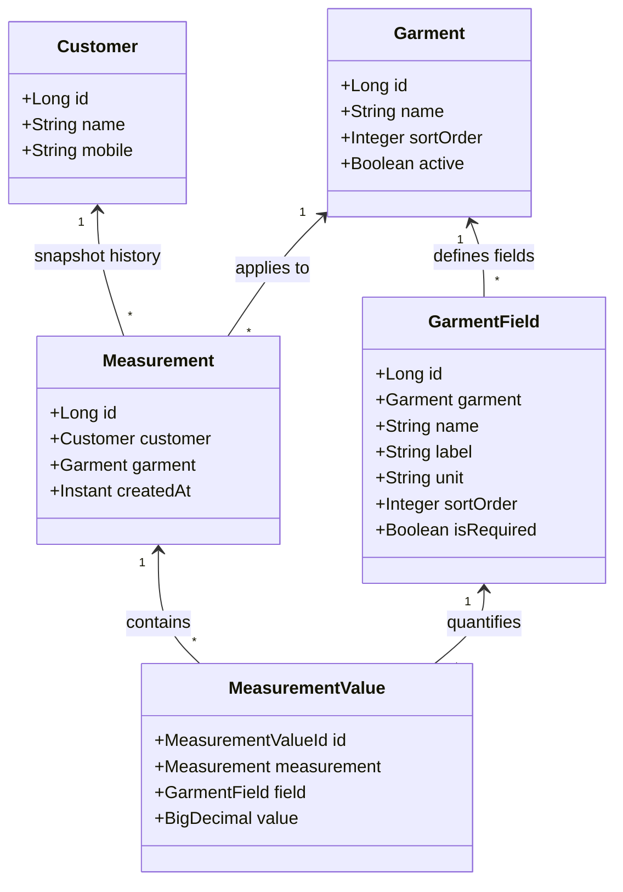
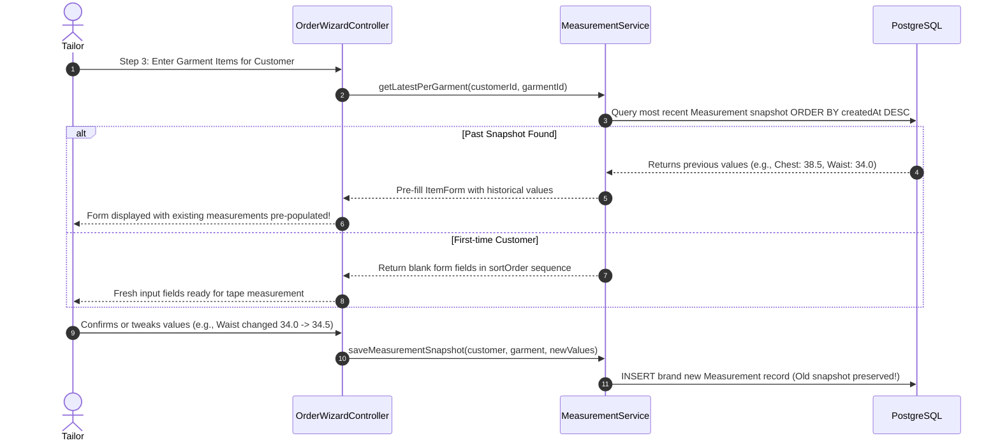

# Geetanjali Tailoring Studio: Dynamic Measurement Engine & Garment Specifications

> **Document Classification**: Deep Dive — Dynamic Measurement Parameter Architecture  
> **Authors**: Shubham Tankariya & Sumit Tailor  
> **Modules**: `com.geetanjali.backend.service.MeasurementService`, `com.geetanjali.backend.service.GarmentService`  

---

## 1. The Domain Challenge: The Failure of Static Relational Schemas

In standard software engineering tutorials, developers often design an `order` table with fixed columns such as `chest_size`, `waist_size`, and `inseam`. In bespoke artisanal tailoring, this approach fails completely for three structural reasons:

1. **Garment Heterogeneity**: 
   - A **Formal Shirt** requires measurements for *Collar, Chest, Stomach/Waist, Full Length, Shoulder, Sleeve Length, Cuff, and Bicep*.
   - A **Tailored Trouser** requires *Waist, Seat/Hip, Outseam Length, Inseam Length, Thigh, Knee, Fork/Rise, and Bottom Hem Width*.
   - A **Safari Suit** requires *Lapel Width, Cross Back, Chest Depth, and Slit Openings*.
   - A **Traditional Kurta** requires *Side Slit Length, Neck Opening, and Flare Width*.
2. **Shop Customization**:
   - Different master tailors use distinct anatomical terminology or regional tailoring idioms (e.g., using Gujarati/Hindi terms such as *લંબાઈ / Lambai*, *છાતી / Chhati*, *કમર / Kamar*, *ઝોળો / Zolo*).
3. **Template Extensibility**:
   - If a tailor begins offering a new garment style (such as an Indo-Western Sherwani or Bandhgala Coat), adding static database columns would require altering SQL tables, recompiling Java classes, and redeploying the application.

---

## 2. The Dynamic EAV-Inspired Parameter Architecture

To solve this challenge, Geetanjali employs a **dynamic, template-driven Entity-Attribute-Value (EAV) architecture** with strong referential integrity:



### Key Data Entities
- **`Garment`**: Categorizes the apparel type (e.g., "Formal Shirt", "Chino Trouser", "Nehru Jacket"). Contains soft-delete support (`active = true/false`) and display sequencing (`sortOrder`).
- **`GarmentField`**: Represents an individual anatomical measurement point belonging to a garment. Defines:
  - `name`: Machine-friendly identifier (e.g., `chest`, `waist`, `sleeve`).
  - `label`: Human-friendly bilingual label (e.g., `Chest / છાતી`).
  - `unit`: Measurement scale (`inches` or `cm`).
  - `sortOrder`: Sequential order of entry on the tailor's physical measuring tape.
  - `isRequired`: Whether the field is mandatory before booking.
- **`Measurement`**: Represents an **immutable historical snapshot** capturing a customer's measurements for a specific garment at an exact timestamp.
- **`MeasurementValue`**: Stores the numerical reading (as high-precision `BigDecimal NUMERIC(6,2)`) linked to a composite primary key `(measurement_id, field_id)`.

---

## 3. Snapshot Immutability & Customer History Reuse

When a repeat customer places an order, the system executes an automated measurement reuse flow:



### Why Historical Snapshots Are Never Updated In-Place
If a customer gained weight between January and November, updating their single database record would retroactively falsify the measurement records for the garments stitched in January! By creating a **new snapshot on every order modification**, past orders, customer receipts, and production records remain permanently historically accurate.

---

## 4. Nested Tabular Visualization (UI & AI Assistant)

To provide clear, rapid readability for tailors on the shop floor, measurements are formatted as **nested tables** across both the web interface and the conversational AI Assistant drawer:

### Table-Inside-Table Layout Design
In the Order Details view (`/orders/{id}`) and AI Assistant chat output, measurements avoid dense JSON strings or comma-separated lists. Instead, each garment item renders an embedded sub-table:

```text
┌────────────────────────────────────────────────────────────────────────┐
│ Garment: Formal Shirt  (Item #1)       Status: [ DONE ]  Price: ₹650  │
├────────────────────────────────────────────────────────────────────────┤
│ MEASUREMENT SPECIFICATIONS:                                            │
│ ┌────────────────────────┬──────────────────────┬────────────────────┐ │
│ │ Anatomical Point       │ Dimension (Inches)   │ Tailor Remarks     │ │
│ ├────────────────────────┼──────────────────────┼────────────────────┤ │
│ │ Collar (ગળું)          │ 15.50 in             │ Regular Spread     │ │
│ │ Chest (છાતી)           │ 39.00 in             │ Slim Fit (+2" ease)│ │
│ │ Waist (કમર)            │ 34.50 in             │ Contoured Cut      │ │
│ │ Length (લંબાઈ)         │ 29.00 in             │ Curved Hem         │ │
│ │ Shoulder (શોલ્ડર)      │ 18.00 in             │ Standard Slope     │ │
│ │ Sleeve (સ્લીવ)         │ 24.50 in             │ Double Button Cuff │ │
│ └────────────────────────┴──────────────────────┴────────────────────┘ │
│ Special Styling Notes: Contrast inner collar band, pocket flap.       │
└────────────────────────────────────────────────────────────────────────┘
```

---

## 5. Seed Garment Specifications & Anatomical Templates

Geetanjali ships out of the box with standardized templates configured via Flyway database migration `V2__seed_defaults.sql`:

### 5.1. Formal & Casual Shirt Template
| Field Key | Label | Default Unit | Sort Order | Required |
|---|---|---|---|---|
| `length` | Full Length (લંબાઈ) | Inches | 1 | Yes |
| `chest` | Chest / Bust (છાતી) | Inches | 2 | Yes |
| `waist` | Waist / Stomach (પેટ / કમર) | Inches | 3 | Yes |
| `shoulder` | Shoulder Width (શોલ્ડર) | Inches | 4 | Yes |
| `sleeve` | Sleeve Length (સ્લીવ) | Inches | 5 | Yes |
| `collar` | Collar Neck (ગળું) | Inches | 6 | Yes |
| `cuff` | Cuff Circumference (કફ) | Inches | 7 | No |

### 5.2. Formal & Chino Trouser Template
| Field Key | Label | Default Unit | Sort Order | Required |
|---|---|---|---|---|
| `length` | Outseam Length (લંબાઈ) | Inches | 1 | Yes |
| `waist` | Waist Band (કમર) | Inches | 2 | Yes |
| `seat` | Hip / Seat (સીટ) | Inches | 3 | Yes |
| `thigh` | Thigh Width (જાંગ) | Inches | 4 | Yes |
| `bottom` | Bottom Hem Width (મોરી) | Inches | 5 | Yes |
| `fork` | Fork / Rise (ઝોળો) | Inches | 6 | No |
| `knee` | Knee Width (ઢીંચણ) | Inches | 7 | No |

### 5.3. Traditional Kurta Template
| Field Key | Label | Default Unit | Sort Order | Required |
|---|---|---|---|---|
| `length` | Full Length (લંબાઈ) | Inches | 1 | Yes |
| `chest` | Chest (છાતી) | Inches | 2 | Yes |
| `shoulder` | Shoulder (શોલ્ડર) | Inches | 3 | Yes |
| `sleeve` | Sleeve (સ્લીવ) | Inches | 4 | Yes |
| `collar` | Mandarin Collar (ગળું) | Inches | 5 | Yes |
| `slit` | Side Slit Height (કટ) | Inches | 6 | No |

---

## 6. Template Configuration & Customization UI

Through the **Shop Settings & Garment Templates** screen (`/settings/garments/{id}`), shop owners can:
1. Enable or disable existing garment categories without deleting past order records.
2. Add custom measurement fields with specialized labels and measurement units.
3. Reorder fields using drag-and-drop or sequence indices to match the tailor's natural measurement tape order.
4. Mark fields mandatory or optional according to shop craftsmanship standards.
