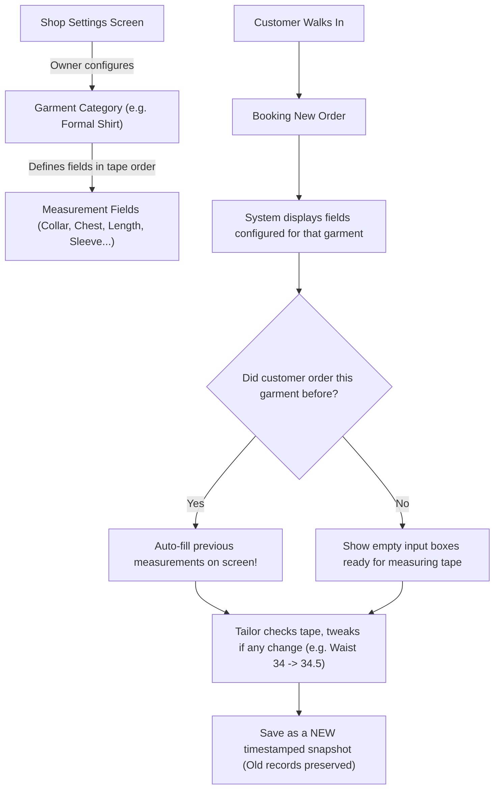

# Geetanjali Tailoring Studio: Dynamic Measurement Engine & Garment Specifications

> **Created By**: Shubham Tankariya & Sumit Tailor  
> **Key Java Classes**: `MeasurementService.java`, `GarmentService.java`  

---

## 1. Why Normal Database Tables Do Not Work for Tailoring

If a beginner programmer designs a database for clothes, they might create a table with columns like:
`chest_size`, `waist_size`, `length`.

In a real custom tailor shop, that fails completely:

1. **Different clothes have completely different measurements**:
   - A **Formal Shirt** needs: *Collar, Chest, Stomach/Waist, Full Length, Shoulder, Sleeve Length, and Cuff*.
   - A **Formal Pant / Trouser** needs: *Waist, Seat/Hip, Length, Inseam, Thigh, Knee, Fork/Rise, and Bottom Width*.
   - A **Traditional Kurta** needs: *Length, Chest, Shoulder, Sleeve, Mandarin Collar, and Side Slit*.
   - A **Safari Suit** needs: *Lapel Width, Cross Back, and Chest Pocket*.
2. **Every master tailor uses their own terms**:
   - Tailors often use regional words like *Lambai* (Length), *Chhati* (Chest), *Kamar* (Waist), *Zolo* (Rise), or *Mori* (Bottom hem).
3. **Adding a new garment shouldn't need a programmer**:
   - If Dad starts stitching a new style like a Bandhgala Coat or Indo-Western Sherwani, he should not have to call a software engineer to change the database. He should just click "Add Garment" in settings.

---

## 2. How Geetanjali Handles Measurements Dynamically

Instead of rigid columns, Geetanjali uses a **template-based system**:



---

## 3. How Old Measurements Are Reused Without Changing History

When a customer comes back to the shop:

1. In **Step 3** of the new order wizard, the tailor selects the garment (for example, Shirt).
2. The system checks the database: *"Does this customer already have saved measurements for a Shirt?"*
3. **If Yes**: The previous numbers pop up in the input boxes automatically!
   - The tailor does not need to retype 7 numbers.
   - The tailor just checks with the customer: *"Uncle, are you still wearing 34 waist or should we loosen it half an inch?"*
   - If the customer gained a little weight, the tailor changes `34.0` to `34.5`.
4. **Saving Safely**:
   - The system **never modifies the old measurement record**.
   - It saves a brand-new measurement record with today's date.
   - This means the customer's previous order from 6 months ago still shows the exact measurements that were used to cut that older shirt.

---

## 4. Tables Inside a Table (Clean Visual Layout)

In both the Order Details page (`/orders/{id}`) and the in-app AI Assistant chat drawer, measurements are presented in a **table inside a table**:

```text
┌────────────────────────────────────────────────────────────────────────┐
│ Garment: Formal Shirt  (Item #1)       Status: [ DONE ]  Price: ₹650   │
├────────────────────────────────────────────────────────────────────────┤
│ MEASUREMENTS TABLE:                                                    │
│ ┌────────────────────────┬──────────────────────┬────────────────────┐ │
│ │ Measurement Field      │ Size (Inches)        │ Tailor Notes       │ │
│ ├────────────────────────┼──────────────────────┼────────────────────┤ │
│ │ Length (લંબાઈ)         │ 29.00 in             │ Curved bottom hem  │ │
│ │ Chest (છાતી)           │ 39.00 in             │ Regular loose fit  │ │
│ │ Waist (કમર)            │ 34.50 in             │ Normal cut         │ │
│ │ Shoulder (શોલ્ડર)      │ 18.00 in             │ Standard           │ │
│ │ Sleeve (સ્લીવ)         │ 24.50 in             │ Double button cuff │ │
│ │ Collar (ગળું)          │ 15.50 in             │ Regular collar     │ │
│ └────────────────────────┴──────────────────────┴────────────────────┘ │
│ Customer Cloth: Raymond blue cotton. 1 front pocket on left side.     │
└────────────────────────────────────────────────────────────────────────┘
```

This nested table design makes it very fast for tailors to glance at their phone or computer while cutting fabric on the table, with zero confusion.

---

## 5. Standard Garment Templates Included Out of the Box

The system comes pre-configured with the most common bespoke clothing types in India:

### 5.1. Shirt Template
| Field Name | Screen Label | Unit | Mandatory? |
|---|---|---|---|
| `length` | Full Length (લંબાઈ) | Inches | Yes |
| `chest` | Chest (છાતી) | Inches | Yes |
| `waist` | Waist / Stomach (પેટ / કમર) | Inches | Yes |
| `shoulder` | Shoulder (શોલ્ડર) | Inches | Yes |
| `sleeve` | Sleeve Length (સ્લીવ) | Inches | Yes |
| `collar` | Collar Neck (ગળું) | Inches | Yes |
| `cuff` | Cuff Size (કફ) | Inches | Optional |

### 5.2. Trouser / Pant Template
| Field Name | Screen Label | Unit | Mandatory? |
|---|---|---|---|
| `length` | Pant Length (લંબાઈ) | Inches | Yes |
| `waist` | Waist (કમર) | Inches | Yes |
| `seat` | Hip / Seat (સીટ) | Inches | Yes |
| `thigh` | Thigh (જાંગ) | Inches | Yes |
| `bottom` | Bottom Mori (મોરી) | Inches | Yes |
| `fork` | Rise / Fork (ઝોળો) | Inches | Optional |
| `knee` | Knee Width (ઢીંચણ) | Inches | Optional |

### 5.3. Kurta Template
| Field Name | Screen Label | Unit | Mandatory? |
|---|---|---|---|
| `length` | Kurta Length (લંબાઈ) | Inches | Yes |
| `chest` | Chest (છાતી) | Inches | Yes |
| `shoulder` | Shoulder (શોલ્ડર) | Inches | Yes |
| `sleeve` | Sleeve (સ્લીવ) | Inches | Yes |
| `collar` | Collar Neck (ગળું) | Inches | Yes |
| `slit` | Side Cut (કટ) | Inches | Optional |

---

## 6. How the Shop Owner Can Change Fields

In the **Garments Settings** page (`/settings/garments`):
- Click on any garment to see its measurement fields.
- Change names, units, or language labels (e.g., adding Gujarati or Hindi translations).
- Change the order of fields so they match how the tailor takes tape measurements top-to-bottom.
- Turn on or off fields as needed.
