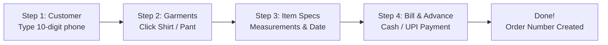
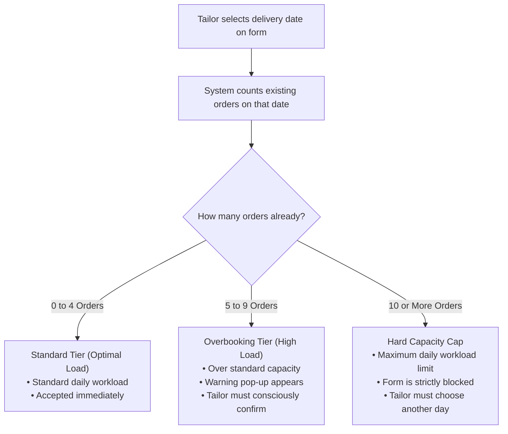

# Geetanjali Tailoring Studio: Order Lifecycle, Financial Invariants & Workload Scheduler

> **Created By**: Shubham Tankariya & Sumit Tailor  
> **Key Java Classes**: `OrderService.java`, `CalendarService.java`, `PaymentService.java`  

---

## 1. The 4-Step Order Booking Wizard

Booking a custom tailor order takes just a few seconds using the 4-step wizard:



### Step 1: Customer (`/orders/new/customer`)
- Staff types the customer's 10-digit mobile number.
- In less than 50 milliseconds, the system checks if the customer has visited before:
  - **Returning Customer**: Their name and how many orders they have placed pop up automatically.
  - **New Customer**: Staff types the customer's name and proceeds.

### Step 2: Garment Selection (`/orders/new/garment`)
- Large clickable tiles let the tailor quickly choose what garments to stitch (e.g. 2 Shirts and 1 Trouser).

### Step 3: Measurements, Cloth Photo & Delivery Date (`/orders/new/item`)
- Measurement fields appear in the exact order the tailor uses their measuring tape.
- Any previous measurements for this customer are already pre-filled.
- Staff can upload a quick phone photo of the customer's fabric swatch so it is never mixed up with another customer's cloth.
- Staff selects the promised delivery date, which immediately runs the **Workload Capacity Check**.

### Step 4: Bill Summary & Advance Payment (`/orders/new/summary`)
- Shows the full bill with item prices.
- Staff enters the advance payment paid by the customer and selects whether it was paid via **CASH** or **UPI** (Google Pay, PhonePe, Paytm).
- Clicking **"Confirm & Place Order"** saves everything safely in the database.

---

## 2. The Tailor Workload Limit: Protecting Tailors From Burnout

In traditional tailor shops, shop owners verbally promise dates to customers without checking how much work is already waiting for that day. This leads to the infamous "Sunday Avalanche" where 25 clothes are due on the same day, forcing tailors to work all night.

Geetanjali protects tailors by enforcing **3 daily capacity tiers**:



### The 3 Workload Tiers:
1. **Standard Capacity (0 to 4 orders / day)**:
   - A tailor can easily cut and stitch up to 5 orders a day with top craftsmanship.
   - The booking form accepts the date immediately without interruption.
2. **Overbooking Zone (5 to 9 orders / day)**:
   - The shop is already handling substantial production volume on this day.
   - If the tailor chooses this date, a clear pop-up modal appears on screen:
     > *"This day already has 6 orders scheduled. Do you want to add an overday order?"*
   - The tailor must explicitly click **"Yes, Confirm Overbooking"** to proceed.
3. **Hard Maximum Cap (10 orders / day)**:
   - 10 orders is the absolute physical ceiling of what the workshop can complete in a 24-hour cycle.
   - The system **strictly blocks the form** and displays a hard limit error:
     > *"Maximum daily capacity reached (10 orders already scheduled for this day). Please select another delivery date."*

---

## 3. Production & Delivery Workload Scheduler (`/calendar`)

To see the whole month at a glance, the shop has a dedicated **Delivery Calendar**:

```text
┌──────────────────────────────────────────────────────────────────────────────────────────────────┐
│  DELIVERY CALENDAR                                     [ < Prev ] November 2026 [ Next > ]       │
├────────────────────────────────────────────────────────────────────────┬─────────────────────────┤
│  SUN       MON       TUE       WED       THU       FRI       SAT       │  MONTHLY SUMMARY        │
│ ┌───────┐ ┌───────┐ ┌───────┐ ┌───────┐ ┌───────┐ ┌───────┐ ┌───────┐  ├─────────────────────────┤
│ │ 1     │ │ 2     │ │ 3     │ │ 4     │ │ 5     │ │ 6     │ │ 7     │  │ Total Clothes: 84 Items │
│ │ 2 ord │ │ 4 ord │ │ 1 ord │ │ 6 ord │ │ 8 ord │ │ 3 ord │ │ 2 ord │  │ Standard Days: 22     │
│ │ [•]   │ │ [•]   │ │ [•]   │ │ [•]   │ │ [•]   │ │ [•]   │ │ [•]   │  │ High Load Days: 6       │
│ └───────┘ └───────┘ └───────┘ └───────┘ └───────┘ └───────┘ └───────┘  ├─────────────────────────┤
│ ┌───────┐ ┌───────┐ ┌───────┐ ┌───────┐ ┌───────┐ ┌───────┐ ┌───────┐  │  BUSIEST DELIVERY DAYS  │
│ │ 8     │ │ 9     │ │ 10    │ │ 11    │ │ 12    │ │ 13    │ │ 14    │  │  1. Nov 5 - 8 Clothes   │
│ │ 5 ord │ │ 3 ord │ │ 4 ord │ │ 7 ord │ │ 2 ord │ │ 5 ord │ │ 1 ord │  │  2. Nov 4 - 6 Clothes   │
│ │ [•]   │ │ [•]   │ │ [•]   │ │ [•]   │ │ [•]   │ │ [•]   │ │ [•]   │  │  3. Nov 8 - 5 Clothes   │
│ └───────┘ └───────┘ └───────┘ └───────┘ └───────┘ └───────┘ └───────┘  ├─────────────────────────┤
│                                                                        │  SELECTED DAY SCHEDULE  │
│  (7-column workshop month grid with daily order counters)             │  Nov 4 (Wednesday):     │
│                                                                        │  • ORD-1004 [RM] - Pant │
│                                                                        │  • ORD-1004 [RM] - Shirt│
│                                                                        │  • ORD-1012 [KT] - Kurta│
└────────────────────────────────────────────────────────────────────────┴─────────────────────────┘
```

### What You See on the Calendar:
1. **7-Column Month Grid (Sunday to Saturday)**:
   - Every day is presented in a clean rounded calendar box.
   - Shows how many clothes are scheduled for delivery on each date.
   - Displays workload tags with subtle dot accents.
2. **Monthly Summary (Right Sidebar)**:
   - Total number of clothes due to be delivered this month.
   - Busiest delivery peak days ranked at the top, so tailors can cut cloth in advance.
3. **Selected Day Inspector**:
   - Click on any day box, and the right panel instantly lists every customer and garment due on that day.
   - Shows customer initials (e.g. `[KT]` for Ketan Tankariya), garment icons, and direct links to the order.

---

## 4. Money Accounting & The Delivery Block Rule

To make sure the shop never loses money on uncollected balances:

### 4.1. Automatic Balance Calculation
Every time you look at an order, the system calculates:
$$\text{Balance} = \text{Total Item Prices} - \text{Total Payments Made}$$

### 4.2. Blocking Delivery If Money Is Unpaid
When a customer comes to collect their stitched garment:
- If the balance is **₹0 (Fully Paid)**: Staff clicks "Deliver Item", and the garment is marked `DELIVERED`.
- If there is **Unpaid Balance (e.g. ₹500 pending)**: The system **blocks delivery** and shows a red alert:
  > *"Delivery blocked: Balance of ₹500 is still pending."*
- Staff clicks "Add Payment", enters the money (Cash or UPI), and then the clothes can be delivered.

### 4.3. Shop Owner Override (For Trusted Neighbors)
In real life, a close family friend or trusted regular customer might say: *"I will send the ₹500 on Google Pay tonight, can I take the clothes for the wedding now?"*

The system handles this safely:
- Normal tailors (`TAILOR`) **cannot override**. They must call the shop owner.
- The shop owner (`OWNER`) can approve the delivery by typing a quick reason (e.g., *"Trusted neighbor, will pay via Google Pay tonight"*).
- The system marks the clothes delivered, but **saves a permanent audit log** recording who approved it, why, and the exact balance amount.
- The unpaid balance continues to appear on the **Pending Payments Dashboard** (`/payments/pending`) so it is never forgotten!
