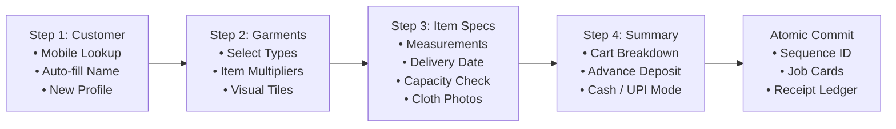
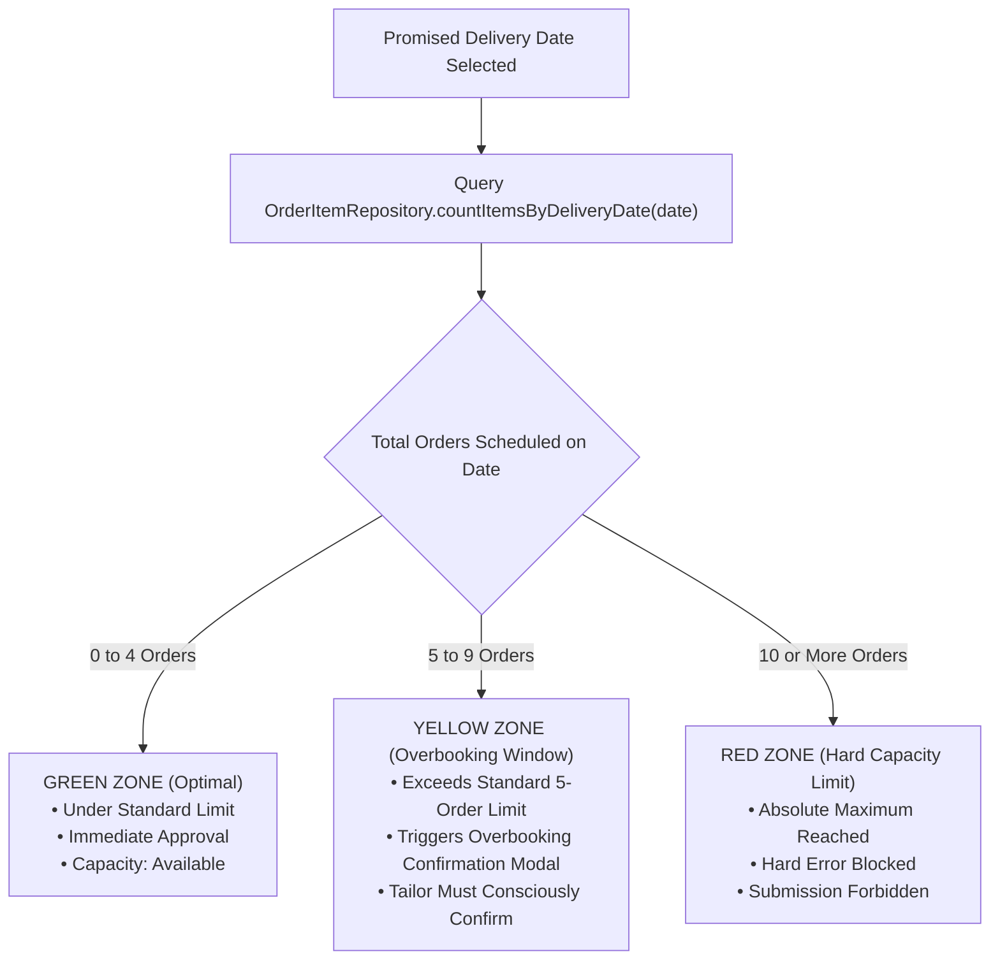

# Geetanjali Tailoring Studio: Order Lifecycle, Financial Invariants & Workload Scheduler

> **Document Classification**: Core Operations & Scheduling Engine  
> **Authors**: Shubham Tankariya & Sumit Tailor  
> **Modules**: `com.geetanjali.backend.service.OrderService`, `com.geetanjali.backend.service.CalendarService`, `com.geetanjali.backend.service.PaymentService`  

---

## 1. End-to-End Order Creation Wizard

The booking of bespoke garments is orchestrated through an interactive 4-step wizard designed for desktop-speed data entry without leaving the keyboard:



### 1.1. Step 1: Customer Identification (`/orders/new/customer`)
- Staff enters a 10-digit Indian mobile number.
- Client-side JavaScript triggers `GET /api/customers/lookup?mobile={normalized}`.
- If the customer exists, their name and historical order count are auto-populated in sub-50ms; if new, staff types the name and the profile is staged in session.

### 1.2. Step 2: Garment Category Selection (`/orders/new/garment`)
- Interactive garment tiles (Shirt, Pant, Kurta, Blouse, Safari) allow single-click selection.

### 1.3. Step 3: Customization, Measurements & Workload Validation (`/orders/new/item`)
- Dynamic measurement fields are displayed in tailor tape order.
- Prior measurements for this customer are automatically pre-filled.
- Staff uploads cloth swatch or design reference photos (`POST /api/photos/upload`).
- Staff chooses a promised delivery date, triggering the **Daily Workload Capacity Check**.

### 1.4. Step 4: Cart Summary & Advance Payment Deposit (`/orders/new/summary`)
- Full itemized bill is presented.
- Advance deposit is recorded with payment mode (`CASH` or `UPI`).
- Clicking **"Confirm & Place Order"** invokes `OrderService.placeOrder()` within a single `@Transactional` boundary.

---

## 2. Daily Tailor Workload Capacity Enforcement Engine

One of the most transformative innovations in Geetanjali is the **Tailor Workload Protection Engine**. In traditional shops, tailors suffer severe burnout and missed deadlines because shop owners verbally promise deliveries without checking existing commitments.

Geetanjali solves this by establishing a clear 3-tier daily capacity model:



### 2.1. The Three Workload Thresholds

| Workload Tier | Daily Order Count | UI Indicator | System Behavior |
|---|---|---|---|
| **Standard Capacity** | 0 to 4 orders | **GREEN** | Allowed seamlessly. No confirmation needed. |
| **Overbooking Zone** | 5 to 9 orders | **YELLOW / AMBER** | Allowed only with explicit confirmation. Displays warning modal: *"This date already has N orders scheduled. Do you want to add an overday order?"* |
| **Maximum Hard Cap** | 10 orders | **RED** | **Strictly Blocked**. Form displays error: *"Maximum daily capacity reached (10 orders already scheduled). Please select another delivery date."* |

### 2.2. Dual-Layer Defense Architecture
1. **Client-Side Interactive Modal**:
   When staff chooses a date in Step 3 or edits an item, `new-order.js` calls `GET /api/calendar/capacity?date=YYYY-MM-DD`. If in the overbooking window, an interactive modal card pops up requiring staff confirmation before form submission is enabled.
2. **Server-Side Binding Validation**:
   Even if client-side JavaScript is bypassed, `OrderWizardController` and `OrderController` independently call `CalendarService.getDayCapacity(date)`. If `capacity.maxReached()`, the controller rejects the request using `bindingResult.rejectValue("deliveryDate", ...)` and returns the user to the form with an inline alert.

---

## 3. Google Calendar-Style Delivery Scheduler (`/calendar`)

To provide master tailors and shop owners with complete visibility into monthly production schedules, Geetanjali provides a dedicated **Production & Delivery Calendar**:

```text
┌──────────────────────────────────────────────────────────────────────────────────────────────────────────────┐
│  GEETANJALI STUDIO PRODUCTION CALENDAR                                             [ < Prev ] November 2026 [ Next > ] │
├────────────────────────────────────────────────────────────────────────┬─────────────────────────────────────┤
│  SUN       MON       TUE       WED       THU       FRI       SAT       │  MONTHLY EXECUTIVE METRICS          │
│ ┌───────┐ ┌───────┐ ┌───────┐ ┌───────┐ ┌───────┐ ┌───────┐ ┌───────┐  ├─────────────────────────────────────┤
│ │ 1     │ │ 2     │ │ 3     │ │ 4     │ │ 5     │ │ 6     │ │ 7     │  │ Total Monthly Deliveries: 84 Items  │
│ │ 2 ord │ │ 4 ord │ │ 1 ord │ │ 6 ord │ │ 8 ord │ │ 3 ord │ │ 2 ord │  │ Standard Days: 22   Overbooking: 6   │
│ │ [•]   │ │ [•]   │ │ [•]   │ │ [•]   │ │ [•]   │ │ [•]   │ │ [•]   │  ├─────────────────────────────────────┤
│ └───────┘ └───────┘ └───────┘ └───────┘ └───────┘ └───────┘ └───────┘  │  TOP DELIVERY PEAK DAYS             │
│ ┌───────┐ ┌───────┐ ┌───────┐ ┌───────┐ ┌───────┐ ┌───────┐ ┌───────┐  │  1. Nov 5 (Thursday)  - 8 Items    │
│ │ 8     │ │ 9     │ │ 10    │ │ 11    │ │ 12    │ │ 13    │ │ 14    │  │  2. Nov 4 (Wednesday) - 6 Items    │
│ │ 5 ord │ │ 3 ord │ │ 4 ord │ │ 7 ord │ │ 2 ord │ │ 5 ord │ │ 1 ord │  │  3. Nov 8 (Sunday)    - 5 Items    │
│ │ [•]   │ │ [•]   │ │ [•]   │ │ [•]   │ │ [•]   │ │ [•]   │ │ [•]   │  ├─────────────────────────────────────┤
│ └───────┘ └───────┘ └───────┘ └───────┘ └───────┘ └───────┘ └───────┘  │  SELECTED DAY SCHEDULE INSPECTOR    │
│  ... (Full 5-6 week boxed grid with clean event tag chips) ...        │  │  Nov 4, 2026 (Wednesday):        │
│                                                                        │  │  • ORD-202611-0004 [RM] - Pant   │
│                                                                        │  │  • ORD-202611-0004 [RM] - Shirt  │
│                                                                        │  │  • ORD-202611-0012 [KT] - Kurta  │
└────────────────────────────────────────────────────────────────────────┴─────────────────────────────────────┘
```

### Calendar Interface Components:
1. **Google Calendar 7-Column Boxed Grid**:
   - Sun through Sat layout with exact monthly padding (leading/trailing days).
   - Each cell displays the date number, total items scheduled, and a **colored capacity tag chip** (Green, Yellow, Red) with clean dot accents.
   - Explanatory color text is cleanly hidden to maintain a minimalist, uncluttered interface.
2. **Monthly Metrics Sidebar**:
   - Total scheduled deliveries for the month.
   - Breakdown of standard vs. overbooked production days.
3. **Ranked Top Delivery Days**:
   - Automatic ranking of peak completion days so tailors can pre-cut fabric in advance.
4. **Selected Day Schedule Inspector**:
   - Clicking any day highlights the cell and instantly reveals the day's scheduled garments in the right inspector.
   - Garment tiles feature **customer initials avatars** (e.g. `[KT]` for Ketan Tankariya), garment icons, item status chips (`PENDING`, `DONE`, `DELIVERED`), and direct links to the order page.

---

## 4. Financial Accounting Engine & Delivery Gate Invariants

Geetanjali maintains strict financial ledger integrity to permanently eliminate advance disputes and unpaid debt leaks:

### 4.1. Runtime Balance Calculation (No Cached Columns)
Balance is dynamically evaluated across all items and payments:
$$\text{Total Amount} = \sum_{i=1}^{n} \text{order\_item}_i\text{.price}$$
$$\text{Total Paid} = \sum_{j=1}^{m} \text{payment}_j\text{.amount}$$
$$\text{Balance} = \text{Total Amount} - \text{Total Paid}$$

All calculations utilize `java.math.BigDecimal` with `RoundingMode.UNNECESSARY`, completely eliminating IEEE 754 floating-point rounding errors.

### 4.2. Zero-Balance Delivery Invariant
When a customer arrives to pick up a stitched garment, staff clicks **"Deliver Item"** (`POST /orders/{id}/items/{itemId}/deliver`):
- If $\text{Balance} == 0$, the item is transitioned to `DELIVERED` and timestamped (`delivered_at = Instant.now()`).
- If $\text{Balance} > 0$, the system **blocks delivery** by throwing `BalancePendingException`. The UI presents a prominent red warning banner detailing the exact outstanding amount.

### 4.3. Owner Delivery Override Protocol
In traditional Indian neighborhood culture, long-standing trusted customers or family friends occasionally request to collect their garments immediately and pay the balance later via UPI.

To accommodate this real-world custom without creating financial leakages:
1. **Role Authorization**: Only users with the `OWNER` role are authorized to override a blocked delivery. Staff tailors (`ROLE_TAILOR`) are strictly forbidden.
2. **Mandatory Documentation**: The owner must provide a written justification (e.g., *"Trusted neighbor, will pay via Google Pay this evening"*).
3. **Immutable Audit Trail**: The system writes a permanent record into the `delivery_override` audit table:
   - Order Item ID
   - Exact outstanding balance at the moment of override
   - Justification reason
   - Owner AppUser ID
   - Audit timestamp (`created_at`)
4. The item is marked `DELIVERED`, while the balance remains tracked on the **Pending Payments Dashboard** (`/payments/pending`).
