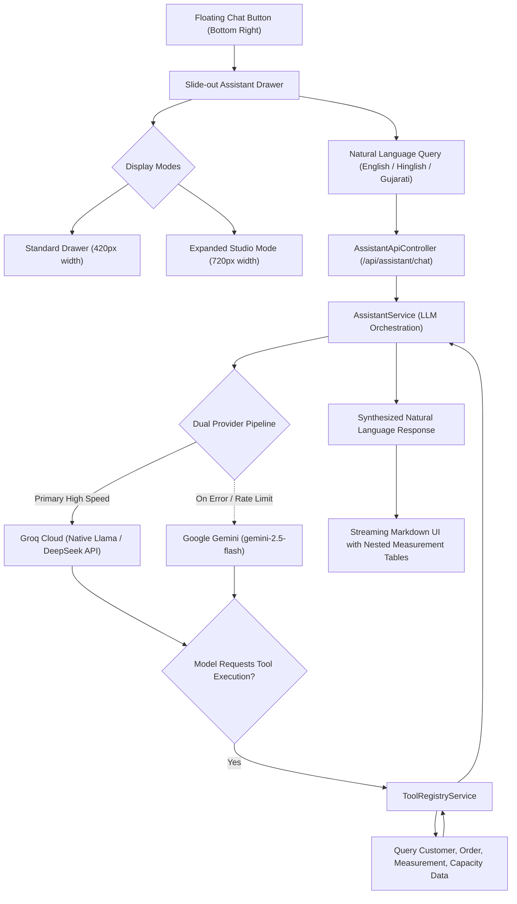
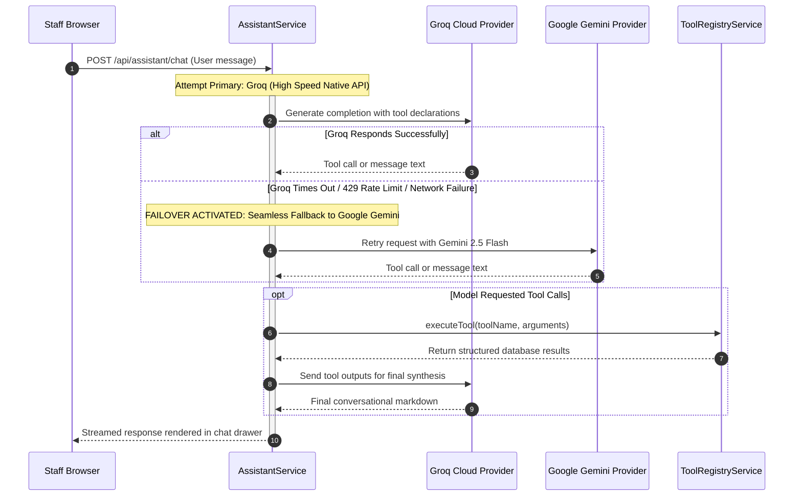

# Geetanjali Tailoring Studio: Studio AI Assistant & Dual-Engine Tool Calling Integration

> **Document Classification**: Deep Dive — In-App Conversational Intelligence & Tool Orchestration  
> **Authors**: Shubham Tankariya & Sumit Tailor  
> **Modules**: `com.geetanjali.backend.service.assistant.AssistantService`, `com.geetanjali.backend.service.assistant.ToolRegistryService`  

---

## 1. Architectural Motivation & UX Design Philosophy

Master tailors frequently operate with chalk-covered hands, fabric shears, or measuring tapes draped over their shoulders. In the middle of cutting or stitching, having to navigate through multiple menu hierarchies or type complex search queries slows down shop momentum.

To solve this, Geetanjali integrates a **Studio AI Assistant** engineered specifically for the tailoring domain:

### UI Features:
1. **Unobtrusive Circular Launcher**: A clean, themed floating button anchored at the bottom-right corner of every screen.
2. **Smooth Slide-Out Drawer**: Slides out from the right margin without refreshing or navigating away from the tailor's active work screen.
3. **Widescreen Expand Mode**: A dedicated maximize button expands the drawer from 420px to 720px wide, ideal for reviewing detailed multi-column nested measurement tables.
4. **Rich Markdown & Table-in-Table Rendering**: Formatted output highlights order numbers as clickable links, colorizes balance status, and formats garment measurements into clean bold tabular structures.

---

## 2. Dual-Provider LLM Fallback Pipeline

In a production tailor shop, an AI assistant cannot be incapacitated by third-party API downtime, network hiccups, or rate limits. Geetanjali implements a **resilient dual-provider pipeline**:

### Provider Responsibilities:
- **Primary Provider (Groq)**: Uses high-speed inference (sub-300ms time-to-first-token) via OpenAI-compatible REST endpoints. Configured for lightweight, lightning-fast order lookups and date calculations.
- **Secondary Provider (Google Gemini)**: Automatic fallback targeting `gemini-2.5-flash`. If Groq experiences rate limits or network issues, the conversation continues uninterrupted without user intervention.

---

## 3. Tool Registry & Executable Domain Tools

Rather than acting as a generic hallucinating chatbot, the assistant is empowered with **strongly-typed, read-only tools** registered in `ToolRegistryService`:

### 3.1. `lookupCustomer`
- **Purpose**: Search customer records by 10-digit mobile number or partial name.
- **Returns**: Customer ID, normalized phone number, full name, total historical order count, and registration date.
- **Example Tailor Query**: *"Is Ketan Tankariya registered and how many orders has he placed?"*

### 3.2. `getOrderDetails`
- **Purpose**: Retrieve the full operational and financial status of an order by order number or ID.
- **Returns**: Order number, customer name, list of garments, total bill, advance paid, current balance, and item completion status (`PENDING`, `DONE`, `DELIVERED`).
- **Example Tailor Query**: *"What is the balance pending on order ORD-202611-0004?"*

### 3.3. `checkDeliveryCapacity`
- **Purpose**: Evaluate tailor workload capacity and overbooking status for any given calendar date.
- **Returns**: Total garments scheduled, standard limit (5), overbooking threshold (5–9), hard cap (10), and capacity category (`GREEN`, `YELLOW`, `RED`).
- **Example Tailor Query**: *"Can we take 2 more shirts for delivery on this coming Friday?"*

### 3.4. `getCalendarSchedule`
- **Purpose**: Retrieve the production schedule for a specific day or entire month.
- **Returns**: Day-by-day item count, customer names, garment types, and top delivery days ranking.
- **Example Tailor Query**: *"Show me the delivery schedule for November 5th."*

### 3.5. `getGarmentMeasurements`
- **Purpose**: Retrieve the customer's dynamic measurement profile for a specific garment.
- **Returns**: Full anatomical parameter table (Collar, Chest, Waist, Length, Inseam, etc.) with values and units.
- **Example Tailor Query**: *"What were the trouser measurements for Ketan in his last order?"*

---

## 4. Privacy, Guardrails & Token Budget Management

To protect customer data and operate within optimal token limits:

1. **Strict Tailor-Domain System Prompt**:
   - The assistant's persona is locked strictly to a **professional studio assistant for Geetanjali Tailoring**.
   - It politely declines non-tailoring conversational queries (e.g. general trivia, coding homework, unrelated topics).
2. **Rolling Context Window**:
   - The conversation history is maintained in a rolling FIFO window of the **last 10 turns** (`ASSISTANT_ROLLING_WINDOW_SIZE = 10`), preventing token exhaustion during lengthy shop sessions.
3. **Data Minimization & Read-Only Safety**:
   - AI tools are strictly **read-only**. The assistant cannot modify order prices, delete customers, or bypass delivery blocks. All state mutations require human action through authenticated web forms.
4. **Bilingual Comprehension**:
   - The system prompt understands Indian tailoring vernacular, including terms such as *Kamar (waist)*, *Chhati (chest)*, *Lambai (length)*, *Zolo (rise)*, *Baki (balance)*, and *Advance*.
