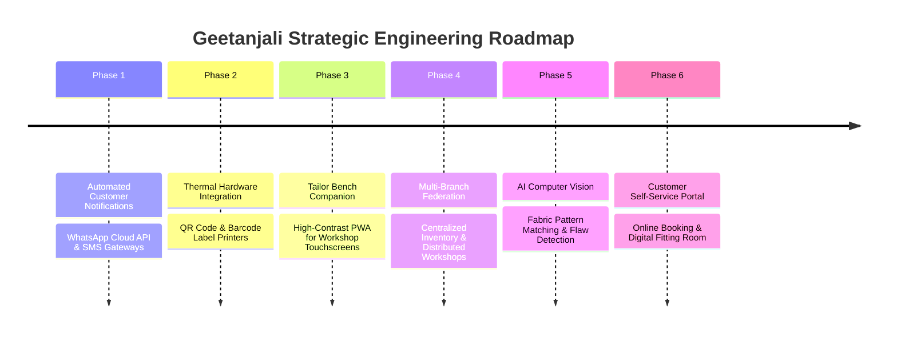

# Geetanjali Tailoring Studio: Future Roadmap & System Upgrades

> **Document Classification**: Evolutionary Architecture & Strategic Engineering Roadmap  
> **Authors**: Shubham Tankariya & Sumit Tailor  

---

## 1. Overview & Strategic Trajectory

While Geetanjali has successfully solved the core physical vulnerabilities of the bespoke tailoring workshop—eliminating lost measurement registers, establishing workload capacity protection, and implementing atomic payment accounting—the system's architecture is explicitly designed for forward expansion.

This document outlines the six-phase architectural roadmap planned for upcoming iterations:

---

## 2. Phase 1: Automated Customer Communication Gateway (WhatsApp & SMS)

### Problem Addressed:
Customers frequently call the shop multiple times to ask: *"Is my shirt ready?"* or *"How much balance is left?"* These phone interruptions disrupt cutting and sewing focus.

### Architecture & Technical Solution:
- Integrate the official **WhatsApp Business Cloud API** and a regional SMS Gateway (such as Twilio or Fast2SMS).
- Implement automated transactional webhooks triggered at critical lifecycle events:
  1. **Order Confirmation**: Instant WhatsApp message containing order number, item summary, promised delivery date, advance paid, and remaining balance.
  2. **Ready for Trial / Pickup Alert**: Triggered automatically when all order items reach status `DONE`.
  3. **Payment Receipt**: Instant acknowledgment of cash or UPI payments with an updated ledger summary.

---

## 3. Phase 2: Barcode & QR Code Tag Thermal Printing for Fabric Bundles

### Problem Addressed:
Paper slips pinned to uncut fabric bundles can detach during steam pressing and handling, causing fabric mix-ups.

### Architecture & Technical Solution:
- Connect network-enabled or USB **Thermal Label Printers** (e.g., Zebra or TSC 2-inch label printers) located adjacent to the cutting bench.
- When an order item is booked, the system generates an ESC/POS or PDF print stream producing a moisture-resistant fabric tag featuring:
  - 2D QR Code encoding `https://geetanjali.local/orders/{orderId}/items/{itemId}`
  - Order Number & Customer Name in high-contrast bold font
  - Garment Type & Key Measurements (Chest, Waist, Length)
- A quick barcode scan with a handheld scanner or phone camera instantly pulls up the garment's job card on screen.

---

## 4. Phase 3: Tailor Workshop Tablet / PWA Companion

### Problem Addressed:
Artisan tailors working on heavy sewing machines or pressing boards need touch-friendly interfaces with large tap targets that can be manipulated without a physical keyboard and mouse.

### Architecture & Technical Solution:
- Develop a lightweight **Progressive Web App (PWA)** optimized for 10-inch rugged Android tablets mounted at each tailor's workstation.
- Features:
  - Large, high-contrast buttons (*"Mark Done"*, *"Need Fabric Inspection"*).
  - Audio prompts in regional languages (e.g., chime on new rush delivery assigned).
  - Offline-first cache using Service Workers for localized resilience during momentary shop Wi-Fi outages.

---

## 5. Phase 4: Multi-Branch & Franchise Federation

### Problem Addressed:
Successful tailoring houses often expand from a single boutique into multiple showroom outlets with a centralized off-site cutting and stitching workshop.

### Architecture & Technical Solution:
- Extend the database schema to support **Multi-Tenancy and Multi-Branch Workspaces**:
  - `branches` entity (Showroom A, Showroom B, Central Workshop).
  - Route garment items to specialized tailors based on category (e.g., master coat maker vs. trouser specialist).
  - Unified Owner Dashboard providing real-time consolidated analytics across all shop locations.

---

## 6. Phase 5: AI Computer Vision for Fabric Pattern & Flaw Detection

### Problem Addressed:
Checkered or striped textiles require careful pattern alignment (plaid matching) along garment seams. Fabric flaws or stains in customer-supplied cloth can lead to disputes after cutting.

### Architecture & Technical Solution:
- Utilize phone camera inputs to capture full-length fabric photos at Step 3 of the booking wizard.
- Deploy an on-device computer vision model (e.g., TensorFlow Lite or Gemini Multimodal API) to:
  1. Inspect customer cloth for pre-existing fabric pulls, tears, or dye discolorations and flag them on the receipt.
  2. Analyze stripe and plaid repeat dimensions, assisting the master cutter with optimal fabric yardage utilization.

---

## 7. Phase 6: Customer Self-Service Portal & Digital Fitting Room

### Problem Addressed:
Elite clientele desire the convenience of checking their order progress, reviewing historical measurements, or booking appointment slots online without visiting the shop in person.

### Architecture & Technical Solution:
- Launch a lightweight customer-facing web portal:
  - Secure OTP login using the customer's registered 10-digit mobile number.
  - Interactive timeline showing real-time garment progress (Cutting &rarr; Stitching &rarr; Ironing &rarr; Ready for Pickup).
  - Online trial slot booking to avoid weekend showroom congestion.
  - Online balance settlement via UPI payment gateways (Razorpay / Cashfree) with automatic receipt generation.
