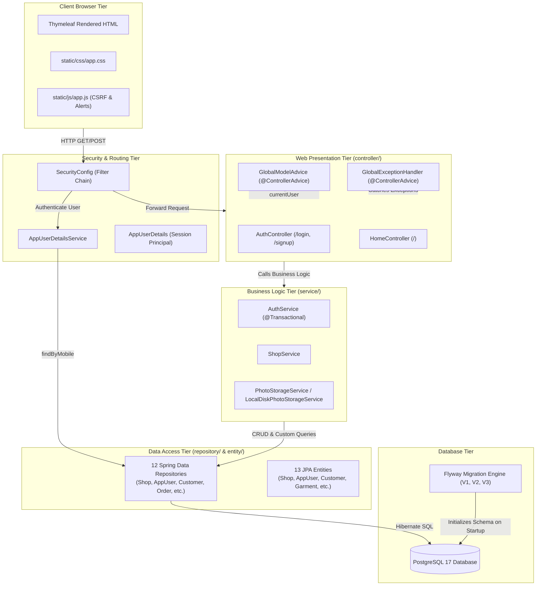
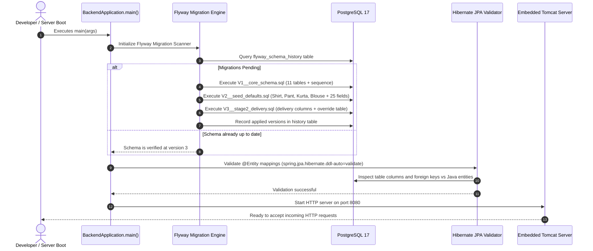
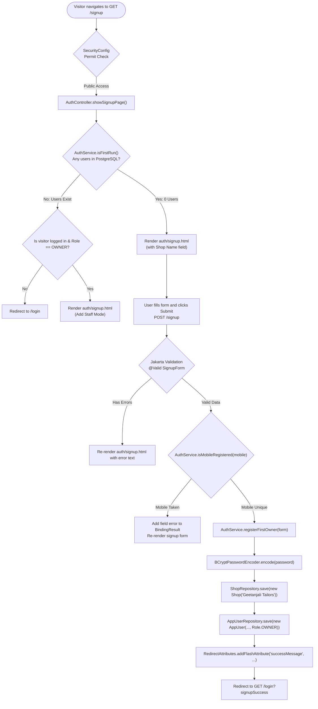
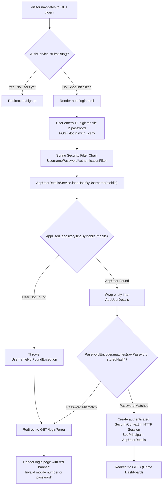
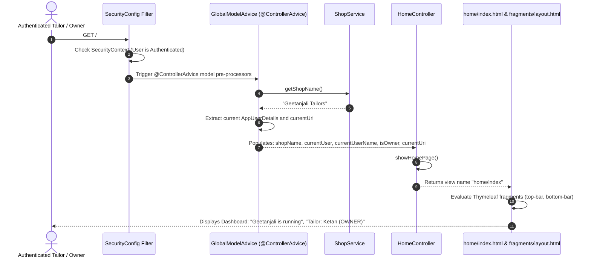
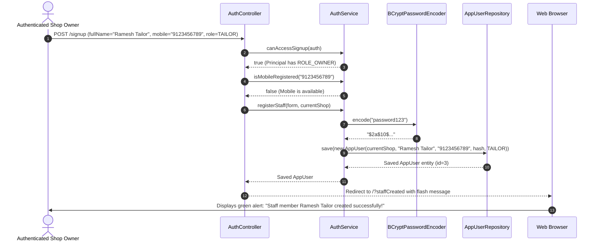
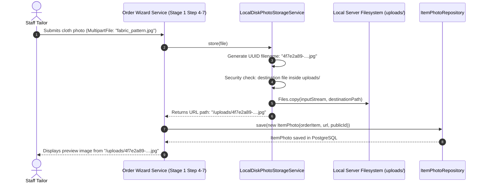
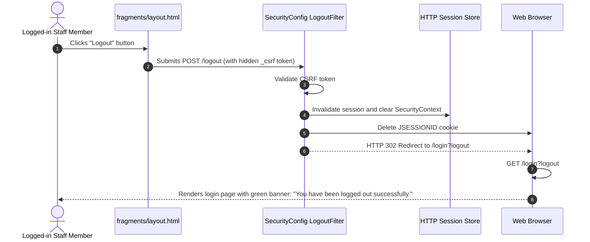

# Geetanjali Tailor Shop System — Exhaustive Architectural & Code Reference

> **Project Stage**: Stage 1, Step 1 (Shared Foundation Completed)  
> **Target App**: Geetanjali — Tailor Shop Management Web Application  
> **Stack**: Java 21, Spring Boot 4.1.1, Spring MVC + Thymeleaf, Spring Data JPA, PostgreSQL 17, Flyway 10, Spring Security 6, Jakarta Validation, Lombok, DevTools  
> **Base Package**: `com.geetanjali.backend`

### Master Reference Parts Index (Deep-Dive Edition)
* **[Part 1: Architecture, Core & Security](file:///home/shubham/storms/Projects/Geetanjali/docs/GEETANJALI_MASTER_REFERENCE_PART_1_ARCHITECTURE_AND_INFRASTRUCTURE.md)** — Project background, folder separation of concerns, core config, security filter chain, utilities, DTOs, enums, exceptions.
* **[Part 2: Entities & Repositories](file:///home/shubham/storms/Projects/Geetanjali/docs/GEETANJALI_MASTER_REFERENCE_PART_2_ENTITIES_AND_REPOSITORIES.md)** — All 13 JPA entities and 12 Spring Data JPA repositories with every field, constructor, getter, setter, equals/hashCode, and custom query method.
* **[Part 3: Services, Controllers & Views](file:///home/shubham/storms/Projects/Geetanjali/docs/GEETANJALI_MASTER_REFERENCE_PART_3_SERVICES_CONTROLLERS_AND_VIEWS.md)** — All services, controllers, advice interceptors, Flyway migrations, Thymeleaf templates, and static CSS/JS assets.
* **[Part 4: Comprehensive Flowcharts & Scenarios](file:///home/shubham/storms/Projects/Geetanjali/docs/GEETANJALI_MASTER_REFERENCE_PART_4_COMPREHENSIVE_FLOWCHARTS_AND_SCENARIOS.md)** — Complete visual sequence and flowcharts covering all 8 application scenarios and mapping every file in the project.

---

## 1. Directory Structure & Separation of Concerns

### Architecture Topology Map

---

### Folder Directory Rationale

| Directory Path | Real-Life Analogy | Responsibility & Rules | Interconnected With |
| :--- | :--- | :--- | :--- |
| **`config/`** | The tailor shop's electrical grid and physical building codes. | System-level configurations and `@Bean` definitions created during application bootup (Clock locked to Indian Standard Time, static file serving routes). | Connects to the Spring Framework container, Servlet environment, and filesystem. |
| **`security/`** | The security guard checking employee ID badges at the shop entrance. | Controls access to routes, verifies mobile number + password, hashes credentials with BCrypt, manages HTTP sessions, and enforces CSRF tokens. | Intercepts all incoming HTTP requests. Uses `AppUserRepository` and wraps `AppUser` into `AppUserDetails`. |
| **`controller/`** | The front-desk receptionist taking customer requests. | Receives HTTP requests, validates form inputs, invokes a **single** service method, and selects which HTML view to render or where to redirect. **Strict Rule**: Never queries database repositories directly. | Receives requests from Client; invokes `service/`; passes model data to `resources/templates/`. |
| **`controller/advice/`** | The shop assistant who hands every visitor a catalog + the emergency response team. | Global controller interceptors. `GlobalModelAdvice` automatically feeds the shop name and logged-in user into every page. `GlobalExceptionHandler` intercepts missing records or business errors and converts them to friendly user alerts. | Intercepts all controllers across the application; injects global attributes into templates. |
| **`controller/api/`** | The quick-order drive-thru window for instant data lookups. | Reserved for AJAX/REST endpoints that return JSON (e.g., instant mobile number lookup, dynamic measurement field fetching). | Called via asynchronous `fetch()` calls from `static/js/`. |
| **`service/`** | The master tailor who knows all shop rules, pricing, and measurements. | Houses business logic, multi-table transactions (`@Transactional`), validation calculations, and workflow rules. Ensures the database is never left in an inconsistent state. | Called by `controller/`; orchestrates calls to `repository/` and `service/storage/`. |
| **`service/storage/`** | The organized filing cabinet for cloth fabric photos and designs. | Decoupled interface (`PhotoStorageService`) for saving and deleting images. Currently stores files on local disk; can be swapped for AWS S3 or Cloudinary without altering controllers. | Called by `service/` during photo uploads; saves files to local `uploads/` directory. |
| **`entity/`** | The physical ledger books and order cards with exact column headings. | JPA classes that mirror PostgreSQL tables. Uses Jakarta Persistence annotations (`@Entity`, `@Table`, `@ManyToOne(fetch = LAZY)`). | Used by repositories, passed to services, and rendered by templates. |
| **`enums/`** | The official rubber stamp categories used by the shop. | Fixed set of typed constants (e.g., `Role`: `OWNER`, `TAILOR`). Stored as clean `VARCHAR` strings in PostgreSQL. | Used in `AppUser`, security role checks, and form validation DTOs. |
| **`repository/`** | The file clerk who knows how to quickly retrieve books from the archives. | Spring Data JPA interfaces that run SQL queries against PostgreSQL. Extends `JpaRepository`. Provides CRUD and derived queries. | Called strictly by `service/`; queries database tables. |
| **`dto/form/`** | The blank customer paper slips handed out to be filled in. | Data Transfer Objects (DTOs) that receive and validate user form input using Jakarta Validation (`@NotBlank`, `@Pattern`, `@Size`) before database entities are touched. | Bound in controllers; validated; passed to services. |
| **`dto/draft/`** | The tailor's temporary notepad for holding measurements during order creation. | Session-backed objects that hold multi-step order data across multiple wizard screens before committing to the database. | Used across order creation steps in session state. |
| **`exception/`** | The emergency alarm bells. | Custom unchecked exceptions (`RuntimeException`). When thrown inside `@Transactional`, Spring automatically rolls back database changes. | Thrown by `service/`; caught by `controller/advice/GlobalExceptionHandler`. |
| **`util/`** | The tailor's standard measuring tape and utility scissors. | Stateless static helper methods used across the application (e.g., Indian mobile number normalization and regex validation). | Used by DTOs, controllers, and services. |
| **`resources/db/migration/`** | The official architectural blueprints of the shop. | Flyway SQL migration scripts (`V1`, `V2`, `V3`). Run sequentially at startup to ensure database schema matches code perfectly. | Read by Flyway on startup to configure PostgreSQL. |
| **`resources/templates/`** | The printed paper receipts, display boards, and posters seen by people. | Thymeleaf HTML templates that dynamically render server-side data using `th:text`, `th:if`, and `th:replace`. | Rendered by Spring MVC and sent to client browser. |
| **`resources/static/`** | The paint on the walls and lighting in the showroom. | Static CSS stylesheets (`app.css`) and client-side JavaScript (`app.js`). | Loaded directly by the client browser. |

---

## 2. Exhaustive File & Function Reference

---

### Group A: Configuration Files (`config/`)

#### 1. [`BackendApplication.java`](file:///home/shubham/storms/Projects/Geetanjali/backend/src/main/java/com/geetanjali/backend/BackendApplication.java)
* **Real-Life Analogy**: The master power switch that turns on the shop's lights, unlocks the doors, powers up the cash register, and starts the day.
* **Class Responsibility**: Main entry point for the JVM. Boots Spring Boot, starts embedded Tomcat on port 8080, runs Flyway migrations, and configures Hibernate.
* **Functions**:
  * `public static void main(String[] args)`
    * **Parameters**: `args` (`String[]`) — Command-line arguments.
    * **In-built Functions Used**: `SpringApplication.run(BackendApplication.class, args)` — Scans package `com.geetanjali.backend`, configures application context, starts Tomcat.
    * **Returns**: `void` — Keeps the HTTP server running and listening.
    * **Destination / Flow**: JVM entry point; kicks off the entire application lifecycle.

#### 2. [`AppConfig.java`](file:///home/shubham/storms/Projects/Geetanjali/backend/src/main/java/com/geetanjali/backend/config/AppConfig.java)
* **Real-Life Analogy**: The master wall clock hung in the shop, fixed permanently to Indian Standard Time (IST), ensuring bills and delivery dates match local time even if the server is in UTC.
* **Class Responsibility**: Application configuration class providing singleton beans.
* **Variables / Injected Fields**:
  * `@Value("${app.timezone:Asia/Kolkata}") private String appTimezone` — Reads timezone property with fallback to `Asia/Kolkata`.
* **Functions**:
  * `public Clock clock()`
    * **Parameters**: None.
    * **In-built Functions Used**:
      * `ZoneId.of(appTimezone)` — Parses timezone string into a Java `ZoneId`.
      * `Clock.system(zoneId)` — Creates a system clock tied to that timezone.
    * **Why Used**: Cloud servers default to UTC. If a customer visits at 11:30 PM IST, UTC records the previous calendar date. Injecting `Clock` guarantees consistent IST dates.
    * **Returns**: `java.time.Clock` singleton bean.
    * **Destination / Flow**: Injected into `service/` classes to determine current dates (`LocalDate.now(clock)`).

#### 3. [`WebMvcConfig.java`](file:///home/shubham/storms/Projects/Geetanjali/backend/src/main/java/com/geetanjali/backend/config/WebMvcConfig.java)
* **Real-Life Analogy**: The delivery counter sign instructing visitors where to pick up their photos.
* **Class Responsibility**: Configures Spring MVC resource handlers to expose files in the local `uploads/` directory over HTTP at `/uploads/**`.
* **Variables / Injected Fields**:
  * `@Value("${app.upload-dir:uploads}") private String uploadDir` — Directory on disk where photos are stored.
* **Functions**:
  * `public void addResourceHandlers(ResourceHandlerRegistry registry)`
    * **Parameters**: `registry` (`ResourceHandlerRegistry`) — Spring MVC resource registry.
    * **In-built Functions Used**:
      * `Paths.get(uploadDir).toAbsolutePath().normalize()` — Resolves disk path safely.
      * `registry.addResourceHandler("/uploads/**").addResourceLocations("file:" + path + "/")` — Maps URL prefix to disk path.
    * **Returns**: `void`.
    * **Destination / Flow**: Configures Tomcat static file dispatcher so browser `` requests serve directly from disk.

---

### Group B: Security Layer (`security/`)

#### 4. [`SecurityConfig.java`](file:///home/shubham/storms/Projects/Geetanjali/backend/src/main/java/com/geetanjali/backend/security/SecurityConfig.java)
* **Real-Life Analogy**: The shop security protocol: who is allowed inside without an ID (login, signup, public CSS/JS) and who must present valid credentials.
* **Class Responsibility**: Configures the HTTP filter chain, form login (using mobile number as username), BCrypt password hashing, session cookies, and CSRF protection.
* **Functions**:
  * `public PasswordEncoder passwordEncoder()`
    * **Parameters**: None.
    * **In-built Functions Used**: `new BCryptPasswordEncoder()` — Instantiates one-way salted BCrypt hash generator.
    * **Returns**: `PasswordEncoder` singleton bean.
    * **Destination / Flow**: Injected into `AuthService` (for hashing passwords during signup) and Spring Security (for verifying passwords during login).
  * `public SecurityFilterChain filterChain(HttpSecurity http)`
    * **Parameters**: `http` (`HttpSecurity`) — Security filter builder.
    * **In-built Functions Used**:
      * `http.authorizeHttpRequests(...)` — Whitelists `/login`, `/signup`, `/css/**`, `/js/**`, `/uploads/**`, `/error`, and `DispatcherType.FORWARD/ERROR`. All other URLs require authentication.
      * `http.formLogin(...)` — Configures custom `/login` page, sets `.usernameParameter("mobile")`, `.passwordParameter("password")`, and `.defaultSuccessUrl("/", true)`.
      * `http.logout(...)` — Configures POST `/logout` with redirect to `/login?logout`.
      * `http.build()` — Compiles rules into the active security filter chain.
    * **Returns**: `SecurityFilterChain` bean.
    * **Destination / Flow**: Registers the filter chain with the servlet container to filter all incoming HTTP requests.

#### 5. [`AppUserDetails.java`](file:///home/shubham/storms/Projects/Geetanjali/backend/src/main/java/com/geetanjali/backend/security/AppUserDetails.java)
* **Real-Life Analogy**: The staff member's digital identity badge containing their name, assigned role, shop ID, and security clearance.
* **Class Responsibility**: Implements `UserDetails`. Wraps our [`AppUser`](file:///home/shubham/storms/Projects/Geetanjali/backend/src/main/java/com/geetanjali/backend/entity/AppUser.java) database entity so Spring Security can inspect credentials and roles.
* **Fields**:
  * `private final AppUser appUser` — The underlying database user entity.
* **Functions**:
  * `public AppUserDetails(AppUser appUser)` — Constructor wrapping the entity.
  * `public Collection<? extends GrantedAuthority> getAuthorities()`
    * **Parameters**: None.
    * **In-built Functions Used**: `Collections.singletonList(new SimpleGrantedAuthority("ROLE_" + appUser.getRole().name()))`.
    * **Returns**: `Collection<GrantedAuthority>` containing `ROLE_OWNER` or `ROLE_TAILOR`.
    * **Destination / Flow**: Used by Spring Security `@PreAuthorize` and `SecurityConfig` for authorization.
  * `public String getPassword()` — Returns `appUser.getPasswordHash()` to Spring Security for credential validation.
  * `public String getUsername()` — Returns `appUser.getMobile()`, establishing mobile number as username.
  * `public boolean isAccountNonExpired()`, `isAccountNonLocked()`, `isCredentialsNonExpired()`, `isEnabled()` — Return `true` (active accounts).
  * `public String getFullName()` — Returns user's full name (`String`) to controllers and templates.
  * `public Role getRole()` — Returns `Role` enum (`OWNER` or `TAILOR`).
  * `public Shop getShop()` — Returns user's assigned `Shop` entity.
  * `public AppUser getAppUser()` — Returns raw `AppUser` entity.

#### 6. [`AppUserDetailsService.java`](file:///home/shubham/storms/Projects/Geetanjali/backend/src/main/java/com/geetanjali/backend/security/AppUserDetailsService.java)
* **Real-Life Analogy**: The attendance ledger keeper who looks up a tailor's record when they give their mobile number at the door.
* **Class Responsibility**: Implements Spring Security's `UserDetailsService`. Called automatically during form login submission.
* **Injected Dependencies**:
  * `private final AppUserRepository appUserRepository`
* **Functions**:
  * `public AppUserDetailsService(AppUserRepository appUserRepository)` — Constructor injection.
  * `public UserDetails loadUserByUsername(String mobile)`
    * **Parameters**: `mobile` (`String`) — Entered mobile number.
    * **In-built Functions Used**: `appUserRepository.findByMobile(mobile).orElseThrow(...)`.
    * **Throws**: `UsernameNotFoundException` if mobile number is not found.
    * **Returns**: `UserDetails` (`AppUserDetails` instance).
    * **Destination / Flow**: Returned to Spring Security `DaoAuthenticationProvider`, which compares the submitted password against the stored BCrypt hash.

---

### Group C: Controllers & Advice (`controller/`, `controller/advice/`)

#### 7. [`GlobalModelAdvice.java`](file:///home/shubham/storms/Projects/Geetanjali/backend/src/main/java/com/geetanjali/backend/controller/advice/GlobalModelAdvice.java)
* **Real-Life Analogy**: The shop assistant who hands every customer a branded receipt header and checks their visitor badge before they view any display.
* **Class Responsibility**: Annotated with `@ControllerAdvice`. Injects common model variables into **every** Thymeleaf view template automatically.
* **Injected Dependencies**:
  * `private final ShopService shopService`
* **Functions**:
  * `public GlobalModelAdvice(ShopService shopService)` — Constructor injection.
  * `public String shopName()`
    * **Annotation**: `@ModelAttribute("shopName")`
    * **Parameters**: None.
    * **In-built Functions Used**: `shopService.getShopName()`.
    * **Returns**: `String` (e.g. `"Geetanjali Tailors"`) available as `${shopName}` in all templates.
  * `public AppUserDetails currentUser(@AuthenticationPrincipal AppUserDetails userDetails)`
    * **Annotation**: `@ModelAttribute("currentUser")`
    * **Parameters**: `userDetails` (`AppUserDetails`) — Automatically resolved by Spring Security.
    * **Returns**: `AppUserDetails` (or `null` if anonymous visitor) available as `${currentUser}`.
  * `public String currentUserName(@AuthenticationPrincipal AppUserDetails userDetails)`
    * **Annotation**: `@ModelAttribute("currentUserName")`
    * **Parameters**: `userDetails` (`AppUserDetails`).
    * **Returns**: Full name string or empty string `""` available as `${currentUserName}`.
  * `public boolean isOwner(@AuthenticationPrincipal AppUserDetails userDetails)`
    * **Annotation**: `@ModelAttribute("isOwner")`
    * **Parameters**: `userDetails` (`AppUserDetails`).
    * **Returns**: `boolean` (`true` if logged in and role is `Role.OWNER`) available as `${isOwner}`.
  * `public String currentUri(HttpServletRequest request)`
    * **Annotation**: `@ModelAttribute("currentUri")`
    * **Parameters**: `request` (`HttpServletRequest`).
    * **In-built Functions Used**: `request.getRequestURI()`.
    * **Returns**: Current request path (`String`, e.g. `"/customers"`) available as `${currentUri}` for navbar highlighting.

#### 8. [`GlobalExceptionHandler.java`](file:///home/shubham/storms/Projects/Geetanjali/backend/src/main/java/com/geetanjali/backend/controller/advice/GlobalExceptionHandler.java)
* **Real-Life Analogy**: The store manager who steps in when something goes missing or an invalid action occurs, keeping the shop running smoothly.
* **Class Responsibility**: Annotated with `@ControllerAdvice`. Catches unhandled exceptions thrown across all controllers.
* **Functions**:
  * `public String handleResourceNotFound(ResourceNotFoundException ex, Model model)`
    * **Annotations**: `@ExceptionHandler(ResourceNotFoundException.class)`, `@ResponseStatus(HttpStatus.NOT_FOUND)`
    * **Parameters**: `ex` (`ResourceNotFoundException`), `model` (`Model`).
    * **In-built Functions Used**: `model.addAttribute("errorMessage", ex.getMessage())`.
    * **Returns**: `String` view name `"error/404"`, rendering `404.html` with HTTP status 404.
  * `public String handleBusinessRule(BusinessRuleException ex, HttpServletRequest request, RedirectAttributes redirectAttributes)`
    * **Annotations**: `@ExceptionHandler(BusinessRuleException.class)`
    * **Parameters**: `ex` (`BusinessRuleException`), `request` (`HttpServletRequest`), `redirectAttributes` (`RedirectAttributes`).
    * **In-built Functions Used**:
      * `redirectAttributes.addFlashAttribute("errorMessage", ex.getMessage())` — Stores error banner in session for one redirect.
      * `request.getHeader("Referer")` — Reads previous page URL from HTTP request header.
    * **Returns**: `String` redirect instruction `"redirect:" + referer` (or `"redirect:/"` if referer missing).
    * **Destination / Flow**: Browser redirects back to previous page; `fragments/layout.html` displays red error banner.

#### 9. [`AuthController.java`](file:///home/shubham/storms/Projects/Geetanjali/backend/src/main/java/com/geetanjali/backend/controller/AuthController.java)
* **Real-Life Analogy**: The front-desk receptionist managing staff sign-in and initial shop owner registration.
* **Class Responsibility**: Handles GET/POST web endpoints for `/login` and `/signup`. Completely decoupled from repositories (strictly uses `AuthService` and `ShopService`).
* **Injected Dependencies**:
  * `private final AuthService authService`
  * `private final ShopService shopService`
* **Functions**:
  * `public AuthController(AuthService authService, ShopService shopService)` — Constructor injection.
  * `public String showLoginPage(Authentication auth, String error, String logout, String signupSuccess, Model model)`
    * **Annotation**: `@GetMapping("/login")`
    * **Parameters**:
      * `auth` (`Authentication`) — Injected security principal.
      * `error`, `logout`, `signupSuccess` (`@RequestParam(required=false) String`) — Query parameters.
      * `model` (`Model`) — View data container.
    * **Flow & Logic**:
      * If `authService.isFirstRun()` -> returns `"redirect:/signup"`.
      * If already authenticated -> returns `"redirect:/"`.
      * If `error != null` -> adds `loginError` to model.
      * If `logout != null` -> adds `logoutMessage` to model.
      * If `signupSuccess != null` -> adds `successMessage` to model.
    * **Returns**: `"auth/login"` template view name.
  * `public String showSignupPage(Authentication auth, Model model)`
    * **Annotation**: `@GetMapping("/signup")`
    * **Parameters**: `auth` (`Authentication`), `model` (`Model`).
    * **Flow & Logic**:
      * Checks `authService.canAccessSignup(auth)`. If false, returns `"redirect:/login"`.
      * Checks `authService.isFirstRun()` and sets `isFirstRun` boolean on model.
      * Pre-populates empty `SignupForm` with current shop name if first run.
    * **Returns**: `"auth/signup"` template view name.
  * `public String handleSignup(SignupForm form, BindingResult bindingResult, Authentication auth, Model model, RedirectAttributes redirectAttributes)`
    * **Annotation**: `@PostMapping("/signup")`
    * **Parameters**:
      * `form` (`@Valid @ModelAttribute("signupForm") SignupForm`) — Submitted form data.
      * `bindingResult` (`BindingResult`) — Validation errors holder.
      * `auth` (`Authentication`), `model` (`Model`), `redirectAttributes` (`RedirectAttributes`).
    * **Flow & Logic**:
      * Verifies access via `authService.canAccessSignup(auth)`. If forbidden, returns `"redirect:/login"`.
      * Checks duplicate mobile via `authService.isMobileRegistered(form.getMobile())`. If duplicate, adds field error to `bindingResult`.
      * If `bindingResult.hasErrors()` -> returns `"auth/signup"`.
      * If first run: calls `authService.registerFirstOwner(form)` and redirects to `"redirect:/login?signupSuccess"`.
      * If adding staff: extracts current shop from `auth`, calls `authService.registerStaff(form, shop)`, and redirects to `"redirect:/?staffCreated"`.
    * **Returns**: Redirect string or template path.

#### 10. [`HomeController.java`](file:///home/shubham/storms/Projects/Geetanjali/backend/src/main/java/com/geetanjali/backend/controller/HomeController.java)
* **Real-Life Analogy**: The shop's main showroom lobby.
* **Class Responsibility**: Thin controller handling `GET /`.
* **Functions**:
  * `public String showHomePage()`
    * **Annotation**: `@GetMapping("/")`
    * **Parameters**: None.
    * **Returns**: `"home/index"` template view name.
    * **Destination / Flow**: Renders `home/index.html` dashboard with global data injected by `GlobalModelAdvice`.

---

### Group D: Service Layer (`service/`, `service/storage/`)

#### 11. [`AuthService.java`](file:///home/shubham/storms/Projects/Geetanjali/backend/src/main/java/com/geetanjali/backend/service/AuthService.java)
* **Real-Life Analogy**: The business office manager who checks identity documents, encrypts contracts, and officially registers employees.
* **Class Responsibility**: Core business rules for account creation, role checks, password hashing, and first-run detection.
* **Injected Dependencies**:
  * `private final AppUserRepository appUserRepository`
  * `private final ShopRepository shopRepository`
  * `private final PasswordEncoder passwordEncoder`
* **Functions**:
  * `public AuthService(AppUserRepository appUserRepository, ShopRepository shopRepository, PasswordEncoder passwordEncoder)` — Constructor injection.
  * `public boolean isFirstRun()`
    * **Parameters**: None.
    * **In-built Functions Used**: `appUserRepository.count() == 0`.
    * **Returns**: `boolean` (`true` if database has 0 users).
    * **Destination / Flow**: Called by `AuthController` to determine whether initial owner setup is required.
  * `public boolean isMobileRegistered(String mobile)`
    * **Parameters**: `mobile` (`String`).
    * **In-built Functions Used**: `appUserRepository.existsByMobile(mobile)`.
    * **Returns**: `boolean` (`true` if mobile exists in PostgreSQL).
    * **Destination / Flow**: Called by `AuthController.handleSignup` to reject duplicate mobile numbers.
  * `public boolean canAccessSignup(Authentication auth)`
    * **Parameters**: `auth` (`Authentication`).
    * **Flow & Logic**:
      * If `isFirstRun()` -> returns `true` (public setup allowed).
      * If `auth == null` or not authenticated -> returns `false`.
      * Iterates `auth.getAuthorities()`. If any equals `"ROLE_OWNER"` -> returns `true`.
      * Otherwise -> returns `false`.
    * **Returns**: `boolean`.
    * **Destination / Flow**: Called by `AuthController` to guard `/signup` GET and POST routes.
  * `public AppUser registerFirstOwner(SignupForm form)`
    * **Annotation**: `@Transactional` (atomic database commit; rolls back on error).
    * **Parameters**: `form` (`SignupForm`) — Form submission data.
    * **Flow & Logic**:
      * Checks if `shopRepository.findAll()` has an existing shop. If empty, creates new `Shop("Geetanjali Tailors")` and saves it.
      * Hashes plain password using `passwordEncoder.encode(form.getPassword())`.
      * Creates new `AppUser` with `shop`, `fullName`, `mobile`, `passwordHash`, and `Role.OWNER`.
      * Saves and returns the owner user.
    * **Returns**: `AppUser` entity.
    * **Destination / Flow**: Called by `AuthController.handleSignup`.
  * `public AppUser registerStaff(SignupForm form, Shop currentShop)`
    * **Annotation**: `@Transactional`.
    * **Parameters**: `form` (`SignupForm`), `currentShop` (`Shop`).
    * **Flow & Logic**:
      * Determines role (uses `form.getRole()` or defaults to `Role.TAILOR`).
      * Hashes password using `passwordEncoder.encode(form.getPassword())`.
      * Creates new `AppUser` attached to `currentShop`.
      * Saves and returns the new staff user.
    * **Returns**: `AppUser` entity.
    * **Destination / Flow**: Called by `AuthController.handleSignup` when authenticated owner adds a tailor.

#### 12. [`ShopService.java`](file:///home/shubham/storms/Projects/Geetanjali/backend/src/main/java/com/geetanjali/backend/service/ShopService.java)
* **Real-Life Analogy**: The shop information desk providing the shop name and store profile.
* **Class Responsibility**: Queries and provides primary shop information.
* **Injected Dependencies**:
  * `private final ShopRepository shopRepository`
* **Functions**:
  * `public ShopService(ShopRepository shopRepository)` — Constructor injection.
  * `public Shop getPrimaryShop()`
    * **Parameters**: None.
    * **In-built Functions Used**: `shopRepository.findAll()`.
    * **Returns**: `Shop` entity or `null` if database is uninitialized.
    * **Destination / Flow**: Called by `ShopService.getShopName()` and controllers.
  * `public String getShopName()`
    * **Parameters**: None.
    * **In-built Functions Used**: `getPrimaryShop()`.
    * **Returns**: `String` — Shop name from database (e.g. `"Geetanjali Tailors"`), or fallback `"Geetanjali Tailors"` if uninitialized.
    * **Destination / Flow**: Injected into every Thymeleaf template via `GlobalModelAdvice`.

#### 13. [`PhotoStorageService.java`](file:///home/shubham/storms/Projects/Geetanjali/backend/src/main/java/com/geetanjali/backend/service/storage/PhotoStorageService.java)
* **Real-Life Analogy**: The contract defining how cloth photos are stored and retrieved, regardless of whether they are kept in a local physical cabinet or an offsite cloud vault.
* **Class Responsibility**: Interface abstracting file storage operations to allow future swapping with Cloudinary/S3.
* **Methods**:
  * `String store(MultipartFile file)` — Saves uploaded file and returns web URL string.
  * `void delete(String identifier)` — Deletes photo by URL or file ID.

#### 14. [`LocalDiskPhotoStorageService.java`](file:///home/shubham/storms/Projects/Geetanjali/backend/src/main/java/com/geetanjali/backend/service/storage/LocalDiskPhotoStorageService.java)
* **Real-Life Analogy**: The local file folder storage system on the shop computer.
* **Class Responsibility**: Implements `PhotoStorageService` by writing uploaded files to disk under the `uploads/` directory with collision-free UUID filenames.
* **Fields**:
  * `private final Path rootLocation` — Absolute disk path for `uploads/`.
* **Functions**:
  * `public LocalDiskPhotoStorageService(@Value("${app.upload-dir:uploads}") String uploadDir)`
    * **Parameters**: `uploadDir` (`String`).
    * **In-built Functions Used**: `Paths.get(uploadDir).toAbsolutePath().normalize()`, `Files.createDirectories(...)`.
    * **Returns**: Instantiated service bean.
  * `public String store(MultipartFile file)`
    * **Parameters**: `file` (`MultipartFile`) — Uploaded binary file.
    * **In-built Functions Used**:
      * `UUID.randomUUID().toString()` — Generates unique collision-free filename.
      * `destinationFile.getParent().equals(this.rootLocation)` — Guard against path traversal attacks.
      * `Files.copy(file.getInputStream(), destinationFile, StandardCopyOption.REPLACE_EXISTING)` — Writes file to disk.
    * **Throws**: `IllegalArgumentException` if file is empty; `SecurityException` if path traversal detected; `RuntimeException` on IO error.
    * **Returns**: `String` URL path (e.g. `"/uploads/9b1deb4d-3b7d-4bad-9bdd-2b0d7b3dcb6d.jpg"`).
    * **Destination / Flow**: Called when customer cloth photos are uploaded in order wizard.
  * `public void delete(String identifier)`
    * **Parameters**: `identifier` (`String`) — File path or URL.
    * **In-built Functions Used**: `Files.deleteIfExists(path)`.
    * **Returns**: `void`.
    * **Destination / Flow**: Called when order items or photos are deleted.

---

### Group E: Utilities, DTOs & Exceptions (`util/`, `dto/form/`, `exception/`, `enums/`)

#### 15. [`PhoneNumbers.java`](file:///home/shubham/storms/Projects/Geetanjali/backend/src/main/java/com/geetanjali/backend/util/PhoneNumbers.java)
* **Real-Life Analogy**: A standardizing rubber stamp that strips spaces, dashes, +91 country codes, and leading zeros, converting any handwritten mobile into clean 10 digits.
* **Class Responsibility**: Pure static utility for normalizing and validating Indian mobile numbers.
* **Functions**:
  * `public static String normalize(String raw)`
    * **Parameters**: `raw` (`String`) — Raw mobile input.
    * **In-built Functions Used**:
      * `raw.replaceAll("[\\s\\-]", "")` — Strips spaces and dashes.
      * `cleaned.startsWith("+91")` / `cleaned.startsWith("91")` — Strips India country code.
      * `cleaned.startsWith("0")` — Strips trunk zero.
      * `cleaned.replaceAll("[^0-9]", "")` — Strips non-digits.
      * `cleaned.substring(cleaned.length() - 10)` — Retains last 10 digits if longer.
    * **Returns**: Clean 10-digit `String` or `""` if blank.
    * **Destination / Flow**: Used before saving mobile numbers into database entities.
  * `public static boolean isValid(String phone)`
    * **Parameters**: `phone` (`String`).
    * **In-built Functions Used**: `phone.matches("^[6-9][0-9]{9}$")`.
    * **Returns**: `boolean` (`true` if valid Indian mobile starting with 6, 7, 8, or 9).
    * **Destination / Flow**: Used in form validations and customer lookup APIs.

#### 16. [`SignupForm.java`](file:///home/shubham/storms/Projects/Geetanjali/backend/src/main/java/com/geetanjali/backend/dto/form/SignupForm.java)
* **Real-Life Analogy**: The blank paper signup sheet given to a new owner or staff member to fill out.
* **Class Responsibility**: Form backing object (DTO) capturing signup input with validation annotations.
* **Fields & Validations**:
  * `private String shopName`
  * `@NotBlank(message = "Full name is required") @Size(min = 2, max = 100) private String fullName`
  * `@NotBlank(message = "Mobile number is required") @Pattern(regexp = "^[0-9]{10}$") private String mobile`
  * `@NotBlank(message = "Password is required") @Size(min = 4, max = 50) private String password`
  * `private Role role = Role.OWNER`
* **Functions**:
  * `public SignupForm()`, `public SignupForm(shopName, fullName, mobile, password, role)` — Constructors.
  * Standard Getters & Setters for all 5 fields (`getShopName()`, `setShopName()`, etc.).

#### 17. [`ResourceNotFoundException.java`](file:///home/shubham/storms/Projects/Geetanjali/backend/src/main/java/com/geetanjali/backend/exception/ResourceNotFoundException.java)
* **Real-Life Analogy**: A red note stating: *"The requested customer record or garment file could not be found."*
* **Class Responsibility**: Unchecked exception (`extends RuntimeException`) thrown when a requested database entity does not exist.
* **Functions**:
  * `public ResourceNotFoundException(String message)` — Constructor passing message to `super(message)`.
* **Destination / Flow**: Caught by `GlobalExceptionHandler.handleResourceNotFound()`, which renders `error/404.html`.

#### 18. [`BusinessRuleException.java`](file:///home/shubham/storms/Projects/Geetanjali/backend/src/main/java/com/geetanjali/backend/exception/BusinessRuleException.java)
* **Real-Life Analogy**: A warning bell stating: *"Cannot mark this suit as delivered because the customer still has an unpaid balance."*
* **Class Responsibility**: Unchecked exception (`extends RuntimeException`) thrown when a domain business rule is violated. Automatically rolls back active `@Transactional` boundaries.
* **Functions**:
  * `public BusinessRuleException(String message)` — Constructor passing message to `super(message)`.
* **Destination / Flow**: Caught by `GlobalExceptionHandler.handleBusinessRule()`, which adds a flash attribute and redirects back to the referer URL.

#### 19. [`Role.java`](file:///home/shubham/storms/Projects/Geetanjali/backend/src/main/java/com/geetanjali/backend/enums/Role.java)
* **Real-Life Analogy**: The official roles in the shop: Owner vs Tailor.
* **Class Responsibility**: Java Enum defining user authorization levels:
  * `OWNER` — Full access (shop configuration, adding tailors, financial overrides).
  * `TAILOR` — Operational access (recording measurements, creating orders, updating status).

---

### Group F: JPA Database Entities (`entity/`)

All entities represent PostgreSQL tables managed by Flyway.

#### 20. [`Shop.java`](file:///home/shubham/storms/Projects/Geetanjali/backend/src/main/java/com/geetanjali/backend/entity/Shop.java)
* **Table**: `shop`
* **Real-Life Analogy**: The tailor shop enterprise record.
* **Fields**:
  * `@Id @GeneratedValue(strategy = IDENTITY) private Long id`
  * `@Column(name = "name", nullable = false) private String name`
* **Functions**: Default constructor, `Shop(String name)` constructor, `getId()`, `setId(Long)`, `getName()`, `setName(String)`.

#### 21. [`AppUser.java`](file:///home/shubham/storms/Projects/Geetanjali/backend/src/main/java/com/geetanjali/backend/entity/AppUser.java)
* **Table**: `app_user`
* **Real-Life Analogy**: An employee profile ledger row.
* **Fields**:
  * `@Id @GeneratedValue(strategy = IDENTITY) private Long id`
  * `@ManyToOne(fetch = LAZY) @JoinColumn(name = "shop_id", nullable = false) private Shop shop`
  * `@Column(name = "full_name", nullable = false) private String fullName`
  * `@Column(name = "mobile", nullable = false, unique = true) private String mobile`
  * `@Column(name = "password_hash", nullable = false) private String passwordHash`
  * `@Enumerated(STRING) @Column(name = "role", nullable = false) private Role role`
* **Functions**: Default constructor, full parameterized constructor, standard getters and setters for all 6 fields.

#### 22. [`Customer.java`](file:///home/shubham/storms/Projects/Geetanjali/backend/src/main/java/com/geetanjali/backend/entity/Customer.java)
* **Table**: `customer`
* **Real-Life Analogy**: A customer's record card in the shop database.
* **Fields**:
  * `@Id @GeneratedValue(strategy = IDENTITY) private Long id`
  * `@Column(name = "name", nullable = false) private String name`
  * `@Column(name = "mobile", nullable = false, unique = true) private String mobile`
* **Functions**: Default constructor, `Customer(String name, String mobile)` constructor, `getId()`, `setId(Long)`, `getName()`, `setName(String)`, `getMobile()`, `setMobile(String)`.

#### 23. [`Garment.java`](file:///home/shubham/storms/Projects/Geetanjali/backend/src/main/java/com/geetanjali/backend/entity/Garment.java)
* **Table**: `garment`
* **Real-Life Analogy**: The catalog entry for a stitchable clothing category (e.g. Shirt, Pant, Kurta, Blouse).
* **Fields**:
  * `@Id @GeneratedValue(strategy = IDENTITY) private Long id`
  * `@Column(name = "name", nullable = false, unique = true) private String name`
  * `@Column(name = "sort_order", nullable = false) private Integer sortOrder = 0`
  * `@Column(name = "active", nullable = false) private Boolean active = true`
* **Functions**: Default constructor, `Garment(name, sortOrder, active)` constructor, standard getters and setters for all 4 fields.

#### 24. [`GarmentField.java`](file:///home/shubham/storms/Projects/Geetanjali/backend/src/main/java/com/geetanjali/backend/entity/GarmentField.java)
* **Table**: `garment_field`
* **Real-Life Analogy**: A specific measurement input box on a garment's pattern sheet (e.g. "Chest", "Waist", "Length" with unit "inch").
* **Fields**:
  * `@Id @GeneratedValue(strategy = IDENTITY) private Long id`
  * `@ManyToOne(fetch = LAZY) @JoinColumn(name = "garment_id", nullable = false) private Garment garment`
  * `@Column(name = "label", nullable = false) private String label`
  * `@Column(name = "unit", nullable = false) private String unit = "inch"`
  * `@Column(name = "sort_order", nullable = false) private Integer sortOrder = 0`
  * `@Column(name = "active", nullable = false) private Boolean active = true`
* **Functions**: Default constructor, full parameterized constructor, standard getters and setters for all 6 fields.

#### 25. [`Measurement.java`](file:///home/shubham/storms/Projects/Geetanjali/backend/src/main/java/com/geetanjali/backend/entity/Measurement.java)
* **Table**: `measurement`
* **Real-Life Analogy**: The dated measurement session header taken for a customer (e.g. "Ramesh's measurements for Shirt taken on Oct 12").
* **Fields**:
  * `@Id @GeneratedValue(strategy = IDENTITY) private Long id`
  * `@ManyToOne(fetch = LAZY) @JoinColumn(name = "customer_id", nullable = false) private Customer customer`
  * `@ManyToOne(fetch = LAZY) @JoinColumn(name = "garment_id", nullable = false) private Garment garment`
  * `@Column(name = "created_at", nullable = false) private Instant createdAt = Instant.now()`
* **Functions**: Default constructor, `Measurement(customer, garment, createdAt)` constructor, standard getters and setters for all 4 fields.

#### 26. [`MeasurementValueId.java`](file:///home/shubham/storms/Projects/Geetanjali/backend/src/main/java/com/geetanjali/backend/entity/MeasurementValueId.java)
* **Table**: Composite Key for `measurement_value`
* **Real-Life Analogy**: The pair of tags identifying a measurement: (Session #12, Field "Chest").
* **Class Responsibility**: Implements `Serializable`. Annotated with `@Embeddable`.
* **Fields**:
  * `@Column(name = "measurement_id") private Long measurementId`
  * `@Column(name = "field_id") private Long fieldId`
* **Functions**:
  * Default constructor, `MeasurementValueId(Long measurementId, Long fieldId)` constructor.
  * Getters and setters for `measurementId` and `fieldId`.
  * `public boolean equals(Object o)` — Implements value equality across both IDs.
  * `public int hashCode()` — Computes consistent hash using `Objects.hash(measurementId, fieldId)`.

#### 27. [`MeasurementValue.java`](file:///home/shubham/storms/Projects/Geetanjali/backend/src/main/java/com/geetanjali/backend/entity/MeasurementValue.java)
* **Table**: `measurement_value`
* **Real-Life Analogy**: The actual recorded numeric measurement (e.g. "Chest = 40.5 inches").
* **Fields**:
  * `@EmbeddedId private MeasurementValueId id = new MeasurementValueId()`
  * `@ManyToOne(fetch = LAZY) @MapsId("measurementId") @JoinColumn(name = "measurement_id") private Measurement measurement`
  * `@ManyToOne(fetch = LAZY) @MapsId("fieldId") @JoinColumn(name = "field_id") private GarmentField field`
  * `@Column(name = "value", nullable = false) private BigDecimal value`
* **Functions**:
  * Default constructor, `MeasurementValue(Measurement, GarmentField, BigDecimal)` constructor.
  * Getters and setters for `id`, `measurement`, `field`, and `value`. Automatically syncs composite key fields.

#### 28. [`CustomerOrder.java`](file:///home/shubham/storms/Projects/Geetanjali/backend/src/main/java/com/geetanjali/backend/entity/CustomerOrder.java)
* **Table**: `customer_order`
* **Real-Life Analogy**: The official paper bill or order jacket tying together items, customer details, and payment ledgers.
* **Fields**:
  * `@Id @GeneratedValue(strategy = IDENTITY) private Long id`
  * `@Column(name = "order_no", nullable = false, unique = true) private Long orderNo`
  * `@ManyToOne(fetch = LAZY) @JoinColumn(name = "customer_id", nullable = false) private Customer customer`
  * `@ManyToOne(fetch = LAZY) @JoinColumn(name = "created_by", nullable = false) private AppUser createdBy`
  * `@Column(name = "created_at", nullable = false) private Instant createdAt = Instant.now()`
* **Functions**: Default constructor, full parameterized constructor, standard getters and setters for all 5 fields.

#### 29. [`OrderItem.java`](file:///home/shubham/storms/Projects/Geetanjali/backend/src/main/java/com/geetanjali/backend/entity/OrderItem.java)
* **Table**: `order_item`
* **Real-Life Analogy**: One specific garment to be stitched within an order (e.g. 1 Slim Fit Shirt, delivery on Friday, price ₹450).
* **Fields**:
  * `@Id @GeneratedValue(strategy = IDENTITY) private Long id`
  * `@ManyToOne(fetch = LAZY) @JoinColumn(name = "order_id", nullable = false) private CustomerOrder order`
  * `@ManyToOne(fetch = LAZY) @JoinColumn(name = "garment_id", nullable = false) private Garment garment`
  * `@ManyToOne(fetch = LAZY) @JoinColumn(name = "measurement_id") private Measurement measurement` (nullable)
  * `@Column(name = "notes") private String notes`
  * `@Column(name = "price", nullable = false) private BigDecimal price`
  * `@Column(name = "delivery_date", nullable = false) private LocalDate deliveryDate`
  * `@Column(name = "status", nullable = false) private String status = "PENDING"`
  * `@Column(name = "done_at") private Instant doneAt`
  * `@Column(name = "delivered_at") private Instant deliveredAt`
* **Functions**: Default constructor, full parameterized constructor, standard getters and setters for all 10 fields.

#### 30. [`ItemPhoto.java`](file:///home/shubham/storms/Projects/Geetanjali/backend/src/main/java/com/geetanjali/backend/entity/ItemPhoto.java)
* **Table**: `item_photo`
* **Real-Life Analogy**: A printed photo of the customer's cloth or design pattern stapled to their order slip.
* **Fields**:
  * `@Id @GeneratedValue(strategy = IDENTITY) private Long id`
  * `@ManyToOne(fetch = LAZY) @JoinColumn(name = "order_item_id", nullable = false) private OrderItem orderItem`
  * `@Column(name = "url", nullable = false) private String url`
  * `@Column(name = "public_id") private String publicId`
* **Functions**: Default constructor, `ItemPhoto(orderItem, url, publicId)` constructor, standard getters and setters for all 4 fields.

#### 31. [`Payment.java`](file:///home/shubham/storms/Projects/Geetanjali/backend/src/main/java/com/geetanjali/backend/entity/Payment.java)
* **Table**: `payment`
* **Real-Life Analogy**: A cash or UPI receipt voucher logged in the cash drawer against an order.
* **Fields**:
  * `@Id @GeneratedValue(strategy = IDENTITY) private Long id`
  * `@ManyToOne(fetch = LAZY) @JoinColumn(name = "order_id", nullable = false) private CustomerOrder order`
  * `@Column(name = "amount", nullable = false) private BigDecimal amount`
  * `@Column(name = "mode", nullable = false) private String mode` (e.g. "CASH", "UPI", "CARD")
  * `@Column(name = "paid_on", nullable = false) private LocalDate paidOn = LocalDate.now()`
* **Functions**: Default constructor, full parameterized constructor, standard getters and setters for all 5 fields.

#### 32. [`DeliveryOverride.java`](file:///home/shubham/storms/Projects/Geetanjali/backend/src/main/java/com/geetanjali/backend/entity/DeliveryOverride.java)
* **Table**: `delivery_override`
* **Real-Life Analogy**: An audit ledger entry recording when a customer was allowed to take clothes without full payment (e.g. trusted neighbor).
* **Fields**:
  * `@Id @GeneratedValue(strategy = IDENTITY) private Long id`
  * `@ManyToOne(fetch = LAZY) @JoinColumn(name = "order_item_id", nullable = false) private OrderItem orderItem`
  * `@Column(name = "balance_at_time", nullable = false) private BigDecimal balanceAtTime`
  * `@Column(name = "reason", nullable = false) private String reason`
  * `@ManyToOne(fetch = LAZY) @JoinColumn(name = "overridden_by", nullable = false) private AppUser overriddenBy`
* **Functions**: Default constructor, full parameterized constructor, standard getters and setters for all 5 fields.

---

### Group G: Repositories (`repository/`)

All repositories extend Spring Data JPA's `JpaRepository<Entity, ID>`.

| # | Repository Interface | Target Entity | Custom Query Methods & Signatures |
| :- | :--- | :--- | :--- |
| **33** | [`ShopRepository.java`](file:///home/shubham/storms/Projects/Geetanjali/backend/src/main/java/com/geetanjali/backend/repository/ShopRepository.java) | `Shop` | Inherits standard CRUD: `findAll()`, `findById()`, `save()`. |
| **34** | [`AppUserRepository.java`](file:///home/shubham/storms/Projects/Geetanjali/backend/src/main/java/com/geetanjali/backend/repository/AppUserRepository.java) | `AppUser` | • `Optional<AppUser> findByMobile(String mobile)` • `boolean existsByMobile(String mobile)` |
| **35** | [`CustomerRepository.java`](file:///home/shubham/storms/Projects/Geetanjali/backend/src/main/java/com/geetanjali/backend/repository/CustomerRepository.java) | `Customer` | • `Optional<Customer> findByMobile(String mobile)` |
| **36** | [`GarmentRepository.java`](file:///home/shubham/storms/Projects/Geetanjali/backend/src/main/java/com/geetanjali/backend/repository/GarmentRepository.java) | `Garment` | • `Optional<Garment> findByName(String name)` • `List<Garment> findByActiveTrueOrderBySortOrderAsc()` |
| **37** | [`GarmentFieldRepository.java`](file:///home/shubham/storms/Projects/Geetanjali/backend/src/main/java/com/geetanjali/backend/repository/GarmentFieldRepository.java) | `GarmentField` | • `List<GarmentField> findByGarmentIdAndActiveTrueOrderBySortOrderAsc(Long garmentId)` |
| **38** | [`MeasurementRepository.java`](file:///home/shubham/storms/Projects/Geetanjali/backend/src/main/java/com/geetanjali/backend/repository/MeasurementRepository.java) | `Measurement` | • `List<Measurement> findByCustomerIdOrderByCreatedAtDesc(Long customerId)` |
| **39** | [`MeasurementValueRepository.java`](file:///home/shubham/storms/Projects/Geetanjali/backend/src/main/java/com/geetanjali/backend/repository/MeasurementValueRepository.java) | `MeasurementValue` | • `List<MeasurementValue> findByMeasurementId(Long measurementId)` |
| **40** | [`CustomerOrderRepository.java`](file:///home/shubham/storms/Projects/Geetanjali/backend/src/main/java/com/geetanjali/backend/repository/CustomerOrderRepository.java) | `CustomerOrder` | • `Optional<CustomerOrder> findByOrderNo(Long orderNo)` • `List<CustomerOrder> findByCustomerIdOrderByCreatedAtDesc(Long customerId)` |
| **41** | [`OrderItemRepository.java`](file:///home/shubham/storms/Projects/Geetanjali/backend/src/main/java/com/geetanjali/backend/repository/OrderItemRepository.java) | `OrderItem` | • `List<OrderItem> findByOrderId(Long orderId)` • `List<OrderItem> findByStatus(String status)` |
| **42** | [`ItemPhotoRepository.java`](file:///home/shubham/storms/Projects/Geetanjali/backend/src/main/java/com/geetanjali/backend/repository/ItemPhotoRepository.java) | `ItemPhoto` | • `List<ItemPhoto> findByOrderItemId(Long orderItemId)` |
| **43** | [`PaymentRepository.java`](file:///home/shubham/storms/Projects/Geetanjali/backend/src/main/java/com/geetanjali/backend/repository/PaymentRepository.java) | `Payment` | • `List<Payment> findByOrderId(Long orderId)` |
| **44** | [`DeliveryOverrideRepository.java`](file:///home/shubham/storms/Projects/Geetanjali/backend/src/main/java/com/geetanjali/backend/repository/DeliveryOverrideRepository.java) | `DeliveryOverride` | • `List<DeliveryOverride> findByOrderItemId(Long orderItemId)` |

---

### Group H: Database Migrations & Configuration

#### 45. [`application.properties`](file:///home/shubham/storms/Projects/Geetanjali/backend/src/main/resources/application.properties)
* **Real-Life Analogy**: The shop's configuration manual setting database URLs, timezone, and file upload size limits.
* **Key Properties**:
  * `spring.datasource.url=${DB_URL:jdbc:postgresql://localhost:5432/geetanjali}`
  * `spring.datasource.username=${DB_USER:shubham}`
  * `spring.datasource.password=${DB_PASSWORD:shubham}`
  * `spring.jpa.hibernate.ddl-auto=validate` — Fails fast on startup if entities don't match database schema.
  * `spring.flyway.enabled=true` — Activates automated SQL migration runner.
  * `spring.servlet.multipart.max-file-size=5MB` — Restricts image uploads to 5 megabytes.
  * `app.timezone=Asia/Kolkata` — Pins business logic to IST.
  * `app.upload-dir=uploads` — Local directory for photos.

#### 46. [`V1__core_schema.sql`](file:///home/shubham/storms/Projects/Geetanjali/backend/src/main/resources/db/migration/V1__core_schema.sql)
* Creates initial tables: `shop`, `app_user`, `customer`, `garment`, `garment_field`, `measurement`, `measurement_value`, `customer_order`, `order_item`, `item_photo`, `payment`.
* Creates sequence `order_no_seq` starting at 1001. Creates foreign keys and indexes.

#### 47. [`V2__seed_defaults.sql`](file:///home/shubham/storms/Projects/Geetanjali/backend/src/main/resources/db/migration/V2__seed_defaults.sql)
* Seeds standard garment categories: Shirt, Pant, Kurta, Blouse.
* Seeds 25 standard measurement fields (Chest, Shoulder, Sleeve, Waist, Length, Inseam, etc.) with unit `'inch'`.

#### 48. [`V3__stage2_delivery.sql`](file:///home/shubham/storms/Projects/Geetanjali/backend/src/main/resources/db/migration/V3__stage2_delivery.sql)
* Adds status tracking columns to `order_item`: `status VARCHAR(20) DEFAULT 'PENDING'`, `done_at TIMESTAMPTZ`, `delivered_at TIMESTAMPTZ`.
* Creates `delivery_override` audit table for unpaid balance releases.

---

### Group I: Templates & Static Assets (`resources/templates/`, `resources/static/`)

#### 49. [`fragments/layout.html`](file:///home/shubham/storms/Projects/Geetanjali/backend/src/main/resources/templates/fragments/layout.html)
* Master page wrapper defining reusable Thymeleaf fragments:
  * `page-head(pageTitle)` — Renders `<title>`, CSS links, JS script, and `<meta name="_csrf">` tokens.
  * `top-bar` — Renders shop name, logged-in tailor badge, and POST `/logout` form.
  * `flash-messages` — Renders green success or red error banner alerts.
  * `bottom-bar` — Renders quick navigation tabs (Home, New Order, Customers, More) with active tab highlighting.

#### 50. [`auth/login.html`](file:///home/shubham/storms/Projects/Geetanjali/backend/src/main/resources/templates/auth/login.html)
* Login form with 10-digit mobile number input, password field, CSRF token, and submit button.

#### 51. [`auth/signup.html`](file:///home/shubham/storms/Projects/Geetanjali/backend/src/main/resources/templates/auth/signup.html)
* First-run setup form (Shop Name, Owner Name, Mobile, Password) or authenticated Owner form (Add Staff Tailor).

#### 52. [`home/index.html`](file:///home/shubham/storms/Projects/Geetanjali/backend/src/main/resources/templates/home/index.html)
* Main showroom dashboard showing *"Geetanjali is running"* and the logged-in tailor's full name.

#### 53. Error Templates (`error/403.html`, `error/404.html`, `error/5xx.html`, `error/error.html`)
* Clean, styled error pages matching the shop theme with return home links.

#### 54. [`static/css/app.css`](file:///home/shubham/storms/Projects/Geetanjali/backend/src/main/resources/static/css/app.css)
* Desktop-first stylesheet defining CSS custom properties, buttons, form cards, navigation bars, and alert banners.

#### 55. [`static/js/app.js`](file:///home/shubham/storms/Projects/Geetanjali/backend/src/main/resources/static/js/app.js)
* Client-side JavaScript providing `getCsrfToken()` and `getCsrfHeader()` global functions, and auto-dismissing flash alerts after 5 seconds.

---

## 3. End-to-End Application Flowcharts

---

### Scenario 1: Application Bootup, Database Migration, and JPA Schema Validation

---

### Scenario 2: First-Run Shop Creation and Owner Setup (`GET & POST /signup`)

---

### Scenario 3: Staff / Owner Form Login (`GET & POST /login`)

---

### Scenario 4: Dashboard Access & Global Context Model Injection (`GET /`)

---

### Scenario 5: Owner Adding a Staff Tailor (`POST /signup`)

---

### Scenario 6: Customer Cloth Photo Upload & Local Disk Storage

---

### Scenario 7: Global Exception Handling (404 Not Found vs 302 Flash Redirect)

```mermaid
flowchart TD
    subgraph NonExistentURL ["Scenario 7A: Visitor requests non-existent URL (/missing-page)"]
        ReqA["GET /missing-page"] --> SecA["SecurityConfig (Authenticated: OK)"]
        SecA --> Dispatcher["DispatcherServlet: No handler found"]
        Dispatcher --> ForwardErr["Forward to /error with HTTP 404"]
        ForwardErr --> ModelAdv["GlobalModelAdvice injects shopName and currentUser"]
        ModelAdv --> Render404["Render error/404.html<br>Status: 404 Not Found<br>Displays shop header & 'Return Home' button"]
    end

    subgraph BusinessViolation ["Scenario 7B: Business rule violation in service"]
        ReqB["Service method executes business action"] --> RuleCheck{"Condition violated?<br>(e.g. deliver unfinished item)"}
        RuleCheck -->|Yes| ThrowEx["throw new BusinessRuleException('Cannot deliver without full payment')"]
        ThrowEx --> TxRollback["@Transactional catches unchecked exception -> ROLLS BACK database"]
        TxRollback --> ExHandler["GlobalExceptionHandler.handleBusinessRule()"]
        ExHandler --> FlashAttr["redirectAttributes.addFlashAttribute('errorMessage', ex.getMessage())"]
        FlashAttr --> GetReferer["Read request.getHeader('Referer')"]
        GetReferer --> Redirect302["Send HTTP 302 Redirect to previous page"]
        Redirect302 --> PageReload["Browser loads previous page via GET"]
        PageReload --> LayoutAlert["fragments/layout.html renders red banner:<br>'Cannot deliver without full payment'"]
    end
```

---

### Scenario 8: POST Logout Flow with CSRF Token

