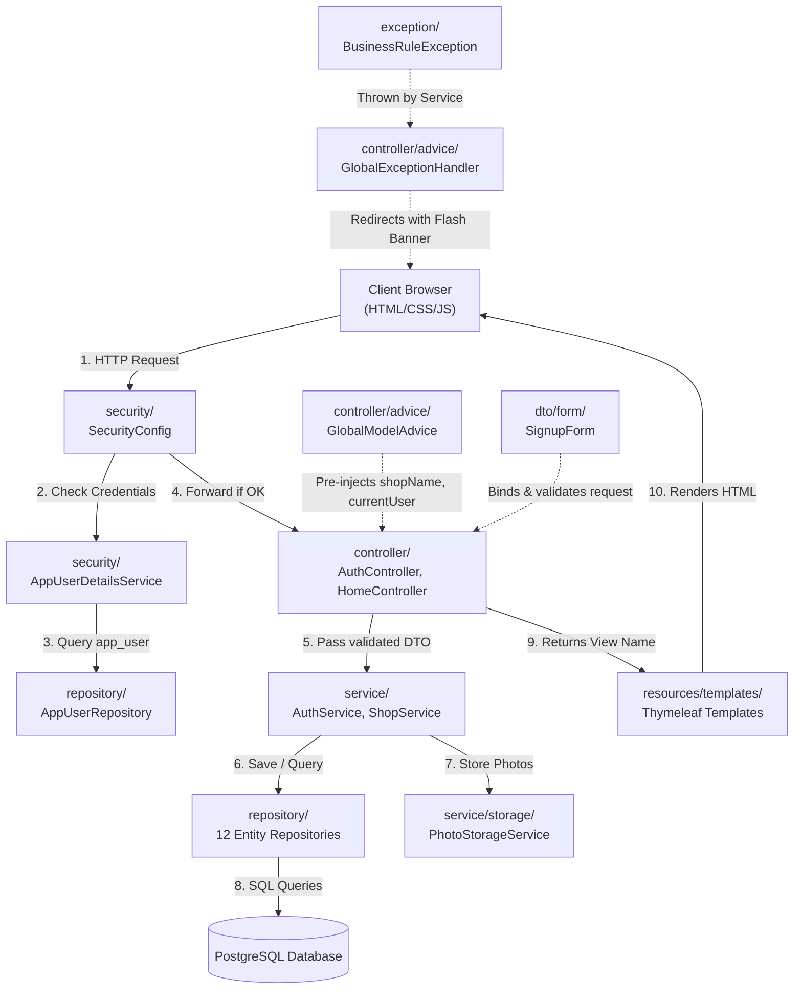

# Geetanjali Tailor Shop System — Master Reference (Part 1: Architecture, Core & Security)

> **Document Scope**: Part 1 of 4 — System Foundation, Directory Rationale, Core Infrastructure, Security, Utilities, DTOs, Enums, and Exceptions.  
> **Project**: Geetanjali Tailor Shop Management Web Application  
> **Target Audience**: Student pair programmer learning Spring Boot during a 24-hour hackathon.  
> **Version / Git Commit**: `Stage 1 - Step 1: Shared foundation` (`1d14e6f`)

---

## 1. Project Background, Stack & Hackathon Rules

### The Real-World Domain
In India, neighborhood tailor shops manage dozens of custom garment orders simultaneously. Unlike standard off-the-shelf retail:
1. Every order involves unique physical body measurements (e.g., chest, waist, shoulder, collar, inseam).
2. Multiple garments (e.g., 2 shirts + 1 trouser) belong to a single customer visit.
3. Garments are stitched in stages: fabric cutting -> stitching -> trial -> pressing -> finished.
4. Payments are collected incrementally (advance deposit at booking, final balance upon collection).
5. Delivery exceptions occur frequently (e.g., regular customers taking clothes with an outstanding balance to settle later via UPI).

Geetanjali automates this workflow desktop-first, prioritizing fast keyboard entry, 10-digit mobile number lookups, and clear ledger accounting.

### Technology Stack Specifications
* **Language**: Java 21 (Long-Term Support)
* **Framework**: Spring Boot 4.1.1
* **Web Engine**: Spring MVC with Thymeleaf template engine
* **Security**: Spring Security 6 with Form Login & CSRF Protection
* **Data Persistence**: Spring Data JPA with Hibernate 6
* **Database**: PostgreSQL 17 (relational ACID compliance)
* **Schema Evolution**: Flyway 10 (sequential versioned database migrations)
* **Validation**: Jakarta Bean Validation (`@NotBlank`, `@Pattern`, `@Size`)
* **Utilities**: Lombok (annotations), DevTools (live reload)

### Strict Architectural Principles
1. **Beginner-Readable Java**: Plain, straightforward Java. No complex functional streams, no reflection tricks, no unnecessary generics.
2. **Layered Separation of Concerns**: Controllers -> Services -> Repositories -> Database. Controllers stay thin; services enforce all business rules inside `@Transactional` boundaries; repositories perform data access only. **A controller must never call a repository directly.**
3. **No Unchecked Dependency Additions**: The stack is fixed to Initializr definitions.
4. **Time & Currency Rules**:
   * All currency amounts are represented using `java.math.BigDecimal` (never `float` or `double`) to eliminate IEEE 754 floating-point rounding errors.
   * "Today" is always obtained from an injected `java.time.Clock` bean pinned to `Asia/Kolkata` (IST), never `LocalDate.now()`.
5. **Database Immutability**: Flyway migrations `V1`, `V2`, `V3` are immutable once applied. New schema changes require a new incremented migration file (`V4`, etc.).

---

## 2. Directory Structure & Separation of Concerns

### High-Level Folder Layout

```
backend/src/main/
├── java/com/geetanjali/backend/
│   ├── BackendApplication.java       <-- Main application bootstrapper
│   ├── config/                       <-- System beans (Clock, Static Uploads)
│   ├── security/                     <-- Authentication & Route Guards
│   ├── controller/                   <-- Web MVC Controllers
│   │   ├── advice/                   <-- Global model injection & Exception handlers
│   │   └── api/                      <-- REST/AJAX endpoints (JSON)
│   ├── service/                      <-- Business logic & @Transactional rules
│   │   └── storage/                  <-- Photo storage abstraction & implementations
│   ├── entity/                       <-- JPA Database Entity models
│   ├── enums/                        <-- Business Enums (Role, etc.)
│   ├── repository/                   <-- Spring Data JPA database interfaces
│   ├── dto/                          <-- Data Transfer Objects
│   │   ├── form/                     <-- Form-backing input DTOs
│   │   └── draft/                    <-- Session-backed multi-step wizard state
│   ├── exception/                    <-- Custom unchecked domain exceptions
│   └── util/                         <-- Stateless static helper utilities
└── resources/
    ├── application.properties        <-- Application properties & environment bindings
    ├── db/migration/                 <-- Flyway versioned SQL scripts
    ├── static/                       <-- Public assets (CSS, client JS)
    │   ├── css/app.css
    │   └── js/app.js
    └── templates/                    <-- Thymeleaf server-side HTML views
        ├── fragments/layout.html
        ├── auth/
        ├── home/
        ├── orders/
        ├── customers/
        ├── payments/
        ├── settings/
        └── error/
```

### Why Multiple Folders? (The Separation of Concerns Topology)



#### Detailed Folder Responsibilities

1. **`config/`**:
   * *Analogy*: The shop's electrical and water connections. Set up once when the building opens.
   * *Why separate*: Centralizes system configuration beans that do not belong to any specific business domain.
   * *Interconnection*: Loaded directly by the Spring container on application bootup.

2. **`security/`**:
   * *Analogy*: The security guard at the shop entrance checking credentials and issuing visitor badges.
   * *Why separate*: Isolates authentication, session cookies, route authorization, and password verification away from regular business logic.
   * *Interconnection*: Intercepts every single HTTP request before controllers run. Communicates with `repository/AppUserRepository`.

3. **`controller/`**:
   * *Analogy*: The front-desk receptionist who greets visitors, collects filled paper forms, asks the manager to approve them, and hands the customer their ticket.
   * *Why separate*: Keeps HTTP protocol details (request params, cookies, sessions, redirects, view names) strictly out of the database and business logic layers.
   * *Interconnection*: Interacts with client browsers via HTTP; delegates to `service/`; sends data models to `templates/`.

4. **`controller/advice/`**:
   * *Analogy*: The store assistant who hands every customer a catalog as they walk in, and the first-aid responder if someone gets hurt.
   * *Why separate*: `@ControllerAdvice` eliminates repetitive code across individual controllers by sharing common data attributes and handling exceptions globally.
   * *Interconnection*: Wraps around all `@Controller` classes. Injects data into all `templates/`.

5. **`controller/api/`**:
   * *Analogy*: The drive-thru window for instant data lookups without re-rendering the whole showroom.
   * *Why separate*: Distinguishes server-rendered HTML controllers from JSON-returning REST controllers consumed by client JavaScript (`fetch`).

6. **`service/`**:
   * *Analogy*: The master tailor who knows all shop rules, garment specifications, pricing calculations, and workflow approvals.
   * *Why separate*: Houses business rules and transactional integrity (`@Transactional`). If an error occurs midway through saving an order, the service rolls back the database.
   * *Interconnection*: Called exclusively by `controller/`; orchestrates calls to `repository/` and `service/storage/`.

7. **`service/storage/`**:
   * *Analogy*: The photo filing cabinet.
   * *Why separate*: Provides an abstraction interface (`PhotoStorageService`). During the hackathon, photos are saved on local disk (`LocalDiskPhotoStorageService`). In production, this can be swapped with AWS S3 or Cloudinary without touching a single controller or entity.

8. **`entity/`**:
   * *Analogy*: The official ledger books with ruled lines and column headers.
   * *Why separate*: Represents the persistent state of the database in object form. Annotated with Jakarta Persistence (`@Entity`, `@Table`, `@Column`, `@ManyToOne`).

9. **`enums/`**:
   * *Analogy*: Standard approved rubber stamps (e.g., "OWNER", "TAILOR").
   * *Why separate*: Type-safe constants that prevent typo bugs and invalid database values.

10. **`repository/`**:
    * *Analogy*: The archival clerk who retrieves specific record books from storage on command.
    * *Why separate*: Encapsulates SQL generation and database queries behind clean Java interfaces.

11. **`dto/form/`**:
    * *Analogy*: The blank paper slip handed to a customer to fill out before their information is officially recorded.
    * *Why separate*: Prevents "over-posting" vulnerabilities by receiving only the fields the user is allowed to submit, validating them with Jakarta annotations before updating entities.

12. **`dto/draft/`**:
    * *Analogy*: The tailor's temporary notepad used while taking measurements across multiple garments before printing the final bill.
    * *Why separate*: Holds intermediate state in the HTTP session across multi-step order creation wizard steps without cluttering the database.

13. **`exception/`**:
    * *Analogy*: The shop's emergency sirens.
    * *Why separate*: Custom unchecked exceptions (`RuntimeException`) signal specific business failures (e.g., `ResourceNotFoundException`, `BusinessRuleException`).

14. **`util/`**:
    * *Analogy*: The tailor's standard measuring tape and scissors.
    * *Why separate*: Stateless static helper functions (e.g., phone normalization regex) accessible across any layer without instantiation.

---

## 3. Detailed File-by-File & Function-by-Function Breakdown

---

### Group 1: Application Bootstrapper & Configuration

#### File 1: [`BackendApplication.java`](file:///home/shubham/storms/Projects/Geetanjali/backend/src/main/java/com/geetanjali/backend/BackendApplication.java)
* **Location**: `src/main/java/com/geetanjali/backend/BackendApplication.java`
* **Real-Life Analogy**: The main circuit breaker that powers on the entire tailor shop every morning.
* **Class Explanation**:
  * Marked with `@SpringBootApplication`.
  * Enables auto-configuration, component scanning across `com.geetanjali.backend`, and Spring configuration property loading.
* **Functions**:
  * **Function**: `public static void main(String[] args)`
    * **Signature**:
      * Takes: `args` (`String[]`) — Command-line argument strings passed to the JVM on launch.
    * **In-Built Functions Used**:
      * `SpringApplication.run(BackendApplication.class, args)`:
        * *What it does*: Creates the Spring `ApplicationContext`, starts the embedded Tomcat web server on port 8080, triggers Flyway database migration scripts, configures Hibernate JPA, and registers all singleton beans.
        * *Why used*: Standard Spring Boot initialization routine.
    * **Returns**: `void`.
    * **Caller / Destination**: Invoked directly by the JVM upon program startup.
    * **Topology**: Boots the entire application hierarchy.

---

#### File 2: [`AppConfig.java`](file:///home/shubham/storms/Projects/Geetanjali/backend/src/main/java/com/geetanjali/backend/config/AppConfig.java)
* **Location**: `src/main/java/com/geetanjali/backend/config/AppConfig.java`
* **Real-Life Analogy**: The master clock hanging on the shop wall, synchronized permanently to Indian Standard Time (IST).
* **Class Explanation**:
  * Marked with `@Configuration`. Declares shared application-level singleton beans.
  * Injects the timezone property `app.timezone` from `application.properties`.
* **Fields**:
  * `@Value("${app.timezone:Asia/Kolkata}") private String appTimezone` — Configuration property holding the shop's operational timezone identifier.
* **Functions**:
  * **Function**: `public Clock clock()`
    * **Annotation**: `@Bean` — Registers the returned object as a managed singleton bean in Spring's ApplicationContext.
    * **Signature**:
      * Takes: No parameters.
    * **In-Built Functions Used**:
      * `ZoneId.of(appTimezone)`:
        * *What it does*: Parses the string `"Asia/Kolkata"` into a timezone object.
        * *Why used*: Needed to create a timezone-specific clock.
      * `Clock.system(zoneId)`:
        * *What it does*: Creates a system clock tied to that timezone.
        * *Why used*: Cloud servers default to UTC. If a customer visits at 11:30 PM IST, UTC records the previous calendar date. By injecting a `Clock` fixed to `Asia/Kolkata`, every service accurately calculates local Indian dates.
    * **Returns**: `java.time.Clock` singleton bean.
    * **Caller / Destination**: Injected into `service/` classes to resolve `LocalDate.now(clock)`.

---

#### File 3: [`WebMvcConfig.java`](file:///home/shubham/storms/Projects/Geetanjali/backend/src/main/java/com/geetanjali/backend/config/WebMvcConfig.java)
* **Location**: `src/main/java/com/geetanjali/backend/config/WebMvcConfig.java`
* **Real-Life Analogy**: The delivery counter sign instructing visitors where to pick up their cloth photos.
* **Class Explanation**:
  * Marked with `@Configuration`. Implements Spring MVC's `WebMvcConfigurer`.
  * Configures static resource routing so local disk files inside `uploads/` can be accessed by browser image tags (``).
* **Fields**:
  * `@Value("${app.upload-dir:uploads}") private String uploadDir` — Directory path on disk where uploaded photos are saved.
* **Functions**:
  * **Function**: `public void addResourceHandlers(ResourceHandlerRegistry registry)`
    * **Annotation**: `@Override`
    * **Signature**:
      * Takes: `registry` (`ResourceHandlerRegistry`) — Spring MVC resource registry object used to bind URL patterns to physical file locations.
    * **In-Built Functions Used**:
      * `Paths.get(uploadDir).toAbsolutePath().normalize()`:
        * *What it does*: Converts relative directory path `"uploads"` into an absolute, normalized filesystem path on the host machine.
        * *Why used*: Protects against path traversal vulnerabilities and ensures Tomcat knows the exact filesystem directory.
      * `registry.addResourceHandler("/uploads/**").addResourceLocations("file:" + uploadPath.toString() + "/")`:
        * *What it does*: Binds URL requests matching `/uploads/**` to serve files directly from the local disk directory.
    * **Returns**: `void`.
    * **Caller / Destination**: Invoked automatically by Spring MVC during web engine startup.

---

### Group 2: Security & Authentication Layer

#### File 4: [`SecurityConfig.java`](file:///home/shubham/storms/Projects/Geetanjali/backend/src/main/java/com/geetanjali/backend/security/SecurityConfig.java)
* **Location**: `src/main/java/com/geetanjali/backend/security/SecurityConfig.java`
* **Real-Life Analogy**: The shop security guard and door access policy: who can enter freely vs who must present a verified mobile number and password.
* **Class Explanation**:
  * Marked with `@Configuration`, `@EnableWebSecurity`, and `@EnableMethodSecurity`.
  * Configures HTTP route authorization, form login parameters (mobile number as username), password hashing, session management, and CSRF protection.
* **Functions**:
  * **Function**: `public PasswordEncoder passwordEncoder()`
    * **Annotation**: `@Bean`
    * **Signature**:
      * Takes: No parameters.
    * **In-Built Functions Used**:
      * `new BCryptPasswordEncoder()`:
        * *What it does*: Creates a salted, adaptive one-way cryptographic hashing engine.
        * *Why used*: Passwords must never be stored in plain text. BCrypt incorporates a random per-user salt and computational work factor to defeat rainbow table attacks.
    * **Returns**: `PasswordEncoder` singleton bean.
    * **Caller / Destination**: Used by `AuthService` to hash passwords on signup, and by Spring Security's `DaoAuthenticationProvider` to verify passwords on login.

  * **Function**: `public SecurityFilterChain filterChain(HttpSecurity http)`
    * **Annotation**: `@Bean`
    * **Signature**:
      * Takes: `http` (`HttpSecurity`) — Builder object for configuring web security filter chains.
    * **In-Built Functions Used**:
      * `http.authorizeHttpRequests(...)`: Whitelists `/login`, `/signup`, `/css/**`, `/js/**`, `/uploads/**`, `/error`, `DispatcherType.FORWARD`, and `DispatcherType.ERROR`. Enforces `.anyRequest().authenticated()`.
      * `http.formLogin(...)`: Configures login URL to `/login`, sets `.usernameParameter("mobile")`, `.passwordParameter("password")`, and `.defaultSuccessUrl("/", true)`.
      * `http.logout(...)`: Configures logout URL to `/logout` (POST only, requiring CSRF token) and redirects to `/login?logout`.
      * `http.build()`: Compiles the security rules into the active `SecurityFilterChain`.
    * **Returns**: `SecurityFilterChain` bean.
    * **Caller / Destination**: Registered with the servlet container to intercept and filter every incoming HTTP request.

---

#### File 5: [`AppUserDetails.java`](file:///home/shubham/storms/Projects/Geetanjali/backend/src/main/java/com/geetanjali/backend/security/AppUserDetails.java)
* **Location**: `src/main/java/com/geetanjali/backend/security/AppUserDetails.java`
* **Real-Life Analogy**: The staff member's digital identity badge containing their name, assigned role, shop ID, and security clearance.
* **Class Explanation**:
  * Implements Spring Security's `UserDetails` interface.
  * Wraps our [`AppUser`](file:///home/shubham/storms/Projects/Geetanjali/backend/src/main/java/com/geetanjali/backend/entity/AppUser.java) database entity so Spring Security can inspect credentials and roles.
* **Fields**:
  * `private final AppUser appUser` — The underlying database user entity.
* **Functions**:
  * **Function**: `public AppUserDetails(AppUser appUser)`
    * **Signature**: Takes `appUser` (`AppUser`).
    * **Returns**: New `AppUserDetails` instance wrapping the database user.

  * **Function**: `public Collection<? extends GrantedAuthority> getAuthorities()`
    * **Signature**: Takes no parameters.
    * **In-Built Functions Used**:
      * `Collections.singletonList(new SimpleGrantedAuthority("ROLE_" + appUser.getRole().name()))`:
        * *What it does*: Formats the user's enum role into Spring Security's standard `"ROLE_OWNER"` or `"ROLE_TAILOR"` authority.
    * **Returns**: `Collection<GrantedAuthority>`.
    * **Caller / Destination**: Spring Security authorization checks (`hasRole('OWNER')`).

  * **Function**: `public String getPassword()`
    * **Signature**: Takes no parameters.
    * **Returns**: `String` — BCrypt password hash from `appUser.getPasswordHash()`.
    * **Caller / Destination**: Spring Security `DaoAuthenticationProvider` during login.

  * **Function**: `public String getUsername()`
    * **Signature**: Takes no parameters.
    * **Returns**: `String` — Mobile number from `appUser.getMobile()`.
    * **Caller / Destination**: Spring Security session context.

  * **Functions**: `isAccountNonExpired()`, `isAccountNonLocked()`, `isCredentialsNonExpired()`, `isEnabled()`
    * **Signature**: Take no parameters.
    * **Returns**: `boolean` (`true`).
    * **Caller / Destination**: Spring Security account status verification.

  * **Function**: `public String getFullName()`
    * **Signature**: Takes no parameters.
    * **Returns**: `String` — Full name from `appUser.getFullName()`.
    * **Caller / Destination**: Injected into templates via `GlobalModelAdvice` to display `"Tailor: Ketan"`.

  * **Function**: `public Role getRole()`
    * **Signature**: Takes no parameters.
    * **Returns**: `Role` enum (`OWNER` or `TAILOR`).
    * **Caller / Destination**: Role-based UI visibility checks in templates.

  * **Function**: `public Shop getShop()`
    * **Signature**: Takes no parameters.
    * **Returns**: `Shop` entity.
    * **Caller / Destination**: Used by `AuthService` when creating staff under the current shop.

  * **Function**: `public AppUser getAppUser()`
    * **Signature**: Takes no parameters.
    * **Returns**: Raw `AppUser` entity.
    * **Caller / Destination**: Order creation services to record `createdBy`.

---

#### File 6: [`AppUserDetailsService.java`](file:///home/shubham/storms/Projects/Geetanjali/backend/src/main/java/com/geetanjali/backend/security/AppUserDetailsService.java)
* **Location**: `src/main/java/com/geetanjali/backend/security/AppUserDetailsService.java`
* **Real-Life Analogy**: The attendance ledger keeper who looks up a tailor's record when they give their mobile number at the door.
* **Class Explanation**:
  * Marked with `@Service`. Implements Spring Security's `UserDetailsService`.
  * Called automatically by Spring Security during form login submission.
* **Injected Dependencies**:
  * `private final AppUserRepository appUserRepository`
* **Functions**:
  * **Function**: `public AppUserDetailsService(AppUserRepository appUserRepository)`
    * **Signature**: Takes `appUserRepository` (`AppUserRepository`).
    * **Returns**: Initialized service bean.

  * **Function**: `public UserDetails loadUserByUsername(String mobile)`
    * **Annotation**: `@Override`
    * **Signature**:
      * Takes: `mobile` (`String`) — Entered mobile number from the login form.
    * **In-Built Functions Used**:
      * `appUserRepository.findByMobile(mobile)`:
        * *What it does*: Executes SQL `SELECT * FROM app_user WHERE mobile = ?`.
      * `.orElseThrow(() -> new UsernameNotFoundException(...))`:
        * *What it does*: Throws standard Spring Security exception if no user matches.
    * **Returns**: `UserDetails` (`AppUserDetails` instance wrapping the found `AppUser`).
    * **Caller / Destination**: Returned to Spring Security's `DaoAuthenticationProvider`, which compares the submitted password against the stored BCrypt hash.

---

### Group 3: Utilities, DTOs, Enums & Exceptions

#### File 7: [`PhoneNumbers.java`](file:///home/shubham/storms/Projects/Geetanjali/backend/src/main/java/com/geetanjali/backend/util/PhoneNumbers.java)
* **Location**: `src/main/java/com/geetanjali/backend/util/PhoneNumbers.java`
* **Real-Life Analogy**: A standardizing rubber stamp that strips spaces, dashes, +91 country codes, and leading zeros, converting any handwritten mobile into clean 10 digits.
* **Class Explanation**:
  * Final utility class with a private constructor to prevent instantiation.
  * Encapsulates all normalization and validation rules for Indian phone numbers.
* **Functions**:
  * **Function**: `public static String normalize(String raw)`
    * **Signature**:
      * Takes: `raw` (`String`) — Raw mobile input string from user.
    * **In-Built Functions Used**:
      * `raw.replaceAll("[\\s\\-]", "")`: Strips all whitespace and hyphens.
      * `cleaned.startsWith("+91")`: Removes country code `+91`.
      * `cleaned.startsWith("91") && cleaned.length() == 12`: Removes country code `91`.
      * `cleaned.startsWith("0")`: Removes leading trunk zero.
      * `cleaned.replaceAll("[^0-9]", "")`: Strips any non-digit characters.
      * `cleaned.substring(cleaned.length() - 10)`: Retains the last 10 digits if more were provided.
    * **Returns**: Clean 10-digit `String`, or `""` if input was null/blank.
    * **Caller / Destination**: Called before saving any phone number to PostgreSQL.

  * **Function**: `public static boolean isValid(String phone)`
    * **Signature**:
      * Takes: `phone` (`String`) — Cleaned phone number to validate.
    * **In-Built Functions Used**:
      * `phone.matches("^[6-9][0-9]{9}$")`:
        * *What it does*: Regex match enforcing exactly 10 digits starting with 6, 7, 8, or 9 (Indian telecom numbering plan).
    * **Returns**: `boolean` (`true` if valid, `false` otherwise).
    * **Caller / Destination**: Form validators, customer creation services, and AJAX lookup controllers.

---

#### File 8: [`SignupForm.java`](file:///home/shubham/storms/Projects/Geetanjali/backend/src/main/java/com/geetanjali/backend/dto/form/SignupForm.java)
* **Location**: `src/main/java/com/geetanjali/backend/dto/form/SignupForm.java`
* **Real-Life Analogy**: The blank paper signup sheet given to a new owner or staff member to fill out.
* **Class Explanation**:
  * Form-backing Data Transfer Object (DTO) capturing signup input with Jakarta validation constraints.
* **Fields & Validations**:
  * `private String shopName` — Shop name (used during first-run shop setup).
  * `@NotBlank(message = "Full name is required") @Size(min = 2, max = 100) private String fullName`
  * `@NotBlank(message = "Mobile number is required") @Pattern(regexp = "^[0-9]{10}$", message = "Mobile number must be exactly 10 digits") private String mobile`
  * `@NotBlank(message = "Password is required") @Size(min = 4, max = 50, message = "Password must be at least 4 characters") private String password`
  * `private Role role = Role.OWNER` — Assigned role, defaults to `OWNER`.
* **Functions**:
  * `public SignupForm()` — Zero-argument constructor required by Spring MVC data binder.
  * `public SignupForm(shopName, fullName, mobile, password, role)` — Convenience constructor.
  * Standard Getters & Setters for all 5 fields (`getShopName()`, `setShopName(String)`, `getFullName()`, `setFullName(String)`, `getMobile()`, `setMobile(String)`, `getPassword()`, `setPassword(String)`, `getRole()`, `setRole(Role)`).
    * *Returns*: Field value or `void`.
    * *Caller / Destination*: Spring MVC form data binding and `AuthService`.

---

#### File 9: [`Role.java`](file:///home/shubham/storms/Projects/Geetanjali/backend/src/main/java/com/geetanjali/backend/enums/Role.java)
* **Location**: `src/main/java/com/geetanjali/backend/enums/Role.java`
* **Real-Life Analogy**: The official job roles within the tailor shop.
* **Class Explanation**:
  * Java Enum defining user authorization levels:
    * `OWNER` — The shop owner. Has full administrative access (shop settings, adding staff, pricing).
    * `TAILOR` — Operational staff member. Records measurements, creates orders, updates stitching status.
* **Values**: `OWNER`, `TAILOR`.

---

#### File 10: [`ResourceNotFoundException.java`](file:///home/shubham/storms/Projects/Geetanjali/backend/src/main/java/com/geetanjali/backend/exception/ResourceNotFoundException.java)
* **Location**: `src/main/java/com/geetanjali/backend/exception/ResourceNotFoundException.java`
* **Real-Life Analogy**: A red note stating: *"The requested customer record or garment file could not be found."*
* **Class Explanation**:
  * Unchecked exception (`extends RuntimeException`) thrown when an entity lookup fails.
  * Why unchecked: Spring's `@Transactional` automatically rolls back active database transactions when an unchecked exception is thrown.
* **Functions**:
  * **Function**: `public ResourceNotFoundException(String message)`
    * **Signature**: Takes `message` (`String`) describing which resource was missing.
    * **Returns**: New exception instance.
    * **Caller / Destination**: Thrown by services; intercepted by `GlobalExceptionHandler.handleResourceNotFound()`.

---

#### File 11: [`BusinessRuleException.java`](file:///home/shubham/storms/Projects/Geetanjali/backend/src/main/java/com/geetanjali/backend/exception/BusinessRuleException.java)
* **Location**: `src/main/java/com/geetanjali/backend/exception/BusinessRuleException.java`
* **Real-Life Analogy**: A warning bell stating: *"Cannot mark this suit as delivered because the customer still has an unpaid balance."*
* **Class Explanation**:
  * Unchecked exception (`extends RuntimeException`) thrown when a business rule is violated.
  * Triggers immediate database transaction rollback in `@Transactional` methods.
* **Functions**:
  * **Function**: `public BusinessRuleException(String message)`
    * **Signature**: Takes `message` (`String`) explaining why the rule was violated.
    * **Returns**: New exception instance.
    * **Caller / Destination**: Thrown by services; intercepted by `GlobalExceptionHandler.handleBusinessRule()`, which stores a flash message and redirects back to the previous page.
