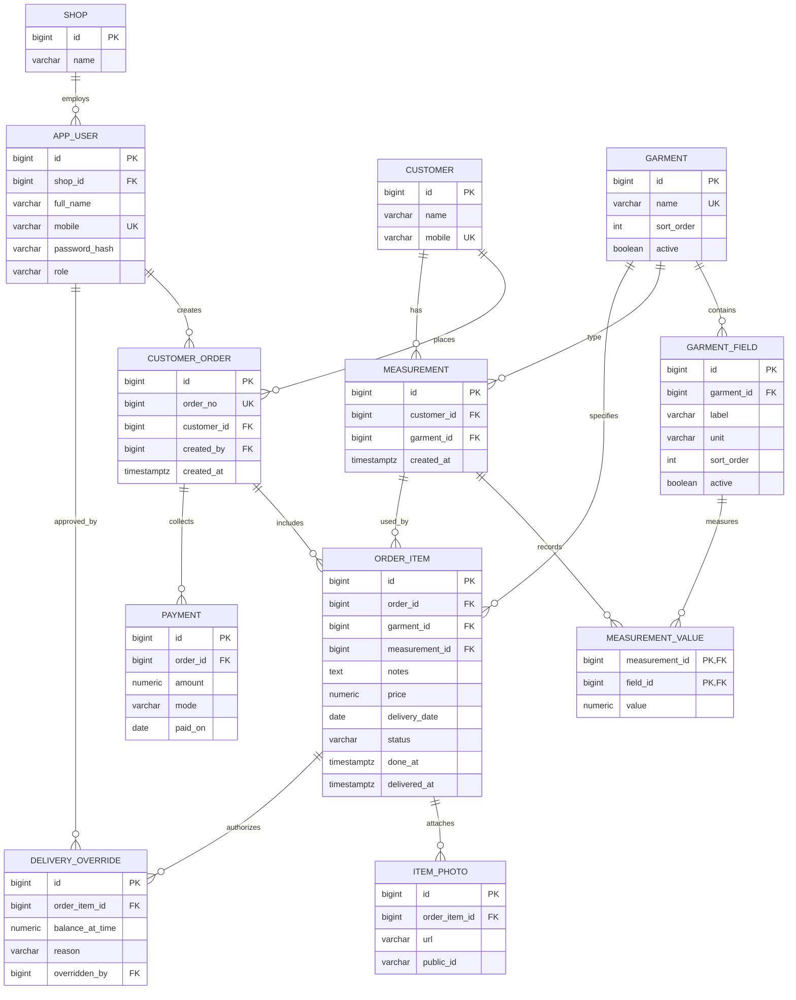

# Geetanjali Tailor Shop System — Master Reference (Part 2: Entities & Repositories)

> **Document Scope**: Part 2 of 4 — Complete breakdown of all 13 JPA Entities, Composite Keys, and 12 Spring Data JPA Repositories.  
> **Project**: Geetanjali Tailor Shop Management Web Application  
> **Target Audience**: Student pair programmer learning Spring Boot during a 24-hour hackathon.  
> **Version / Git Commit**: `Stage 1 - Step 1: Shared foundation` (`1d14e6f`)

---

## 1. Domain Data Model & Entity Relationship Overview

The database uses PostgreSQL 17, with tables and constraints managed by Flyway migrations (`V1`, `V2`, `V3`).

---

## 2. Exhaustive Entity Breakdown (13 Files)

---

### Entity 1: [`Shop.java`](file:///home/shubham/storms/Projects/Geetanjali/backend/src/main/java/com/geetanjali/backend/entity/Shop.java)
* **Location**: `src/main/java/com/geetanjali/backend/entity/Shop.java`
* **PostgreSQL Table**: `shop`
* **Real-Life Analogy**: The tailor shop enterprise record.
* **Fields**:
  * `@Id @GeneratedValue(strategy = GenerationType.IDENTITY) private Long id` — Auto-incrementing primary key.
  * `@Column(name = "name", nullable = false) private String name` — Shop business name (e.g., "Geetanjali Tailors").
* **Functions & Methods**:
  1. `public Shop()` — Zero-argument constructor required by JPA to instantiate entities when reading rows from the database.
  2. `public Shop(String name)` — Convenience constructor. Takes `name` (`String`), sets `this.name = name`. Returns a new `Shop` instance.
  3. `public Long getId()` — Getter for primary key. Takes no parameters. Returns `Long` id to callers (services, JPA).
  4. `public void setId(Long id)` — Setter for primary key. Takes `id` (`Long`). Returns `void`.
  5. `public String getName()` — Getter for shop name. Takes no parameters. Returns `String` name to views and services.
  6. `public void setName(String name)` — Setter for shop name. Takes `name` (`String`). Returns `void`.

---

### Entity 2: [`AppUser.java`](file:///home/shubham/storms/Projects/Geetanjali/backend/src/main/java/com/geetanjali/backend/entity/AppUser.java)
* **Location**: `src/main/java/com/geetanjali/backend/entity/AppUser.java`
* **PostgreSQL Table**: `app_user` ("user" is a reserved keyword in PostgreSQL).
* **Real-Life Analogy**: An employee profile ledger row for a tailor or the shop owner.
* **Fields**:
  * `@Id @GeneratedValue(strategy = GenerationType.IDENTITY) private Long id` — Primary key.
  * `@ManyToOne(fetch = FetchType.LAZY) @JoinColumn(name = "shop_id", nullable = false) private Shop shop` — Foreign key to `shop`. Lazy loading prevents fetching the shop until requested.
  * `@Column(name = "full_name", nullable = false) private String fullName` — Tailor's display name.
  * `@Column(name = "mobile", nullable = false, unique = true) private String mobile` — 10-digit mobile number used as unique login identifier.
  * `@Column(name = "password_hash", nullable = false) private String passwordHash` — BCrypt hashed password string.
  * `@Enumerated(EnumType.STRING) @Column(name = "role", nullable = false) private Role role` — Enum stored as string (`"OWNER"`, `"TAILOR"`).
* **Functions & Methods**:
  1. `public AppUser()` — Zero-argument constructor for JPA.
  2. `public AppUser(Shop shop, String fullName, String mobile, String passwordHash, Role role)` — Full constructor for creating new staff during signup. Takes 5 parameters. Sets all fields.
  3. `public Long getId()` — Returns `Long` id.
  4. `public void setId(Long id)` — Sets `id`. Returns `void`.
  5. `public Shop getShop()` — Returns parent `Shop` entity.
  6. `public void setShop(Shop shop)` — Sets `shop`. Returns `void`.
  7. `public String getFullName()` — Returns `String` full name.
  8. `public void setFullName(String fullName)` — Sets `fullName`. Returns `void`.
  9. `public String getMobile()` — Returns `String` 10-digit mobile number.
  10. `public void setMobile(String mobile)` — Sets `mobile`. Returns `void`.
  11. `public String getPasswordHash()` — Returns `String` BCrypt hash.
  12. `public void setPasswordHash(String passwordHash)` — Sets `passwordHash`. Returns `void`.
  13. `public Role getRole()` — Returns `Role` enum (`OWNER` / `TAILOR`).
  14. `public void setRole(Role role)` — Sets `role`. Returns `void`.

---

### Entity 3: [`Customer.java`](file:///home/shubham/storms/Projects/Geetanjali/backend/src/main/java/com/geetanjali/backend/entity/Customer.java)
* **Location**: `src/main/java/com/geetanjali/backend/entity/Customer.java`
* **PostgreSQL Table**: `customer`
* **Real-Life Analogy**: A customer's file folder containing their contact details and order history.
* **Fields**:
  * `@Id @GeneratedValue(strategy = GenerationType.IDENTITY) private Long id` — Primary key.
  * `@Column(name = "name", nullable = false) private String name` — Customer full name.
  * `@Column(name = "mobile", nullable = false, unique = true) private String mobile` — Customer's unique 10-digit mobile phone number.
* **Functions & Methods**:
  1. `public Customer()` — Zero-argument JPA constructor.
  2. `public Customer(String name, String mobile)` — Convenience constructor. Takes `name` and `mobile`.
  3. `public Long getId()` — Returns `Long` id.
  4. `public void setId(Long id)` — Sets `id`. Returns `void`.
  5. `public String getName()` — Returns `String` name.
  6. `public void setName(String name)` — Sets `name`. Returns `void`.
  7. `public String getMobile()` — Returns `String` mobile number.
  8. `public void setMobile(String mobile)` — Sets `mobile`. Returns `void`.

---

### Entity 4: [`Garment.java`](file:///home/shubham/storms/Projects/Geetanjali/backend/src/main/java/com/geetanjali/backend/entity/Garment.java)
* **Location**: `src/main/java/com/geetanjali/backend/entity/Garment.java`
* **PostgreSQL Table**: `garment`
* **Real-Life Analogy**: The catalog entry for a stitchable clothing category (e.g., Shirt, Pant, Kurta, Blouse).
* **Fields**:
  * `@Id @GeneratedValue(strategy = GenerationType.IDENTITY) private Long id` — Primary key.
  * `@Column(name = "name", nullable = false, unique = true) private String name` — Garment title.
  * `@Column(name = "sort_order", nullable = false) private Integer sortOrder = 0` — UI display priority.
  * `@Column(name = "active", nullable = false) private Boolean active = true` — Soft-delete flag.
* **Functions & Methods**:
  1. `public Garment()` — Zero-argument JPA constructor.
  2. `public Garment(String name, Integer sortOrder, Boolean active)` — Full constructor. Takes 3 parameters.
  3. `public Long getId()`, `public void setId(Long id)`
  4. `public String getName()`, `public void setName(String name)`
  5. `public Integer getSortOrder()`, `public void setSortOrder(Integer sortOrder)`
  6. `public Boolean getActive()`, `public void setActive(Boolean active)`

---

### Entity 5: [`GarmentField.java`](file:///home/shubham/storms/Projects/Geetanjali/backend/src/main/java/com/geetanjali/backend/entity/GarmentField.java)
* **Location**: `src/main/java/com/geetanjali/backend/entity/GarmentField.java`
* **PostgreSQL Table**: `garment_field`
* **Real-Life Analogy**: A specific measurement box on a garment's pattern sheet (e.g. "Chest", "Waist", "Inseam" with unit "inch").
* **Fields**:
  * `@Id @GeneratedValue(strategy = GenerationType.IDENTITY) private Long id` — Primary key.
  * `@ManyToOne(fetch = FetchType.LAZY) @JoinColumn(name = "garment_id", nullable = false) private Garment garment` — Parent garment.
  * `@Column(name = "label", nullable = false) private String label` — Field label (e.g., "Chest").
  * `@Column(name = "unit", nullable = false) private String unit = "inch"` — Unit of measurement.
  * `@Column(name = "sort_order", nullable = false) private Integer sortOrder = 0` — Form display order.
  * `@Column(name = "active", nullable = false) private Boolean active = true` — Active flag.
* **Functions & Methods**:
  1. `public GarmentField()` — Zero-argument JPA constructor.
  2. `public GarmentField(Garment garment, String label, String unit, Integer sortOrder, Boolean active)` — Full constructor.
  3. `public Long getId()`, `public void setId(Long id)`
  4. `public Garment getGarment()`, `public void setGarment(Garment garment)`
  5. `public String getLabel()`, `public void setLabel(String label)`
  6. `public String getUnit()`, `public void setUnit(String unit)`
  7. `public Integer getSortOrder()`, `public void setSortOrder(Integer sortOrder)`
  8. `public Boolean getActive()`, `public void setActive(Boolean active)`

---

### Entity 6: [`Measurement.java`](file:///home/shubham/storms/Projects/Geetanjali/backend/src/main/java/com/geetanjali/backend/entity/Measurement.java)
* **Location**: `src/main/java/com/geetanjali/backend/entity/Measurement.java`
* **PostgreSQL Table**: `measurement`
* **Real-Life Analogy**: The dated measurement session header taken for a customer (e.g. "Ramesh's measurements for Shirt taken on Oct 12").
* **Fields**:
  * `@Id @GeneratedValue(strategy = GenerationType.IDENTITY) private Long id` — Primary key.
  * `@ManyToOne(fetch = FetchType.LAZY) @JoinColumn(name = "customer_id", nullable = false) private Customer customer` — Customer foreign key.
  * `@ManyToOne(fetch = FetchType.LAZY) @JoinColumn(name = "garment_id", nullable = false) private Garment garment` — Garment foreign key.
  * `@Column(name = "created_at", nullable = false) private Instant createdAt = Instant.now()` — Timestamp of measurement session.
* **Functions & Methods**:
  1. `public Measurement()` — Zero-argument JPA constructor.
  2. `public Measurement(Customer customer, Garment garment, Instant createdAt)` — Convenience constructor.
  3. `public Long getId()`, `public void setId(Long id)`
  4. `public Customer getCustomer()`, `public void setCustomer(Customer customer)`
  5. `public Garment getGarment()`, `public void setGarment(Garment garment)`
  6. `public Instant getCreatedAt()`, `public void setCreatedAt(Instant createdAt)`

---

### Entity 7: [`MeasurementValueId.java`](file:///home/shubham/storms/Projects/Geetanjali/backend/src/main/java/com/geetanjali/backend/entity/MeasurementValueId.java)
* **Location**: `src/main/java/com/geetanjali/backend/entity/MeasurementValueId.java`
* **PostgreSQL Table**: Composite primary key for `measurement_value` table: `(measurement_id, field_id)`.
* **Real-Life Analogy**: The combined coordinate tag: (Session #12, Field #3 "Chest").
* **Annotations**: `@Embeddable`, implements `Serializable`.
* **Fields**:
  * `@Column(name = "measurement_id") private Long measurementId`
  * `@Column(name = "field_id") private Long fieldId`
* **Functions & Methods**:
  1. `public MeasurementValueId()` — Zero-argument constructor.
  2. `public MeasurementValueId(Long measurementId, Long fieldId)` — Constructor initializing both IDs.
  3. `public Long getMeasurementId()`, `public void setMeasurementId(Long measurementId)`
  4. `public Long getFieldId()`, `public void setFieldId(Long fieldId)`
  5. `public boolean equals(Object o)` — Overridden equality check. Verifies both `measurementId` and `fieldId` match.
  6. `public int hashCode()` — Overridden hash code generator using `Objects.hash(measurementId, fieldId)`.

---

### Entity 8: [`MeasurementValue.java`](file:///home/shubham/storms/Projects/Geetanjali/backend/src/main/java/com/geetanjali/backend/entity/MeasurementValue.java)
* **Location**: `src/main/java/com/geetanjali/backend/entity/MeasurementValue.java`
* **PostgreSQL Table**: `measurement_value`
* **Real-Life Analogy**: The actual recorded numeric measurement (e.g. "Chest = 40.50 inches").
* **Fields**:
  * `@EmbeddedId private MeasurementValueId id = new MeasurementValueId()` — Composite primary key.
  * `@ManyToOne(fetch = FetchType.LAZY) @MapsId("measurementId") @JoinColumn(name = "measurement_id") private Measurement measurement` — Maps to composite key's `measurementId`.
  * `@ManyToOne(fetch = FetchType.LAZY) @MapsId("fieldId") @JoinColumn(name = "field_id") private GarmentField field` — Maps to composite key's `fieldId`.
  * `@Column(name = "value", nullable = false) private BigDecimal value` — Measured numeric value. `BigDecimal` preserves exact precision.
* **Functions & Methods**:
  1. `public MeasurementValue()` — Zero-argument JPA constructor.
  2. `public MeasurementValue(Measurement measurement, GarmentField field, BigDecimal value)` — Constructor initializing relationships, value, and composite ID.
  3. `public MeasurementValueId getId()`, `public void setId(MeasurementValueId id)`
  4. `public Measurement getMeasurement()`, `public void setMeasurement(Measurement measurement)` — Sets measurement and syncs `id.measurementId`.
  5. `public GarmentField getField()`, `public void setField(GarmentField field)` — Sets field and syncs `id.fieldId`.
  6. `public BigDecimal getValue()`, `public void setValue(BigDecimal value)`

---

### Entity 9: [`CustomerOrder.java`](file:///home/shubham/storms/Projects/Geetanjali/backend/src/main/java/com/geetanjali/backend/entity/CustomerOrder.java)
* **Location**: `src/main/java/com/geetanjali/backend/entity/CustomerOrder.java`
* **PostgreSQL Table**: `customer_order`
* **Real-Life Analogy**: The official paper bill or order jacket tying together items, customer details, and payment ledgers.
* **Fields**:
  * `@Id @GeneratedValue(strategy = GenerationType.IDENTITY) private Long id` — Primary key.
  * `@Column(name = "order_no", nullable = false, unique = true) private Long orderNo` — Sequential bill number from PostgreSQL sequence `order_no_seq` (e.g., 1001, 1002).
  * `@ManyToOne(fetch = FetchType.LAZY) @JoinColumn(name = "customer_id", nullable = false) private Customer customer` — Customer reference.
  * `@ManyToOne(fetch = FetchType.LAZY) @JoinColumn(name = "created_by", nullable = false) private AppUser createdBy` — Staff member who created the order.
  * `@Column(name = "created_at", nullable = false) private Instant createdAt = Instant.now()` — Timestamp of order placement.
  * `@OneToMany(mappedBy = "order") private List<OrderItem> items = new ArrayList<>()` — Bidirectional association to order garments.
  * `@OneToMany(mappedBy = "order") private List<Payment> payments = new ArrayList<>()` — Bidirectional association to payments collected.
* **Functions & Methods**:
  1. `public CustomerOrder()` — Zero-argument JPA constructor.
  2. `public CustomerOrder(Long orderNo, Customer customer, AppUser createdBy, Instant createdAt)` — Full constructor.
  3. `public Long getId()`, `public void setId(Long id)`
  4. `public Long getOrderNo()`, `public void setOrderNo(Long orderNo)`
  5. `public Customer getCustomer()`, `public void setCustomer(Customer customer)`
  6. `public AppUser getCreatedBy()`, `public void setCreatedBy(AppUser createdBy)`
  7. `public Instant getCreatedAt()`, `public void setCreatedAt(Instant createdAt)`
  8. `public List<OrderItem> getItems()`, `public void setItems(List<OrderItem> items)`
  9. `public List<Payment> getPayments()`, `public void setPayments(List<Payment> payments)`
* **Calculated Business Getters**:
  10. `public BigDecimal getTotalAmount()` — Sums prices of all order items (`BigDecimal.ZERO` if empty).
  11. `public int getItemCount()` — Returns count of garment items in the order.
  12. `public LocalDate getNearestDeliveryDate()` — Earliest promised delivery date among all items.
  13. `public BigDecimal getTotalPaid()` — Sums all payment vouchers recorded against this order.
  14. `public BigDecimal getBalanceDue()` — Computes outstanding balance (`totalAmount - totalPaid`), clamped to zero.

---

### Entity 10: [`OrderItem.java`](file:///home/shubham/storms/Projects/Geetanjali/backend/src/main/java/com/geetanjali/backend/entity/OrderItem.java)
* **Location**: `src/main/java/com/geetanjali/backend/entity/OrderItem.java`
* **PostgreSQL Table**: `order_item`
* **Real-Life Analogy**: One specific garment to be stitched within an order (e.g. 1 Slim Fit Shirt, delivery on Friday, price ₹450).
* **Fields**:
  * `@Id @GeneratedValue(strategy = GenerationType.IDENTITY) private Long id` — Primary key.
  * `@ManyToOne(fetch = FetchType.LAZY) @JoinColumn(name = "order_id", nullable = false) private CustomerOrder order` — Parent order.
  * `@ManyToOne(fetch = FetchType.LAZY) @JoinColumn(name = "garment_id", nullable = false) private Garment garment` — Garment category.
  * `@ManyToOne(fetch = FetchType.LAZY) @JoinColumn(name = "measurement_id") private Measurement measurement` — Optional measurement snapshot.
  * `@Column(name = "notes") private String notes` — Custom instructions (e.g. "Double pocket, slim fit, Chinese collar").
  * `@Column(name = "price", nullable = false) private BigDecimal price` — Stitching charge in rupees.
  * `@Column(name = "delivery_date", nullable = false) private LocalDate deliveryDate` — Promised delivery date.
  * `@Column(name = "status", nullable = false) private String status = "PENDING"` — Stitching status (`"PENDING"`, `"DONE"`, `"DELIVERED"`).
  * `@Column(name = "done_at") private Instant doneAt` — Timestamp when marked done.
  * `@Column(name = "delivered_at") private Instant deliveredAt` — Timestamp when handed to customer.
* **Functions & Methods**:
  1. `public OrderItem()` — Zero-argument JPA constructor.
  2. `public OrderItem(CustomerOrder order, Garment garment, Measurement measurement, String notes, BigDecimal price, LocalDate deliveryDate)` — Constructor initializing an item in `"PENDING"` status.
  3. `public Long getId()`, `public void setId(Long id)`
  4. `public CustomerOrder getOrder()`, `public void setOrder(CustomerOrder order)`
  5. `public Garment getGarment()`, `public void setGarment(Garment garment)`
  6. `public Measurement getMeasurement()`, `public void setMeasurement(Measurement measurement)`
  7. `public String getNotes()`, `public void setNotes(String notes)`
  8. `public BigDecimal getPrice()`, `public void setPrice(BigDecimal price)`
  9. `public LocalDate getDeliveryDate()`, `public void setDeliveryDate(LocalDate deliveryDate)`
  10. `public String getStatus()`, `public void setStatus(String status)`
  11. `public Instant getDoneAt()`, `public void setDoneAt(Instant doneAt)`
  12. `public Instant getDeliveredAt()`, `public void setDeliveredAt(Instant deliveredAt)`

---

### Entity 11: [`ItemPhoto.java`](file:///home/shubham/storms/Projects/Geetanjali/backend/src/main/java/com/geetanjali/backend/entity/ItemPhoto.java)
* **Location**: `src/main/java/com/geetanjali/backend/entity/ItemPhoto.java`
* **PostgreSQL Table**: `item_photo`
* **Real-Life Analogy**: A photo of the customer's cloth fabric or reference design stapled to their order slip.
* **Fields**:
  * `@Id @GeneratedValue(strategy = GenerationType.IDENTITY) private Long id` — Primary key.
  * `@ManyToOne(fetch = FetchType.LAZY) @JoinColumn(name = "order_item_id", nullable = false) private OrderItem orderItem` — Parent item.
  * `@Column(name = "url", nullable = false) private String url` — Web-accessible path (e.g. `"/uploads/uuid.jpg"`).
  * `@Column(name = "public_id") private String publicId` — Cloud public ID (for future Cloudinary/S3 deletion).
* **Functions & Methods**:
  1. `public ItemPhoto()` — Zero-argument JPA constructor.
  2. `public ItemPhoto(OrderItem orderItem, String url, String publicId)` — Constructor.
  3. `public Long getId()`, `public void setId(Long id)`
  4. `public OrderItem getOrderItem()`, `public void setOrderItem(OrderItem orderItem)`
  5. `public String getUrl()`, `public void setUrl(String url)`
  6. `public String getPublicId()`, `public void setPublicId(String publicId)`

---

### Entity 12: [`Payment.java`](file:///home/shubham/storms/Projects/Geetanjali/backend/src/main/java/com/geetanjali/backend/entity/Payment.java)
* **Location**: `src/main/java/com/geetanjali/backend/entity/Payment.java`
* **PostgreSQL Table**: `payment`
* **Real-Life Analogy**: A cash or UPI receipt voucher logged in the cash drawer against an order.
* **Fields**:
  * `@Id @GeneratedValue(strategy = GenerationType.IDENTITY) private Long id` — Primary key.
  * `@ManyToOne(fetch = FetchType.LAZY) @JoinColumn(name = "order_id", nullable = false) private CustomerOrder order` — Parent order.
  * `@Column(name = "amount", nullable = false) private BigDecimal amount` — Payment amount in rupees.
  * `@Column(name = "mode", nullable = false) private String mode` — Payment method (`"CASH"`, `"UPI"`, `"CARD"`).
  * `@Column(name = "paid_on", nullable = false) private LocalDate paidOn = LocalDate.now()` — Payment date.
* **Functions & Methods**:
  1. `public Payment()` — Zero-argument JPA constructor.
  2. `public Payment(CustomerOrder order, BigDecimal amount, String mode, LocalDate paidOn)` — Constructor.
  3. `public Long getId()`, `public void setId(Long id)`
  4. `public CustomerOrder getOrder()`, `public void setOrder(CustomerOrder order)`
  5. `public BigDecimal getAmount()`, `public void setAmount(BigDecimal amount)`
  6. `public String getMode()`, `public void setMode(String mode)`
  7. `public LocalDate getPaidOn()`, `public void setPaidOn(LocalDate paidOn)`

---

### Entity 13: [`DeliveryOverride.java`](file:///home/shubham/storms/Projects/Geetanjali/backend/src/main/java/com/geetanjali/backend/entity/DeliveryOverride.java)
* **Location**: `src/main/java/com/geetanjali/backend/entity/DeliveryOverride.java`
* **PostgreSQL Table**: `delivery_override`
* **Real-Life Analogy**: An audit ledger entry recording when a customer was allowed to take clothes without full payment (e.g. trusted neighbor).
* **Fields**:
  * `@Id @GeneratedValue(strategy = GenerationType.IDENTITY) private Long id` — Primary key.
  * `@ManyToOne(fetch = FetchType.LAZY) @JoinColumn(name = "order_item_id", nullable = false) private OrderItem orderItem` — Delivered item.
  * `@Column(name = "balance_at_time", nullable = false) private BigDecimal balanceAtTime` — Pending rupee balance at delivery time.
  * `@Column(name = "reason", nullable = false) private String reason` — Justification text.
  * `@ManyToOne(fetch = FetchType.LAZY) @JoinColumn(name = "overridden_by", nullable = false) private AppUser overriddenBy` — Staff member who approved the release.
* **Functions & Methods**:
  1. `public DeliveryOverride()` — Zero-argument JPA constructor.
  2. `public DeliveryOverride(OrderItem orderItem, BigDecimal balanceAtTime, String reason, AppUser overriddenBy)` — Constructor.
  3. `public Long getId()`, `public void setId(Long id)`
  4. `public OrderItem getOrderItem()`, `public void setOrderItem(OrderItem orderItem)`
  5. `public BigDecimal getBalanceAtTime()`, `public void setBalanceAtTime(BigDecimal balanceAtTime)`
  6. `public String getReason()`, `public void setReason(String reason)`
  7. `public AppUser getOverriddenBy()`, `public void setOverriddenBy(AppUser overriddenBy)`

---

## 3. Exhaustive Repositories Breakdown (12 Files)

All repositories reside in `com.geetanjali.backend.repository`, extend `JpaRepository<Entity, ID>`, and are marked with `@Repository`.

---

#### Repository 1: [`ShopRepository.java`](file:///home/shubham/storms/Projects/Geetanjali/backend/src/main/java/com/geetanjali/backend/repository/ShopRepository.java)
* **Interface Signature**: `public interface ShopRepository extends JpaRepository<Shop, Long>`
* **Inherited Methods**: `findAll()`, `findById(Long id)`, `save(Shop shop)`, `count()`.
* **Used by**: `AuthService` (checks if shop exists, saves initial shop) and `ShopService` (retrieves primary shop).

#### Repository 2: [`AppUserRepository.java`](file:///home/shubham/storms/Projects/Geetanjali/backend/src/main/java/com/geetanjali/backend/repository/AppUserRepository.java)
* **Interface Signature**: `public interface AppUserRepository extends JpaRepository<AppUser, Long>`
* **Custom Query Methods**:
  1. `Optional<AppUser> findByMobile(String mobile)`
     * *Parameters*: `mobile` (`String`) — 10-digit mobile number.
     * *Generated SQL*: `SELECT * FROM app_user WHERE mobile = ?`
     * *Returns*: `Optional<AppUser>` — Wrapped user entity or empty optional.
     * *Called by*: `AppUserDetailsService.loadUserByUsername()` during login.
  2. `boolean existsByMobile(String mobile)`
     * *Parameters*: `mobile` (`String`).
     * *Generated SQL*: `SELECT count(*) > 0 FROM app_user WHERE mobile = ?`
     * *Returns*: `boolean` (`true` if mobile exists).
     * *Called by*: `AuthService.isMobileRegistered()` during signup.

#### Repository 3: [`CustomerRepository.java`](file:///home/shubham/storms/Projects/Geetanjali/backend/src/main/java/com/geetanjali/backend/repository/CustomerRepository.java)
* **Interface Signature**: `public interface CustomerRepository extends JpaRepository<Customer, Long>`
* **Custom & Derived Query Methods**:
  1. `Optional<Customer> findByMobile(String mobile)`
     * *Parameters*: `mobile` (`String`) — Customer's 10-digit mobile number.
     * *Generated SQL*: `SELECT * FROM customer WHERE mobile = ?`
     * *Returns*: `Optional<Customer>`.
     * *Called by*: `CustomerService.findByMobile()` and `CustomerApiController.lookupCustomer()`.
  2. `List<Customer> findAllByOrderByNameAsc()`
     * *Parameters*: None.
     * *Derived Query*: Spring Data JPA parses the method name and automatically generates `SELECT * FROM customer ORDER BY name ASC`.
     * *Returns*: `List<Customer>` — All customers sorted alphabetically by full name for the default directory view.
     * *Called by*: `CustomerService.search()` when the search term is empty or omitted.
  3. `List<Customer> searchByNameOrMobile(@Param("query") String query)`
     * *Parameters*: `query` (`String`) — Search keyword (partial name or phone digits).
     * *Custom JPQL Query*:
       `@Query("SELECT c FROM Customer c WHERE LOWER(c.name) LIKE LOWER(CONCAT('%', :query, '%')) OR c.mobile LIKE CONCAT('%', :query, '%') ORDER BY c.name ASC")`
     * *Why Custom Query with Bound Parameter*:
       Using JPQL `@Query` with named parameter `:query` ensures the search term is bound safely, completely preventing SQL injection. `LOWER()` guarantees case-insensitive matching across names (e.g., "ramesh", "Ramesh", "RAMESH"). A custom query was chosen over a derived query because a derived equivalent (`findByNameContainingIgnoreCaseOrMobileContaining`) would be awkwardly verbose and require passing the same parameter twice.
     * *Returns*: `List<Customer>` — Matching customers ordered alphabetically by name.
     * *Called by*: `CustomerService.search()` and `CustomerController.listCustomers()`.

#### Repository 4: [`GarmentRepository.java`](file:///home/shubham/storms/Projects/Geetanjali/backend/src/main/java/com/geetanjali/backend/repository/GarmentRepository.java)
* **Interface Signature**: `public interface GarmentRepository extends JpaRepository<Garment, Long>`
* **Custom Query Methods**:
  1. `Optional<Garment> findByName(String name)`
     * *Parameters*: `name` (`String`) — Garment title (e.g., "Shirt").
     * *Generated SQL*: `SELECT * FROM garment WHERE name = ?`
     * *Returns*: `Optional<Garment>`.
  2. `List<Garment> findByActiveTrueOrderBySortOrderAsc()`
     * *Parameters*: None.
     * *Generated SQL*: `SELECT * FROM garment WHERE active = true ORDER BY sort_order ASC`
     * *Returns*: `List<Garment>`.
     * *Called by*: `GarmentService.listActiveGarments()` for order category tiles.

#### Repository 5: [`GarmentFieldRepository.java`](file:///home/shubham/storms/Projects/Geetanjali/backend/src/main/java/com/geetanjali/backend/repository/GarmentFieldRepository.java)
* **Interface Signature**: `public interface GarmentFieldRepository extends JpaRepository<GarmentField, Long>`
* **Custom Query Methods**:
  1. `List<GarmentField> findByGarmentIdAndActiveTrueOrderBySortOrderAsc(Long garmentId)`
     * *Parameters*: `garmentId` (`Long`) — Parent garment ID.
     * *Generated SQL*: `SELECT * FROM garment_field WHERE garment_id = ? AND active = true ORDER BY sort_order ASC`
     * *Returns*: `List<GarmentField>` — List of active measurement boxes (Chest, Waist, etc.).
     * *Called by*: `GarmentService.getActiveFields(garmentId)` for measurement forms.

#### Repository 6: [`MeasurementRepository.java`](file:///home/shubham/storms/Projects/Geetanjali/backend/src/main/java/com/geetanjali/backend/repository/MeasurementRepository.java)
* **Interface Signature**: `public interface MeasurementRepository extends JpaRepository<Measurement, Long>`
* **Custom Query Methods**:
  1. `List<Measurement> findByCustomerIdOrderByCreatedAtDesc(Long customerId)`
     * *Parameters*: `customerId` (`Long`).
     * *Generated SQL*: `SELECT * FROM measurement WHERE customer_id = ? ORDER BY created_at DESC`
     * *Returns*: `List<Measurement>` — Customer's measurement history, most recent first.
     * *Called by*: Customer detail and order creation screens.

#### Repository 7: [`MeasurementValueRepository.java`](file:///home/shubham/storms/Projects/Geetanjali/backend/src/main/java/com/geetanjali/backend/repository/MeasurementValueRepository.java)
* **Interface Signature**: `public interface MeasurementValueRepository extends JpaRepository<MeasurementValue, MeasurementValueId>`
* **Custom Query Methods**:
  1. `List<MeasurementValue> findByMeasurementId(Long measurementId)`
     * *Parameters*: `measurementId` (`Long`).
     * *Generated SQL*: `SELECT * FROM measurement_value WHERE measurement_id = ?`
     * *Returns*: `List<MeasurementValue>` — All measured numbers for a specific session.
     * *Called by*: Measurement display cards.

#### Repository 8: [`CustomerOrderRepository.java`](file:///home/shubham/storms/Projects/Geetanjali/backend/src/main/java/com/geetanjali/backend/repository/CustomerOrderRepository.java)
* **Interface Signature**: `public interface CustomerOrderRepository extends JpaRepository<CustomerOrder, Long>`
* **Custom & Derived Query Methods**:
  1. `Optional<CustomerOrder> findByOrderNo(Long orderNo)`
     * *Parameters*: `orderNo` (`Long`) — Sequential bill number (e.g., 1001).
     * *Generated SQL*: `SELECT * FROM customer_order WHERE order_no = ?`
     * *Returns*: `Optional<CustomerOrder>`.
     * *Called by*: Order lookup by bill number.
  2. `List<CustomerOrder> findByCustomerIdOrderByCreatedAtDesc(Long customerId)`
     * *Parameters*: `customerId` (`Long`).
     * *Generated SQL*: `SELECT * FROM customer_order WHERE customer_id = ? ORDER BY created_at DESC`
     * *Returns*: `List<CustomerOrder>` — Order history for a specific customer.
     * *Called by*: `CustomerService.getCustomerOrders(customerId)` for customer profile order history table.
  3. `long countByCustomerId(Long customerId)`
     * *Parameters*: `customerId` (`Long`).
     * *Derived Query*: Spring Data JPA generates `SELECT count(*) FROM customer_order WHERE customer_id = ?`.
     * *Returns*: `long` — Total count of earlier orders placed by this customer.
     * *Called by*: `CustomerService.countEarlierOrders(customerId)` for customer detail cards and lookup API.
  4. `Optional<CustomerOrder> findFirstByCustomerIdOrderByCreatedAtDesc(Long customerId)`
     * *Parameters*: `customerId` (`Long`).
     * *Derived Query*: Spring Data JPA generates `SELECT * FROM customer_order WHERE customer_id = ? ORDER BY created_at DESC LIMIT 1`.
     * *Returns*: `Optional<CustomerOrder>` — Customer's single most recent order.
     * *Called by*: `CustomerService.findLastOrderDate(customerId)` to compute the date of their last visit.
  5. `Long getNextOrderNo()`
     * *Parameters*: None.
     * *Native Query*: `@Query(value = "SELECT nextval('order_no_seq')", nativeQuery = true)`.
     * *Returns*: `Long` — Next atomic sequence number for human-readable order slips.
     * *Called by*: `OrderService.placeOrder()` when booking a new order.
  6. `List<CustomerOrder> findTop20ByOrderByCreatedAtDesc()`
     * *Parameters*: None.
     * *Derived Query*: Spring Data JPA generates `SELECT * FROM customer_order ORDER BY created_at DESC LIMIT 20`.
     * *Returns*: `List<CustomerOrder>` — Top 20 most recent orders across the shop.
     * *Called by*: `HomeController.showHome()` for tailor landing dashboard.

#### Repository 9: [`OrderItemRepository.java`](file:///home/shubham/storms/Projects/Geetanjali/backend/src/main/java/com/geetanjali/backend/repository/OrderItemRepository.java)
* **Interface Signature**: `public interface OrderItemRepository extends JpaRepository<OrderItem, Long>`
* **Custom Query Methods**:
  1. `List<OrderItem> findByOrderId(Long orderId)`
     * *Parameters*: `orderId` (`Long`).
     * *Generated SQL*: `SELECT * FROM order_item WHERE order_id = ?`
     * *Returns*: `List<OrderItem>` — All garments in an order.
  2. `List<OrderItem> findByStatus(String status)`
     * *Parameters*: `status` (`String`, e.g., `"PENDING"`, `"DONE"`).
     * *Generated SQL*: `SELECT * FROM order_item WHERE status = ?`
     * *Returns*: `List<OrderItem>` — Active stitching queue items.
     * *Called by*: Dashboard and tailor workbench views.

#### Repository 10: [`ItemPhotoRepository.java`](file:///home/shubham/storms/Projects/Geetanjali/backend/src/main/java/com/geetanjali/backend/repository/ItemPhotoRepository.java)
* **Interface Signature**: `public interface ItemPhotoRepository extends JpaRepository<ItemPhoto, Long>`
* **Custom Query Methods**:
  1. `List<ItemPhoto> findByOrderItemId(Long orderItemId)`
     * *Parameters*: `orderItemId` (`Long`).
     * *Generated SQL*: `SELECT * FROM item_photo WHERE order_item_id = ?`
     * *Returns*: `List<ItemPhoto>` — Photos attached to a garment item.

#### Repository 11: [`PaymentRepository.java`](file:///home/shubham/storms/Projects/Geetanjali/backend/src/main/java/com/geetanjali/backend/repository/PaymentRepository.java)
* **Interface Signature**: `public interface PaymentRepository extends JpaRepository<Payment, Long>`
* **Custom Query Methods**:
  1. `List<Payment> findByOrderId(Long orderId)`
     * *Parameters*: `orderId` (`Long`).
     * *Generated SQL*: `SELECT * FROM payment WHERE order_id = ?`
     * *Returns*: `List<Payment>` — All advance and final payments for an order.
     * *Called by*: Billing calculations to compute pending balances.

#### Repository 12: [`DeliveryOverrideRepository.java`](file:///home/shubham/storms/Projects/Geetanjali/backend/src/main/java/com/geetanjali/backend/repository/DeliveryOverrideRepository.java)
* **Interface Signature**: `public interface DeliveryOverrideRepository extends JpaRepository<DeliveryOverride, Long>`
* **Custom Query Methods**:
  1. `List<DeliveryOverride> findByOrderItemId(Long orderItemId)`
     * *Parameters*: `orderItemId` (`Long`).
     * *Generated SQL*: `SELECT * FROM delivery_override WHERE order_item_id = ?`
     * *Returns*: `List<DeliveryOverride>` — Audit trail of release overrides for an item.
