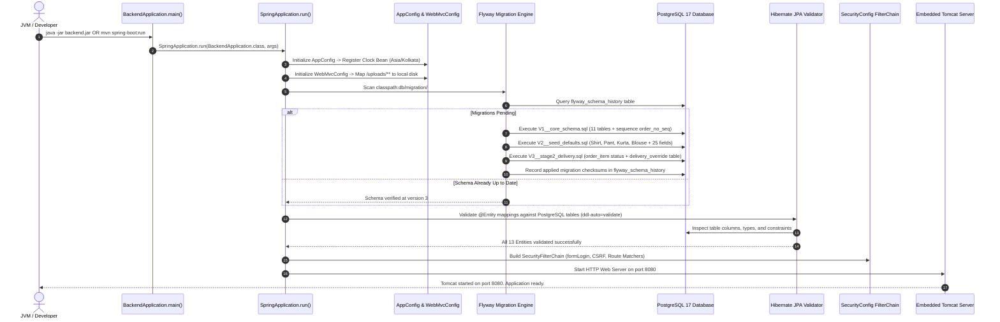
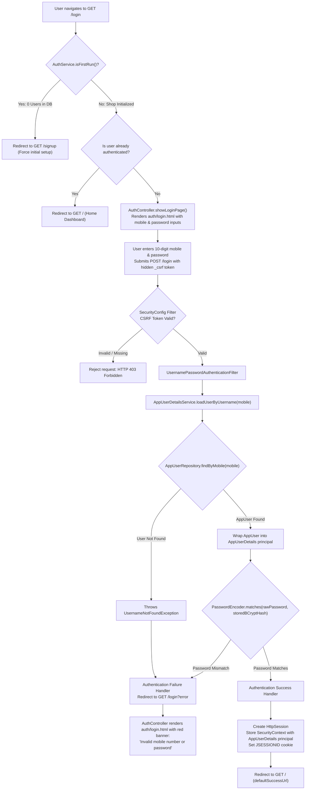
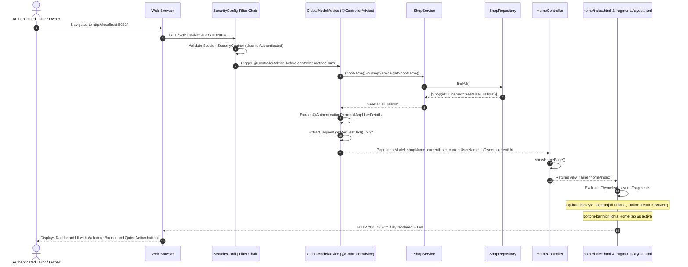
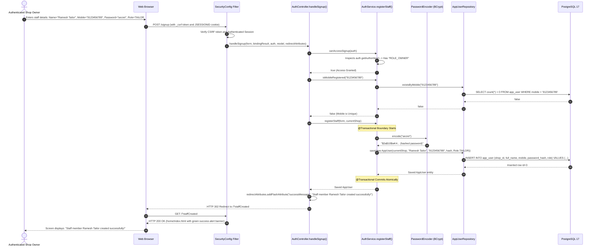
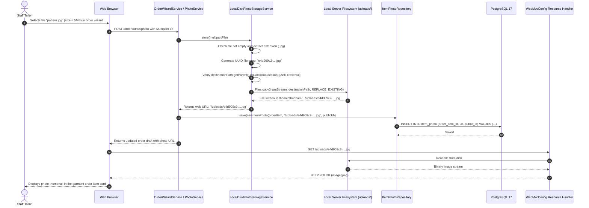
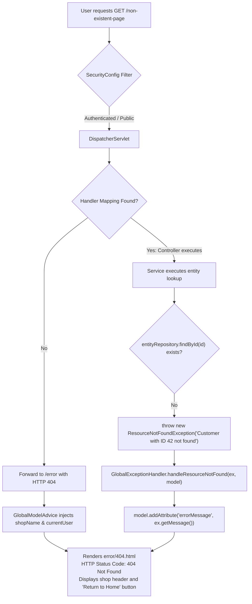
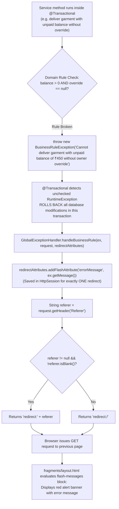

# Geetanjali Tailor Shop System — Master Reference (Part 4: Comprehensive Flowcharts & Scenarios)

> **Document Scope**: Part 4 of 4 — Complete visual topologies, sequence diagrams, and decision flowcharts covering every single file, execution path, branch condition, and failure mode.  
> **Project**: Geetanjali Tailor Shop Management Web Application  
> **Target Audience**: Student pair programmer learning Spring Boot during a 24-hour hackathon.  
> **Version / Git Commit**: `Stage 1 - Step 1: Shared foundation` (`1d14e6f`)

---

## Master File Coverage Matrix

Every file in the codebase is represented across the scenarios below:

| File Name | Primary Scenario(s) Covered | Role in Flow |
| :--- | :--- | :--- |
| [`BackendApplication.java`](file:///home/shubham/storms/Projects/Geetanjali/backend/src/main/java/com/geetanjali/backend/BackendApplication.java) | Scenario 1 | JVM entry point; boots Tomcat, Flyway, and Spring ApplicationContext |
| [`AppConfig.java`](file:///home/shubham/storms/Projects/Geetanjali/backend/src/main/java/com/geetanjali/backend/config/AppConfig.java) | Scenario 1, 4 | Produces the IST `Clock` bean for time-aware services |
| [`WebMvcConfig.java`](file:///home/shubham/storms/Projects/Geetanjali/backend/src/main/java/com/geetanjali/backend/config/WebMvcConfig.java) | Scenario 1, 6 | Registers `/uploads/**` static resource handler for cloth photos |
| [`SecurityConfig.java`](file:///home/shubham/storms/Projects/Geetanjali/backend/src/main/java/com/geetanjali/backend/security/SecurityConfig.java) | Scenario 1, 2, 3, 4, 5, 7, 8 | Evaluates HTTP request paths; enforces authentication; configures form login/logout |
| [`AppUserDetails.java`](file:///home/shubham/storms/Projects/Geetanjali/backend/src/main/java/com/geetanjali/backend/security/AppUserDetails.java) | Scenario 3, 4, 5 | Wraps `AppUser` entity into Spring Security principal session object |
| [`AppUserDetailsService.java`](file:///home/shubham/storms/Projects/Geetanjali/backend/src/main/java/com/geetanjali/backend/security/AppUserDetailsService.java) | Scenario 3 | Queries `app_user` table by mobile number during form login |
| [`GlobalModelAdvice.java`](file:///home/shubham/storms/Projects/Geetanjali/backend/src/main/java/com/geetanjali/backend/controller/advice/GlobalModelAdvice.java) | Scenario 4, 7A | Injects `${shopName}`, `${currentUser}`, `${currentUserName}`, `${isOwner}`, `${currentUri}` |
| [`GlobalExceptionHandler.java`](file:///home/shubham/storms/Projects/Geetanjali/backend/src/main/java/com/geetanjali/backend/controller/advice/GlobalExceptionHandler.java) | Scenario 7A, 7B | Intercepts `ResourceNotFoundException` and `BusinessRuleException` |
| [`AuthController.java`](file:///home/shubham/storms/Projects/Geetanjali/backend/src/main/java/com/geetanjali/backend/controller/AuthController.java) | Scenario 2, 3, 5 | Handles `/login` and `/signup` GET and POST requests |
| [`HomeController.java`](file:///home/shubham/storms/Projects/Geetanjali/backend/src/main/java/com/geetanjali/backend/controller/HomeController.java) | Scenario 4 | Handles `GET /` and renders `home/index.html` |
| [`AuthService.java`](file:///home/shubham/storms/Projects/Geetanjali/backend/src/main/java/com/geetanjali/backend/service/AuthService.java) | Scenario 2, 3, 5 | Evaluates `isFirstRun()`, `isMobileRegistered()`, registers owners and tailors |
| [`ShopService.java`](file:///home/shubham/storms/Projects/Geetanjali/backend/src/main/java/com/geetanjali/backend/service/ShopService.java) | Scenario 4 | Queries `ShopRepository` to provide primary shop name |
| [`PhotoStorageService.java`](file:///home/shubham/storms/Projects/Geetanjali/backend/src/main/java/com/geetanjali/backend/service/storage/PhotoStorageService.java) | Scenario 6 | Storage interface defining `store()` and `delete()` contracts |
| [`LocalDiskPhotoStorageService.java`](file:///home/shubham/storms/Projects/Geetanjali/backend/src/main/java/com/geetanjali/backend/service/storage/LocalDiskPhotoStorageService.java) | Scenario 6 | Writes photos to disk under UUID names in `uploads/` |
| [`PhoneNumbers.java`](file:///home/shubham/storms/Projects/Geetanjali/backend/src/main/java/com/geetanjali/backend/util/PhoneNumbers.java) | Scenario 2, 5 | Normalizes Indian mobile numbers and validates 10-digit regex |
| [`SignupForm.java`](file:///home/shubham/storms/Projects/Geetanjali/backend/src/main/java/com/geetanjali/backend/dto/form/SignupForm.java) | Scenario 2, 5 | Form DTO holding signup fields with Jakarta validation |
| [`Role.java`](file:///home/shubham/storms/Projects/Geetanjali/backend/src/main/java/com/geetanjali/backend/enums/Role.java) | Scenario 2, 3, 4, 5 | Enum defining `OWNER` and `TAILOR` authorization |
| [`ResourceNotFoundException.java`](file:///home/shubham/storms/Projects/Geetanjali/backend/src/main/java/com/geetanjali/backend/exception/ResourceNotFoundException.java) | Scenario 7A | Thrown when database entity lookup fails |
| [`BusinessRuleException.java`](file:///home/shubham/storms/Projects/Geetanjali/backend/src/main/java/com/geetanjali/backend/exception/BusinessRuleException.java) | Scenario 7B | Thrown on domain violation; triggers transaction rollback |
| 13 JPA Entities (`Shop`, `AppUser`, etc.) | Scenario 1, 2, 4, 5, 6 | Map relational tables to Java objects |
| 12 JPA Repositories (`ShopRepository`, etc.) | Scenario 1, 2, 3, 4, 5, 6 | Execute SQL queries against PostgreSQL |
| 3 Flyway Migrations (`V1`, `V2`, `V3`) | Scenario 1 | Initialize database schema, defaults, and delivery extensions |
| Templates (`layout.html`, `login.html`, etc.) | Scenario 2, 3, 4, 7, 8 | Render server-side dynamic HTML views |
| Static Assets (`app.css`, `app.js`) | Scenario 2, 3, 4, 8 | Provide UI tokens, styling, CSRF headers, and alert timers |

---

## Scenario 1: Application Initialization & Cold Boot Flow



---

## Scenario 2: First-Run Shop Creation & Owner Registration (`GET & POST /signup`)

```mermaid
flowchart TD
    Start(["Visitor navigates to GET /signup"]) --> SecFilter{"SecurityConfig<br>Request Whitelist Check"}
    SecFilter -->|Permitted| AuthCtrlGet["AuthController.showSignupPage()"]
    AuthCtrlGet --> FirstRunCheck{"AuthService.isFirstRun()<br>appUserRepository.count() == 0?"}
    
    FirstRunCheck -->|Yes: Fresh Database| ShowFirstRun["Model: isFirstRun = true<br>Form pre-populated with shop name<br>Render auth/signup.html"]
    FirstRunCheck -->|No: Users Exist| CheckAuth{"Is visitor authenticated & Role == OWNER?"}
    CheckAuth -->|No| RedirectLogin["Redirect to GET /login"]
    CheckAuth -->|Yes| ShowAddStaff["Model: isFirstRun = false<br>Render auth/signup.html (Add Staff Mode)"]

    ShowFirstRun --> UserSubmits["User fills form and clicks 'Create Shop & Owner'<br>POST /signup (fullName, mobile, password, shopName)"]
    UserSubmits --> PostSecFilter{"SecurityConfig<br>POST permit check"}
    PostSecFilter --> AuthCtrlPost["AuthController.handleSignup()"]
    AuthCtrlPost --> CanAccessPost{"AuthService.canAccessSignup(auth)"}
    CanAccessPost -->|Forbidden| RedirectLogin
    CanAccessPost -->|Permitted| DTOValidation{"Jakarta Validation<br>@Valid SignupForm"}
    
    DTOValidation -->|Errors Found (e.g. 8-digit mobile)| ShowFormErrors["bindingResult holds errors<br>Re-render auth/signup.html with inline red alerts"]
    DTOValidation -->|Valid Inputs| CheckMobile{"AuthService.isMobileRegistered(mobile)"}
    
    CheckMobile -->|Mobile Already Taken| MobileDuplicate["bindingResult.rejectValue('mobile', ...)<br>Re-render auth/signup.html"]
    CheckMobile -->|Mobile Available| FirstRunBranch{"isFirstRun()?"}
    
    FirstRunBranch -->|Yes| RegisterOwner["AuthService.registerFirstOwner(form)<br>@Transactional Boundary Begins"]
    RegisterOwner --> CheckShop{"ShopRepository.findAll() empty?"}
    CheckShop -->|Yes| CreateShop["ShopRepository.save(new Shop('Geetanjali Tailors'))"]
    CheckShop -->|No| UseShop["Use existing Shop entity"]
    CreateShop --> HashPassword["BCryptPasswordEncoder.encode(form.getPassword())"]
    UseShop --> HashPassword
    HashPassword --> CreateOwnerUser["AppUserRepository.save(new AppUser(shop, name, mobile, hash, Role.OWNER))"]
    CreateOwnerUser --> CommitTx["@Transactional Commits Database Transaction"]
    CommitTx --> SetFlashMsg["redirectAttributes.addFlashAttribute('successMessage', 'Shop setup complete!')"]
    SetFlashMsg --> RedirectLoginSuccess["Redirect to GET /login?signupSuccess"]
    RedirectLoginSuccess --> ShowLoginPage["AuthController.showLoginPage()<br>Renders auth/login.html with green success banner"]
```

---

## Scenario 3: Staff / Owner Form Login Lifecycle (`GET & POST /login`)



---

## Scenario 4: Authenticated Dashboard Request & Global Pre-processing (`GET /`)



---

## Scenario 5: Authenticated Owner Adding a Staff Tailor (`POST /signup`)



---

## Scenario 6: Customer Cloth Photo Upload Flow



---

## Scenario 7: Global Exception & Error Handling Scenarios

### Scenario 7A: Non-Existent Route / Missing Resource (404 Not Found)



### Scenario 7B: Business Rule Violation (302 Flash Redirect)



---

## Scenario 8: Safe Logout Flow with CSRF Verification (`POST /logout`)

```mermaid
sequenceDiagram
    autonumber
    actor Tailor as Logged-in Staff Member
    participant View as fragments/layout.html
    participant Sec as SecurityConfig LogoutFilter
    participant Session as HTTP Session Store
    participant Browser as Web Browser

    Tailor->>View: Clicks "Logout" button in top-bar
    View->>Sec: Submits form POST /logout with hidden _csrf token
    Sec->>Sec: Verify CSRF token matches session token
    alt CSRF Valid
        Sec->>Session: Invalidate active HttpSession
        Sec->>Session: Clear SecurityContext and Authentication Principal
        Sec->>Browser: Set-Cookie: JSESSIONID=; Max-Age=0 (Deletes Cookie)
        Sec-->>Browser: HTTP 302 Redirect to /login?logout
        Browser->>Browser: Issues GET /login?logout
        Browser-->>Tailor: Renders auth/login.html with green banner:<br>"You have been logged out successfully."
    else CSRF Invalid / Missing
        Sec-->>Browser: HTTP 403 Forbidden (CSRF attack prevented)
    end
```
